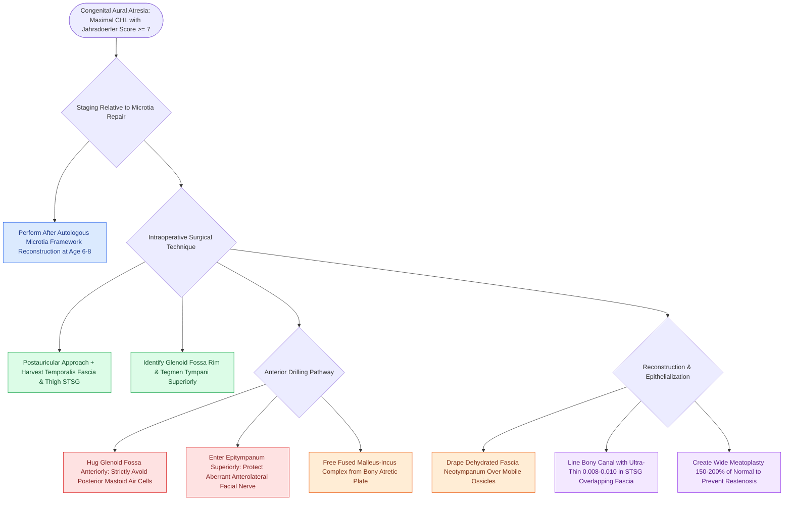

# Congenital aural atresiaplasty utilizes an anterior surgical approach along the glenoid fossa with split-thickness skin grafting to reconstruct the external auditory canal

## Active Recall

> [!question]- What anatomical boundary serves as the primary surgical landmark to guide drilling in the anterior approach to congenital aural atresiaplasty?
> *Answer / Clinical Rationale*: The **posterior root of the zygoma and the bony rim of the glenoid fossa (temporomandibular joint)**, which directs the drilling anteriorly and superiorly toward the epitympanum while safely avoiding mastoid air cells and the aberrantly positioned facial nerve.

> [!question]- What is the most common long-term postoperative complication requiring surgical revision following atresiaplasty, and how is it prevented?
> *Answer / Clinical Rationale*: **Canal and meatal restenosis** (occurring in $15\text{–}25\%$ of cases), prevented by creating an initial bony canal and soft-tissue meatus that is **$150\text{–}200\%$ of normal adult caliber** (twice normal size) and lining it with an ultra-thin ($0.008\text{–}0.010\text{ inch}$) split-thickness skin graft.

## Core Clinical & Mechanistic Principles

Congenital aural atresia (CAA) occurs in 1 in 10,000 to 20,000 live births, representing complete failure of recanalization of the first branchial cleft and first branchial pouch ectodermal cord. The inner ear originates independently from the otic placode and is typically anatomically intact, resulting in maximal conductive hearing loss ($50\text{–}60\text{ dB}$ air-bone gap) with preserved cochlear sensorineural reserves:

### Surgical Candidacy & Preoperative Staging
- Candidacy is determined by high-resolution temporal bone CT scored on the 10-point Jahrsdoerfer scale (evaluating presence of stapes bone, patent round window, open oval window, middle ear volume, facial nerve course, malleus-incus complex, mastoid pneumatization, incus-stapes connection, and external ear appearance).
- A score of $\ge 7/10$ denotes good surgical candidacy ($>80\%$ achieve post-op speech reception thresholds $\le 30\text{ dB}$).
- **Timing with Microtia Repair**: In patients with concurrent microtia, atresiaplasty must be delayed until **after completion of external ear framework reconstruction** (typically age 6 to 8 years), following techniques such as [[Microtia autologous costal cartilage framework stages balance four-stage Brent and two-stage Nagata reconstruction protocols]], because atresia incisions violate the native temporoparietal and mastoid skin envelope required for framework coverage.

### Aberrant Facial Nerve Course in CAA
In congenital aural atresia, the third (vertical/mastoid) segment of the facial nerve characteristically lacks a bony external canal to dictate its vertical descent:
- The nerve turns sharply anteriorly and laterally at the second genu (exiting at an acute angle of $\approx 60^\circ$ rather than the normal $90\text{–}120^\circ$).
- It often courses directly across the promontory lateral to the stapes or exits the temporal bone into the posterior wall of the glenoid fossa.
- Continuous 4-channel intraoperative facial nerve monitoring is mandatory.

### Step-by-Step Surgical Technique (Anterior Approach)
1. **Patient Preparation & Graft Harvest**:
   - The ipsilateral arm or lateral thigh is prepped for split-thickness skin graft (STSG) harvest.
   - Long-acting neuromuscular blocking agents and nitrous oxide are strictly avoided.
2. **Incision & Exposure**:
   - A postauricular incision is performed down to the temporalis muscle; a quarter-sized piece of temporalis fascia is harvested and dehydrated.
   - A T-shaped periosteal incision is made along the linea temporalis and anteriorly along the glenoid fossa.
3. **Anterior Drilling Vector**:
   - Drilling commences with a large cutting burr at the junction of the root of the zygoma and the cribriform area.
   - The bony rim of the **glenoid fossa** is identified and hugged anteriorly; the **tegmen tympani** is identified and hugged superiorly.
   - Mastoid air cells posteriorly are strictly avoided to prevent creating an open, unlined mastoid cavity that causes chronic postoperative drainage.
4. **Epitympanic Entry & Ossicular Mobilization**:
   - As drilling advances medially through dense atretic bone, diamond burrs are transitioned as the epitympanum is entered superior to the ossicles.
   - The fused malleus-incus complex is identified. The bony atretic plate is meticulously thinned and dissected free from the ossicular head using fine picks to avoid transmitting acoustic trauma to the inner ear.
   - Ossicular mobility and continuity to the stapes suprastructure and mobile footplate are confirmed.
5. **Neotympanum & Split-Thickness Skin Grafting**:
   - A circumferential bony ledge is created at the level of the epitympanic ring.
   - The dehydrated temporalis fascia graft is draped under-and-over the ossicular mass and supported on the bony ledge.
   - An ultra-thin STSG ($0.008\text{–}0.010\text{ inch}$) is harvested with a dermatome and placed into the bony canal, overlapping the edges of the fascia graft to establish immediate epithelial coverage.
6. **Wide Meatoplasty & Stenting**:
   - A soft-tissue core is excised from the auricle in line with the new bony canal, splayed with cruciate cuts, and sutured to the anterior periosteum.
   - The meatus is created twice normal size ($150\text{–}200\%$) to counteract concentric soft-tissue scar contracture. The canal is packed with non-adherent silicone sheets and expandable sponges for 2 to 3 weeks.

## Connected Concepts & Graph Traversal

- **Jahrsdoerfer CT Staging**: [[Congenital aural atresia candidacy is graded by the ten-point Jahrsdoerfer scale]]
- **Microtia Reconstruction Spectrum**: [[Microtia reconstruction spans staged autologous costal cartilage frameworks and porous polyethylene implants]]
- **Auricular Embryology**: [[The six auricular hillocks of His derive from the first and second branchial arches to form the pinna]]
- **Bone-Anchored Auditory Implants**: [[Bone-anchored hearing implants BAHA stimulate the cochlea directly via bone conduction pathways]]
- **Alloplastic Ear Frameworks**: [[Porcine and porous polyethylene Medpor frameworks provide synthetic alternatives in microtia repair]]
