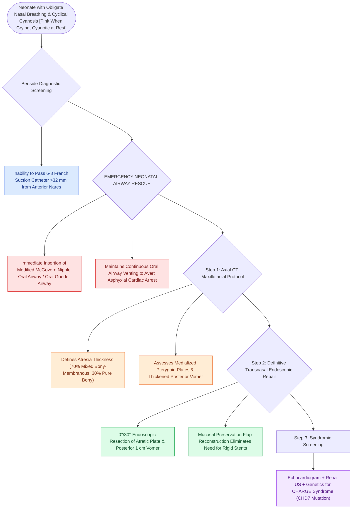

# Congenital bilateral choanal atresia causes cyclical cyanosis relieved by crying and requires urgent oral airway placement

## Active Recall

> [!question]- Why does a newborn with bilateral choanal atresia present with cyclical cyanosis that resolves when crying?
> *Answer / Clinical Rationale*: Because newborns are **obligate nasal breathers**; resting with mouth closed causes asphyxiation, whereas crying opens the oral airway and restores ventilation.

> [!question]- What hereditary syndrome is associated with choanal atresia in $>50\%$ of cases, and what gene is mutated?
> *Answer / Clinical Rationale*: **CHARGE syndrome**, caused by mutations in the **CHD7 gene**.

## Core Clinical & Mechanistic Principles
**Congenital Choanal Atresia** is the failure of the posterior nasal cavity to communicate with the nasopharynx ($1\text{ in }7,000$ births):
- **Obligate Nasal Breathing & The "Cyclical Cyanosis" Paradox**:
  - Neonates are **obligate nasal breathers** until 4–6 weeks of age (due to the high anatomical position of the larynx and tongue-palate apposition).
  - In bilateral choanal atresia, the neonate experiences severe inspiratory obstruction and cyanosis while resting with mouth closed; **when the infant cries, the oral airway opens and cyanosis immediately resolves ("cyclical cyanosis")**.
- **Anatomical Atresia Plate Composition**:
  - **Mixed Bony-Membranous ($70\%$)** or **Pure Bony ($30\%$)**; pure membranous atresia is exceptionally rare ($<1\%$).
- **The Four Anatomical Components of the Atresia Deformity**:
  1. Lateral bony impingement from **medialized pterygoid plates**.
  2. Medial bony thickening of the **posterior vomer**.
  3. High-arched hard palate.
  4. Central atretic membranous/bony plate.
- **CHARGE Syndrome Association ($50\text{–}60\%$)**:
  - **C**oloboma of eye, **H**eart defects, **A**tresia choanae, **R**etardation of growth, **G**enital hypoplasia, **E**ar anomalies / deafness (mutations in *CHD7* gene).

### Surgical Technique & Critical Safety Checks
- **Immediate Resuscitation**: Insert a **McGovern nipple** (a feeding nipple with a widened tip strapped around the ears) or an oral airway; definitive surgical repair within 24–72 hours (see [[Transnasal endoscopic resection of the atretic plate and posterior vomer establishes choanal patency without stents|Choanal Atresia Repair]]).

## Connected Concepts & Graph Traversal
- **Choanal Atresia Repair**: [[Transnasal endoscopic resection of the atretic plate and posterior vomer establishes choanal patency without stents|Choanal Atresia Repair]]
- **Pyriform Aperture Stenosis**: [[Congenital pyriform aperture stenosis causes neonatal nasal obstruction and presents with a solitary central incisor|Pyriform Aperture Stenosis]]
- **Pediatric Emergency**: [[High-stakes pediatric and adult sleep airway complications require rapid structured algorithmic emergency rescue|Airway Emergency Rescue]]
- **Embryological & Sleep Foundation**: [[Critical closing pressure Pcrit stratifies upper airway collapsibility from snorers to severe obstructive sleep apnea]]
- **Sleep Endoscopy & Airway Dynamics**: [[Drug-induced sleep endoscopy DISE evaluates dynamic multi-level upper airway collapse under sedation|Drug-Induced Sleep Endoscopy (DISE)]] [[Lingual tonsil hypertrophy causes persistent pediatric obstructive sleep apnea and base of tongue collapse]]
- **Congenital Airway Pathology**: [[Inspiratory, biphasic, and expiratory stridor localize pediatric airway obstruction to supraglottic, subglottic, and tracheobronchial subsites]]
- **Open Airway Reconstruction**: [[Aortopexy suspends the aorta to the sternum to relieve anterior vascular tracheal compression]]
