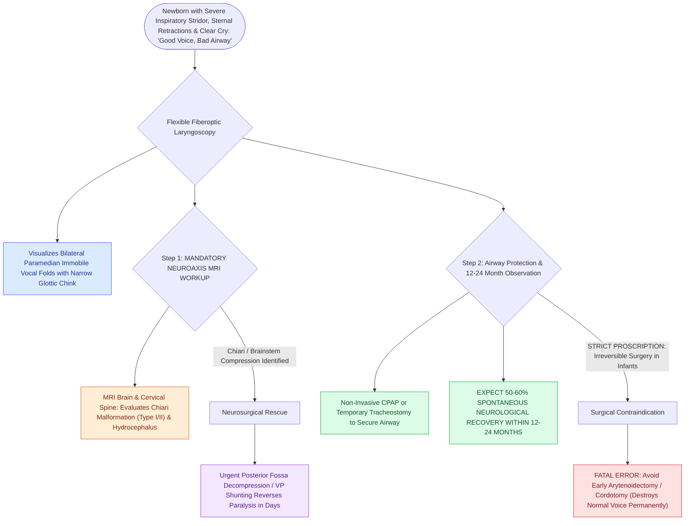

# Congenital bilateral vocal fold paralysis presents with severe inspiratory stridor requiring airway protection

## Active Recall

> [!question]- What is the most important central nervous system malformation to rule out with MRI in an infant with bilateral vocal fold paralysis?
> *Answer / Clinical Rationale*: **Chiari malformation (Type I or II)** with brainstem compression.

> [!question]- Why is permanent destructive surgical enlargement (e.g., arytenoidectomy) contraindicated in early congenital BVFP?
> *Answer / Clinical Rationale*: Because up to **$50\text{–}60\%$ of cases experience spontaneous neurological recovery within 12 to 24 months**.

## Core Clinical & Mechanistic Principles
**Bilateral Vocal Fold Paralysis (BVFP)** is the second most common congenital laryngeal anomaly ($15\text{–}20\%$ of congenital stridor), presenting with severe respiratory distress:
- **Etiological Classification**:
  1. **Central Neurological Causes ($50\text{–}60\%$)**:
     - **Chiari Malformation (Type I or II)**: Herniation of cerebellar tonsils compresses the brainstem and nucleus ambiguus / vagus nerve roots.
     - Hydrocephalus, intracranial hemorrhage, myelomeningocele, hypoxic-ischemic encephalopathy.
  2. **Peripheral Neuropathies / Iatrogenic ($20\text{–}30\%$)**:
     - Cardiothoracic surgery (PDA ligation, coarctation repair), tracheoesophageal fistula repair.
  3. **Idiopathic ($15\text{–}20\%$)**.
- **Clinical Presentation & The "Good Voice, Bad Airway" Paradox**:
  - Vocal folds rest in the **paramedian / median position**, producing a **normal, clear cry / voice** despite **severe inspiratory stridor, retractions, and cyanosis**.
- **Spontaneous Recovery & Management Timeline**:
  - Up to **$>50\text{–}60\%$ of congenital BVFP cases recover spontaneous vocal fold mobility within $12\text{ to }24\text{ months}$** (as brainstem myelinates or hydrocephalus is shunted).
  - **Surgical Rule**: Avoid irreversible destructive vocal cord procedures (arytenoidectomy, cordotomy) in infants; manage with **temporary tracheostomy** or CPAP while observing for 12–24 months for neurological recovery.

### Surgical Technique & Critical Safety Checks
- **Chiari Rescue**: Emergent ventriculoperitoneal (VP) shunting or posterior fossa decompression [[High-stakes pediatric and adult sleep airway complications require rapid structured algorithmic emergency rescue|can]] completely restore vocal fold mobility within days if performed promptly.

## Connected Concepts & Graph Traversal
- **Stridor Localization**: [[Inspiratory, biphasic, and expiratory stridor localize pediatric airway obstruction to supraglottic, subglottic, and tracheobronchial subsites|Stridor Localization]]
- **Laryngeal Cleft**: [[Type I through Type IV laryngeal clefts represent congenital tracheoesophageal communication defects|Laryngeal Cleft]]
- **LTR Reconstruction**: [[Single-stage and double-stage laryngotracheal reconstruction LTR repair mature high-grade subglottic stenosis|LTR Reconstruction]]
- **Embryological & Sleep Foundation**: [[Loop gain, arousal threshold, and muscle responsiveness represent the non-anatomical endotypes of obstructive sleep apnea]]
- **Sleep Endoscopy & Airway Dynamics**: [[Drug-induced sleep endoscopy DISE evaluates dynamic multi-level upper airway collapse under sedation|Drug-Induced Sleep Endoscopy (DISE)]] [[Nasal steroid sprays and montelukast provide medical therapy for mild pediatric sleep-disordered breathing]]
- **Congenital Airway Pathology**: [[Laryngomalacia is the most common cause of congenital pediatric stridor characterized by dynamic supraglottic collapse]]
- **Open Airway Reconstruction**: [[Aortopexy suspends the aorta to the sternum to relieve anterior vascular tracheal compression]]
