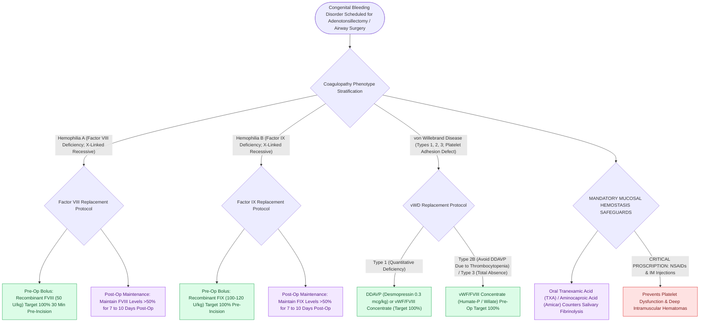

# Congenital bleeding disorders in otolaryngology encompass hemophilia A, hemophilia B, and von Willebrand disease subtypes

## Active Recall

> [!question]- How do Hemophilia A and Hemophilia B differ in their specific factor deficiencies, inheritance patterns, and laboratory profiles?
> *Answer / Clinical Rationale*: - **Hemophilia A**: Deficiency of **Factor VIII** ($80\text{–}85\%$ of hemophilias; X-linked recessive). - **Hemophilia B (Christmas Disease)**: Deficiency of **Factor IX** ($15\text{–}20\%$ of hemophilias; X-linked recessive). - **Laboratory Profile**: Both exhibit an **isolated prolonged aPTT** with a normal PT/INR, normal platelet count, and normal bleeding time. Severity is defined by baseline plasma factor activity: Severe ($<1\%$), Moderate ($1\text{–}5\%$), and Mild ($5\text{–}40\%$).

> [!question]- What are the clinical, genetic, and diagnostic distinctions between von Willebrand Disease (vWD) Types 1, 2, and 3?
> *Answer / Clinical Rationale*: - **Type 1 ($70\text{–}80\%$)**: Partial **quantitative deficiency** of structurally normal von Willebrand factor (Autosomal dominant); responds robustly to **DDAVP (Desmopressin)**. - **Type 2 ($15\text{–}20\%$)**: **Qualitative dysfunction** of vWF (subtypes 2A, 2B, 2M, 2N; Autosomal dominant); DDAVP is contraindicated in Type 2B due to risk of thrombocytopenia. - **Type 3 ($<5\%$)**: Severe, total **absence of vWF** (Autosomal recessive); manifests with undetectable vWF antigen, very low Factor VIII ($<5\%$), and severe hemophilia-like bleeding; requires vWF/FVIII concentrate replacement (DDAVP is ineffective).

> [!question]- What is the perioperative factor replacement target for elective tonsillectomy or major head and neck surgery in a patient with severe Hemophilia A or vWD?
> *Answer / Clinical Rationale*: - **Hemophilia A**: Preoperative **Factor VIII target of $100\%$ ($50\text{ units/kg}$ recombinant FVIII bolus)** given 30 minutes prior to incision, maintained at **$>50\%$ factor levels for $7\text{–}10\text{ days}$** postoperatively via twice-daily boluses or continuous infusion, combined with oral **aminocaproic acid (Amicar) or tranexamic acid (TXA)** to stabilize mucosal clots. - **vWD**: vWF/FVIII concentrate (e.g., Humate-P, Wilate) infused to achieve **vWF:RCo and FVIII:C levels $\ge 100\%$** preoperatively and $>50\%$ for 5–7 days.

## Core Clinical & Mechanistic Principles
Congenital coagulopathies present major hemorrhagic risks during high-vascularity head and neck mucosal procedures (e.g., [[Adenotonsillectomy is the first-line surgical treatment for pediatric obstructive sleep apnea|adenotonsillectomy]], endoscopic sinus surgery, and cleft palate repair):

### High-Yield Surgical Safeguards
- **Avoid NSAIDs & Intramuscular Injections**: In all patients with congenital bleeding disorders to prevent worsening platelet inhibition or deep muscular hematomas.
- **Antifibrinolytic Synergy**: Oral tranexamic acid ($25\text{ mg/kg}$ tid) or aminocaproic acid mouthwash provides crucial local clot stabilization against salivary enzymes in oral/oropharyngeal surgical beds.

## Connected Concepts & Graph Traversal
- **Coagulation Cascade**: [[The coagulation cascade is organized into extrinsic, intrinsic, and common pathways evaluated by PT and aPTT|Coagulation Pathways & Mixing Studies]]
- **Anticoagulant Reversal**: [[Targeted reversal of direct oral anticoagulants and antiplatelet agents is required for emergent head and neck surgery|Anticoagulation Reversal]]
- **Tonsillectomy Hemorrhage**: [[Paradise criteria define evidence-based indications for pediatric tonsillectomy in recurrent throat infections|Pediatric Tonsillectomy Criteria]]
- **High-Risk Airway Admission**: [[High-risk pediatric criteria mandate overnight inpatient admission following adenotonsillectomy|High-Risk Pediatric Inpatient Criteria]]
- **Cleft Palate Repair**: [[Two-flap palatoplasty and Furlow double-reversing Z-plasty reconstruct the hard and soft palate musculature|Cleft Palate Reconstruction]]
