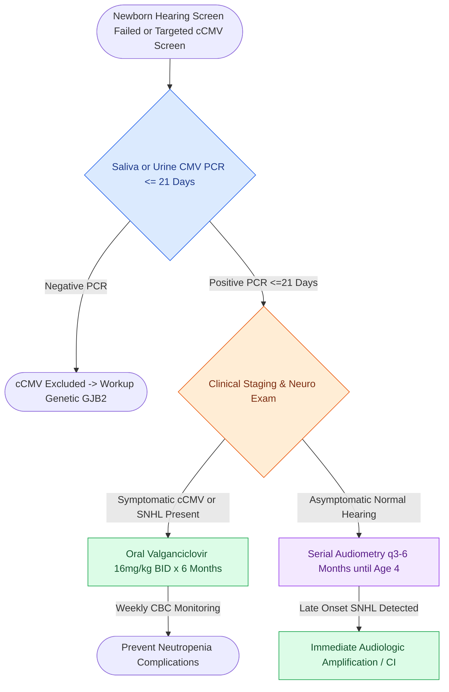
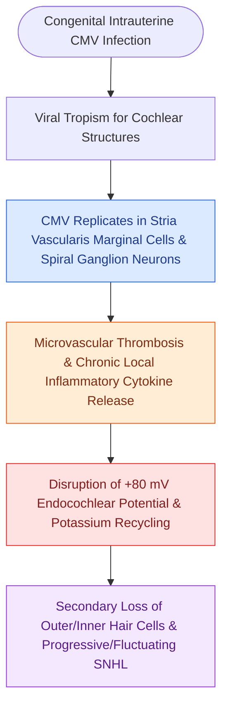

# Congenital cytomegalovirus infection is the most common non-genetic cause of pediatric sensorineural hearing loss

## Active Recall

> [!question]- Why must diagnostic testing for congenital cytomegalovirus (cCMV) be completed within the first 21 days (3 weeks) of life?
> *Answer / Clinical Rationale*: **Urine or saliva CMV Real-Time PCR must be obtained within the first 21 days of life** to differentiate *true intrauterine congenital infection* from *postnatal acquired CMV infection* (acquired through breast milk, intrapartum vaginal secretions, or blood transfusion). Testing after 3 weeks cannot distinguish congenital transmission (which carries a high risk of progressive SNHL and neurological sequelae) from benign postnatally acquired viral shedding.

> [!question]- What percentage of infants with congenital CMV are completely asymptomatic at birth, and what proportion of these asymptomatic infants will go on to develop progressive or late-onset SNHL?
> *Answer / Clinical Rationale*: Approximately **$85-90\%$ of infants with cCMV are entirely asymptomatic at birth** (lacking microcephaly, petechiae, jaundice, or chorioretinitis). However, **$10-15\%$ of these asymptomatic infants will develop delayed-onset, progressive, or fluctuating sensorineural hearing loss** (accounting for the majority of cCMV hearing loss cases in early childhood), mandating serial audiometric tracking until at least age 4–6 years even if newborn hearing screening is passed.

> [!question]- What is the first-line targeted antiviral regimen for symptomatic congenital CMV, and what critical laboratory parameter mandates close weekly monitoring?
> *Answer / Clinical Rationale*: **Oral valganciclovir ($16\text{ mg/kg/dose}$ twice daily for 6 months)** initiated within the first 4 weeks of life improves both audiometric and neurodevelopmental outcomes. The primary dose-limiting toxicity is **severe neutropenia (absolute neutrophil count $<500/\mu\text{L}$)**, requiring weekly complete blood counts (CBC) with differential for the first 6 weeks, then monthly thereafter.

## Core Clinical & Mechanistic Principles

**Cytomegalovirus (cCMV)**, a double-stranded DNA herpesvirus, is the leading non-genetic cause of sensorineural hearing loss and neurodevelopmental disability in children:

### Pathophysiology of Cochlear Damage
- CMV targets the **stria vascularis** and spiral ganglion neurons, causing chronic viral replication, loss of the positive endocochlear potential ($+80\text{ mV}$), microvascular thrombosis, and secondary degeneration of inner and outer hair cells.
- This persistent low-grade viral presence drives the characteristic **fluctuating and progressive hearing deterioration** seen throughout early childhood.

### Surveillance Protocol and Amplification
- **Serial Audiometry Schedule**:
  - Every 3–6 months during the first 2 years of life.
  - Every 6–12 months through age 6.
- **Hearing Rehabilitation**:
  - Immediate bilateral hearing aid fitting upon identification of SNHL.
  - Early cochlear implantation for severe-to-profound loss provides excellent auditory and language acquisition outcomes (see [[Connexin 26 mutations in GJB2 and congenital CMV infection are leading causes of non-syndromic pediatric sensorineural hearing loss|GJB2 vs CMV Etiologies]]).

## Connected Concepts & Graph Traversal
- **Non-Syndromic Genetic SNHL**: [[Connexin 26 mutations in GJB2 and congenital CMV infection are leading causes of non-syndromic pediatric sensorineural hearing loss|GJB2 vs CMV Etiologies]]
- **Universal Newborn Hearing Screening**: [[Auditory brainstem response waves I through V identify retrocochlear and brainstem pathology|ABR in Infant Screening]]
- **Syndromic Genetic SNHL**: [[Syndromic pediatric sensorineural hearing loss encompasses Pendred, Usher, Waardenburg, and Jervell and Lange-Nielsen syndromes|Syndromic Pediatric SNHL]]
- **Cochlear Implant Candidates**: [[Cochlear implant candidacy criteria include severe to profound bilateral sensorineural hearing loss|Pediatric CI Candidacy]]
- **Stria Vascularis Pathology**: [[The stria vascularis generates the endocochlear potential of positive eighty millivolts|Stria Vascularis Endocochlear Potential]]
- **Pediatric Airway and Speech**: [[Adenotonsillectomy is the first-line surgical treatment for pediatric obstructive sleep apnea|Pediatric Otolaryngology Care]]
