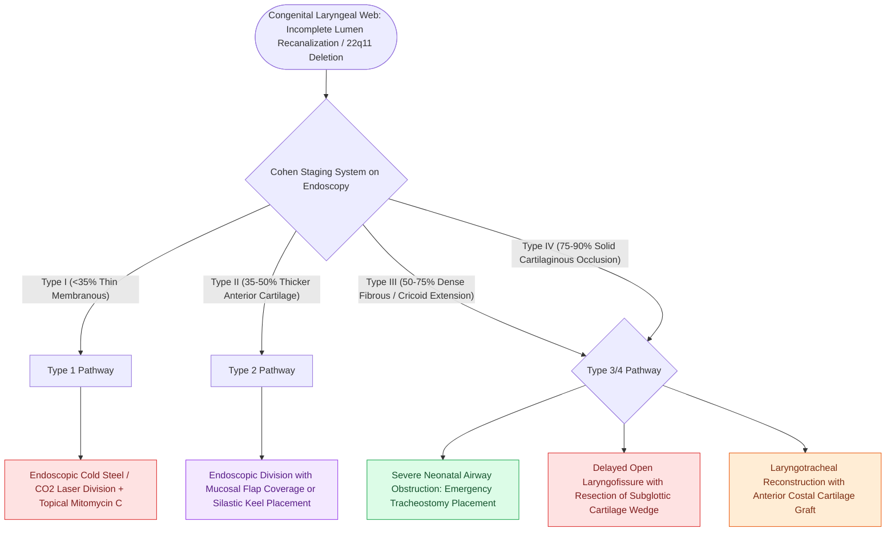

# Congenital laryngeal webs are classified by the Cohen system based on glottic luminal occlusion and anterior cartilaginous subglottic extension

## Active Recall

> [!question]- What genetic microdeletion is strongly associated with congenital anterior glottic laryngeal webs?
> *Answer / Clinical Rationale*: **22q11.2 microdeletion syndrome** (velocardiofacial / DiGeorge syndrome), identified in up to $65\%$ of pediatric patients with congenital anterior laryngeal webs, mandating genetic testing and cardiac screening.

> [!question]- How does the Cohen classification define the four degrees of congenital laryngeal webs?
> *Answer / Clinical Rationale*: **Type I**: $<35\%$ glottic occlusion, thin membranous; **Type II**: $35\text{–}50\%$ occlusion, thicker with anterior subglottic cartilage; **Type III**: $50\text{–}75\%$ occlusion, thick fibrous web with anterior cricoid extension; **Type IV**: $75\text{–}90\%$ occlusion, solid continuous cartilaginous fusion into the subglottis causing severe airway distress.

## Core Clinical & Mechanistic Principles

Congenital laryngeal webs result from incomplete recanalization of the primitive laryngeal lumen during the 7th to 10th weeks of gestation due to arrested resorption of the embryonic epithelial lamina. Over $75\%$ of webs occur at the vocal fold level, characteristically positioned across the anterior commissure with a concave posterior margin:

### Pathophysiology & Genetic Syndromes
- **Embryonic Arrest**: The larynx recanalizes from posterior to anterior; incomplete lamina resorption leaves an anterior web with varying degrees of cartilaginous subglottic fusion (the "anterior sail" deformity), fundamentally linked to the development of [[Congenital subglottic stenosis results from incomplete recanalization of the laryngeal lumen during embryogenesis]].
- **Syndromic Associations**: Strongly associated with **22q11.2 microdeletion syndrome** (velocardiofacial / DiGeorge syndrome); all neonates presenting with congenital laryngeal webs require fluorescence in situ hybridization (FISH) or chromosomal microarray testing and echocardiography.
- **Clinical Presentation**: Weak, high-pitched, or absent neonatal cry (falsetto voice), chronic hoarseness, and progressive biphasic stridor. In severe forms, acute neonatal respiratory distress and complete aphonia occur at birth.

### The Cohen Staging System
1. **Type I (Mild Web — $<35\%$ Glottic Luminal Occlusion)**:
   - Thin, translucent, mucosal membrane localized strictly to the anterior glottis.
   - Vocal folds are clearly visible through the membrane; subglottic extension is absent.
   - Symptoms: Mild dysphonia or high-pitched cry; airway compromise is absent.
2. **Type II (Moderate Web — $35\text{–}50\%$ Glottic Luminal Occlusion)**:
   - Thicker membrane with an anterior fibrous or cartilaginous component involving the subglottis.
   - Symptoms: Husky voice, mild to moderate exertional biphasic stridor; rarely causes resting distress.
3. **Type III (Severe Web — $50\text{–}75\%$ Glottic Luminal Occlusion)**:
   - Thick, dense fibrous tissue extending deep into the anterior cricoid ring; vocal cord margins are poorly visualized.
   - Symptoms: Marked hoarseness or weak cry, persistent resting biphasic stridor, and recurrent croup-like episodes.
4. **Type IV (Near-Total Atresia — $75\text{–}90\%$ Glottic Luminal Occlusion)**:
   - Dense, solid cartilaginous fusion between the vocal folds extending into the subglottis; true lumen reduced to a small posterior chink.
   - Symptoms: Complete aphonia, severe neonatal cyanosis and airway obstruction requiring immediate resuscitation.

### Staged Surgical Management
- **Type I Webs**: Endoscopic cold-knife or CO2 laser division along the midline. Application of topical mitomycin C ($0.4\text{ mg/mL}$ for 2–3 minutes) is used to prevent anterior commissure re-adhesion. Simple dilation or [[Endoscopic balloon dilation with steroid injection manages early, soft, non-circumferential subglottic stenosis]] can be adjunctively performed.
- **Type II Webs**: Endoscopic division with mucosal microflap advancement to cover denuded vocal cord margins, or placement of an endoscopic Silastic or Teflon keel secured with transcutaneous nylon sutures across the thyroid cartilage for 10 to 14 days.
- **Type III & IV Webs**: Require open surgical reconstruction. Neonates with Type IV webs mandate immediate tracheostomy at delivery. Definitive repair involves open laryngofissure, division and submucosal thinning of the cartilaginous web, keel placement, and formal reconstruction with anterior and posterior cartilage grafts.

## Connected Concepts & Graph Traversal

- **Subglottic Stenosis Classification**: [[Myer-Cotton grading system stratifies subglottic stenosis from Grade I less than fifty percent to Grade IV no lumen]]
- **Supraglottic Collapse**: [[Laryngomalacia is the most common cause of congenital pediatric stridor characterized by dynamic supraglottic collapse]]
- **Open Airway Repair**: [[Single-stage and double-stage laryngotracheal reconstruction LTR repair mature high-grade subglottic stenosis]]
- **Resection & Anastomosis**: [[Cricotracheal resection CTR achieves primary end-to-end anastomosis for severe Grade III and IV subglottic stenosis]]
- **Posterior Cricoid Splitting**: [[Posterior costal cartilage grafts with a carved flange split the posterior cricoid lamina to expand the glottic lumen]]
