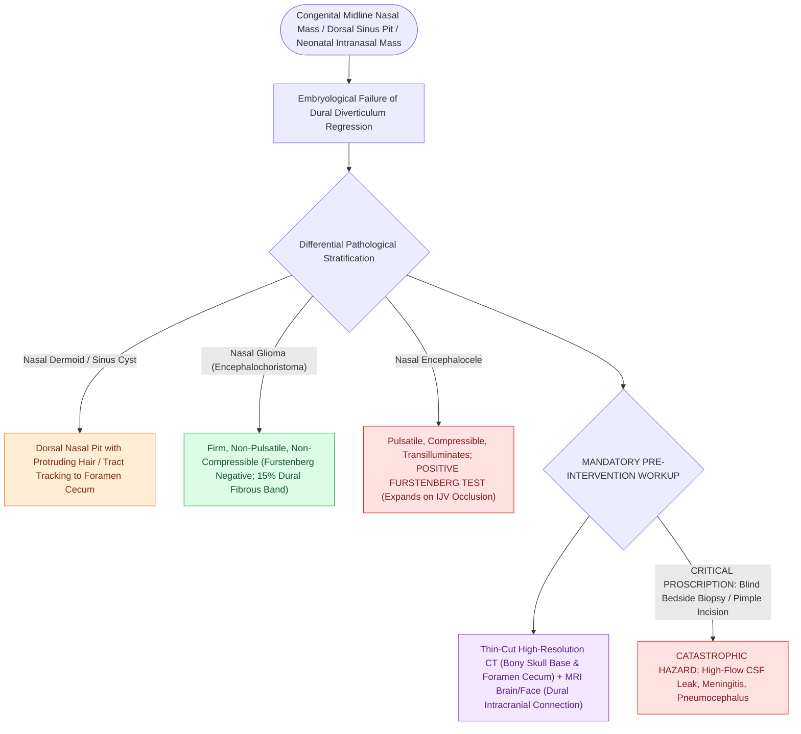

# Congenital midline nasal masses must be imaged before any biopsy to exclude intracranial connection

## Active Recall

> [!question]- Interpret a positive Furstenberg test and its anatomic meaning.
> *Answer / Clinical Rationale*: Mass expands with crying or jugular compression — a patent CSF communication, i.e., encephalocele; gliomas and dermoids do not transmit pressure.

> [!question]- Why is the 'infected pimple on the nasal dorsum with a hair' a neurosurgical conversation?
> *Answer / Clinical Rationale*: It is a dermoid sinus whose tract may reach the foramen cecum and dura — incision without imaging risks intracranial contamination.

## Core Clinical & Mechanistic Principles
- The three lesions are one embryology: incomplete regression of the dural diverticulum through the **[[Thyroglossal duct cyst tract tracks from the foramen cecum through the hyoid bone to the anterior neck|foramen cecum]]/prenasal space** leaves a **dermoid** (with sinus tract and pit, often a hair), a **glioma** (sequestered glial rest, firm, non-compressible), or an **encephalocele** (persistent CSF/brain connection, compressible, pulsatile).
- **Furstenberg test**: expansion with crying/jugular compression = encephalocele (patent CSF connection); gliomas and dermoids are Furstenberg-negative.
- The rule that must never be violated: **no biopsy, no incision, no 'pimple drainage' before MRI** (with CT for bone detail) — a midline pit or mass may be continuous with the subarachnoid space, and the casual bedside procedure becomes meningitis or CSF leak.
- Dermoid tract tells: a pit on the dorsum with a protruding hair, recurrent local infection, bifid crista galli/enlarged foramen cecum on imaging suggesting intracranial extension.

### Management & Critical Safety Checks
- Definitive management is complete surgical excision including any tract (dermoid recurrence lives in retained tract); intracranial extension recruits neurosurgery for combined approaches, increasingly endoscopic-assisted.
- Nasal obstruction in a neonate with a bluish intranasal midline mass is an encephalocele until imaged — nasal continuous positive airway pressure and instrumentation wait for the MRI.

## Connected Concepts & Graph Traversal
- **Nasal Atresia Endoscopy**: [[Transnasal endoscopic resection of the atretic plate and posterior vomer establishes choanal patency without stents|Choanal Atresia Resection]]
- **Pediatric Airway Noise**: [[Pediatric stertor and stridor differentiate upper supraglottic airway obstruction from intrathoracic tracheobronchial disease|Pediatric Airway Noise]]
- **Hemangioma Pharmacotherapy**: [[Oral propranolol is the first-line pharmacotherapy for proliferating infantile hemangiomas|Infantile Hemangiomas]]
- **Nasal Foreign Body**: [[Nasal foreign bodies presenting with unilateral foul-smelling rhinorrhea mandate urgent removal with particular vigilance for button batteries|Nasal Foreign Bodies]]
- **Airway Button Battery**: [[Pediatric esophageal button battery impaction causes liquefaction necrosis within two hours and mandates emergent endoscopic extraction|Esophageal Button Battery]]
- **Foramen Cecum Preoperative Imaging**: [[Congenital nasal dermoid sinus cysts require preoperative MRI and CT to detect intracranial extension through the foramen cecum or bifid crista galli|Congenital Nasal Dermoid Sinus Cysts]]
