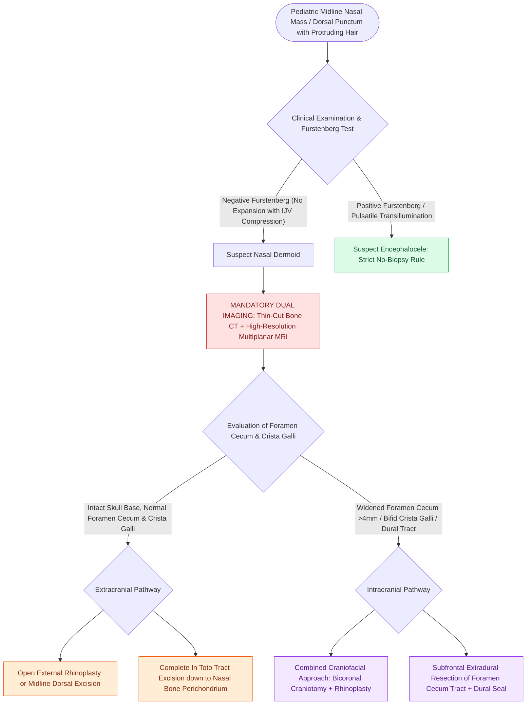

# Congenital nasal dermoid sinus cysts require preoperative MRI and CT to detect intracranial extension through the foramen cecum or bifid crista galli

## Active Recall

> [!question]- What is the developmental embryology of congenital nasal dermoids, and how does their histological composition differ from epidermoids?
> *Answer / Clinical Rationale*: Nasal dermoids arise from incomplete obliteration of the **fonticulus frontalis or prenasal space**, trapping both **ectodermal and mesodermal elements** (squamous epithelium, hair follicles, sebaceous glands, sweat glands), whereas epidermoids contain only ectoderm without dermal adnexal structures.

> [!question]- Why is diagnostic needle aspiration or incisional biopsy strictly contraindicated in suspected pediatric midline nasal masses?
> *Answer / Clinical Rationale*: Midline nasal masses frequently communicate with the anterior cranial fossa or represent sincipital encephaloceles; instrumentation prior to definitive neuroimaging risks **cerebrospinal fluid (CSF) leakage, meningitis, or intracranial herniation**.

## Core Clinical & Mechanistic Principles

Congenital nasal dermoid sinus cysts (NDSCs) represent the most common congenital midline nasal mass in children, accounting for approximately $61\%$ of midline nasal lesions. They occur in 1 in 20,000 to 40,000 live births and carry a high clinical index of suspicion due to their potential for intracranial communication:

### Embryology of the Prenasal Space
- During human embryogenesis, a transient projection of dura mater extends through the **foramen cecum** (anterior to the crista galli) into the **prenasal space** between the nasal bones and the unossified cartilaginous nasal capsule.
- Concurrently, the **fonticulus frontalis** forms a temporary membranous gap between the frontal and nasal bones.
- As the nasal bones fuse and the frontonasal suture closes, this dural projection normally obliterates and retracts intracranial to the crista galli.
- Failure of complete regression results in entrapment of surface ectoderm and adnexal mesoderm within the tract, creating an epithelial-lined cyst or sinus tract that can extend anywhere from the nasal tip to the dura of the anterior cranial fossa.

### Clinical Presentation & Differential Diagnosis
- **Classic Presentation**: A midline pit, punctum, or non-compressible subcutaneous nodule located anywhere along the nasal dorsum from the columella to the glabella. Pathognomonically, **hair protruding from the pit** or sebaceous discharge is noted.
- **Differential Diagnosis of Pediatric Midline Nasal Masses**:
  - **Nasal Dermoid**: Non-compressible, non-pulsatile; does not transilluminate; **negative Furstenberg test** (does not expand with bilateral internal jugular vein compression).
  - **Encephalocele**: Herniation of meninges $\pm$ brain tissue through a skull base defect; soft, bluish, pulsatile mass that enlarges with crying/straining or bilateral IJV compression (**positive Furstenberg test**); lies medial to the middle turbinate.
  - **Nasal Glioma (Encephalochoristoma)**: Heterotopic neuroglial tissue without active subarachnoid fluid connection in $85\%$; firm, non-compressible, red or purplish mass that lies lateral to the middle turbinate; negative Furstenberg test.

### Mandatory Preoperative Neuroimaging Protocol
Biopsy or blind excision without neuroimaging is strictly contraindicated. A combined, complementary imaging approach is mandatory:
1. **High-Resolution Thin-Cut CT (Axial & Coronal, $\le 1\text{ mm}$ slices)**:
   - Evaluates the osseous boundaries of the anterior skull base.
   - Signs of intracranial extension: Widened foramen cecum ($>4\text{ mm}$), bifid or eroded crista galli, and splaying of the nasal bones.
2. **Multiplanar Contrast-Enhanced MRI (T1, T2, and 3D CISS/FIESTA)**:
   - Essential to trace the soft-tissue tract and differentiate a non-enhancing fibrous/dermoid stalk from the high-signal CSF of an encephalocele.
   - Evaluates whether the tract terminates blindly at the skull base or penetrates the dural envelope of the subfrontal space.

### Surgical Approaches & Principles
- The primary objective is complete surgical excision of the cyst, wall, and entire sinus tract down to its deepest terminus; incomplete resection leads to a $30\text{–}100\%$ recurrence rate and persistent risk of intracranial abscess.
- **Extracranial Cysts**: Managed via an open rhinoplasty approach (transcolumellar inverted-V incision) or vertical midline dorsal incision, providing excellent exposure of the nasal dorsum and upper lateral cartilages with minimal scarring.
- **Intracranial Extension**: Managed via a coordinated craniofacial approach combining a bicoronal craniotomy with subfrontal extradural exploration and intradural dural patch reconstruction, ensuring complete tract extirpation from the foramen cecum, following the principles of meticulous tract tracking seen in [[Sistrunk procedure resects the thyroglossal duct cyst with the central body of the hyoid bone and foramen cecum core]].

## Connected Concepts & Graph Traversal

- **Diagnostic Mandate**: [[Congenital midline nasal masses must be imaged before any biopsy to exclude intracranial connection|Imaging Mandate Before Biopsy]]
- **Midline Aperture Stenosis**: [[Congenital pyriform aperture stenosis causes neonatal nasal obstruction and presents with a solitary central incisor]]
- **Choanal Obstruction**: [[Congenital bilateral choanal atresia causes cyclical cyanosis relieved by crying and requires urgent oral airway placement]]
- **Embryological Tract Comparison**: [[Thyroglossal duct cyst tract tracks from the foramen cecum through the hyoid bone to the anterior neck|Foramen Cecum Obliteration Dynamics]]
- **🔗 Skull Base Danger Zone (Sinus)**: [[The CLOSE checklist systematically evaluates critical radiological danger zones|Cribriform Plate and Crista Galli Danger Zones]]
