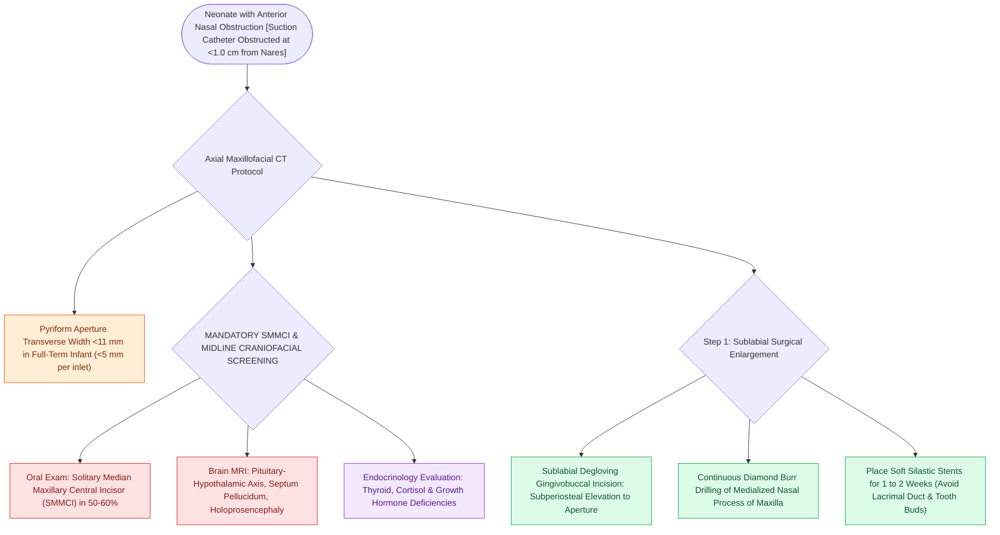

# Congenital pyriform aperture stenosis causes neonatal nasal obstruction and presents with a solitary central incisor

## Active Recall

> [!question]- What is the diagnostic CT width threshold for congenital pyriform aperture stenosis in a full-term neonate?
> *Answer / Clinical Rationale*: A pyriform aperture width of **$<11\text{ mm}$**.

> [!question]- What dental and intracranial anomalies are strongly associated with congenital pyriform aperture stenosis?
> *Answer / Clinical Rationale*: A **Solitary Median Maxillary Central Incisor (SMMCI)** and **Holoprosencephaly / pituitary-hypothalamic axis abnormalities**.

## Core Clinical & Mechanistic Principles
**Congenital Pyriform Aperture Stenosis (CNPAS)** is a rare cause of neonatal upper airway obstruction resulting from bony overgrowth of the nasal process of the maxilla at the anterior inlet of the nasal cavity:
- **Diagnostic Criteria on High-Resolution CT**:
  - Axial CT temporal bone/sinuses at the level of the inferior turbinates:
  - **Pyriform aperture width $<11\text{ mm}$ in a full-term neonate** (or each individual nasal inlet width $<5\text{ mm}$).
- **The Pathognomonic Association: SMMCI & Holoprosencephaly**:
  - Present in **$50\text{–}60\%$ of CNPAS infants**: **Solitary Median Maxillary Central Incisor (SMMCI)** (a single, central incisor tooth in the maxillary midline).
  - SMMCI is a microform of **Holoprosencephaly (mutation in *SHH* - Sonic Hedgehog pathway)**; mandatory to obtain a **Brain MRI** to rule out pituitary-hypothalamic endocrine deficiency, absent septum pellucidum, and lobar holoprosencephaly.
- **Surgical Management (Sublabial Repair)**:
  - Indicated for severe respiratory distress failing conservative nasal stenting.
  - Sublabial degloving incision; elevate periosteum; drill medialized nasal process of maxilla with a diamond burr; place soft Silastic stents for 1–2 weeks.

### Surgical Technique & Critical Safety Checks
- **Distinction from Choanal Atresia**: In CNPAS, a catheter cannot pass more than **$1.0\text{ cm}$ into the anterior nose**; in choanal atresia, the catheter passes $3\text{–}4\text{ cm}$ to the posterior choana (see [[Congenital bilateral choanal atresia causes cyclical cyanosis relieved by crying and requires urgent oral airway placement|Choanal Atresia Overview]]).

## Connected Concepts & Graph Traversal
- **Choanal Atresia Overview**: [[Congenital bilateral choanal atresia causes cyclical cyanosis relieved by crying and requires urgent oral airway placement|Choanal Atresia Overview]]
- **Choanal Atresia Repair**: [[Transnasal endoscopic resection of the atretic plate and posterior vomer establishes choanal patency without stents|Choanal Atresia Repair]]
- **Pediatric PSG**: [[Pediatric polysomnography criteria define obstructive sleep apnea with an obstructive apnea-hypopnea index exceeding one|Pediatric PSG]]
- **Embryological & Sleep Foundation**: [[Adult polysomnography criteria define obstructive sleep apnea severity by apnea-hypopnea index thresholds of five, fifteen, and thirty]]
- **Sleep Endoscopy & Airway Dynamics**: [[Drug-induced sleep endoscopy DISE evaluates dynamic multi-level upper airway collapse under sedation|Drug-Induced Sleep Endoscopy (DISE)]] [[High-risk pediatric criteria mandate overnight inpatient admission following adenotonsillectomy]]
- **Congenital Airway Pathology**: [[Recurrent respiratory papillomatosis RRP is driven by HPV six and eleven causing recurrent laryngeal lesions]]
- **Open Airway Reconstruction**: [[Slide tracheoplasty achieves immediate vascularized mucosal lumen doubling with lowest restenosis rates]]
