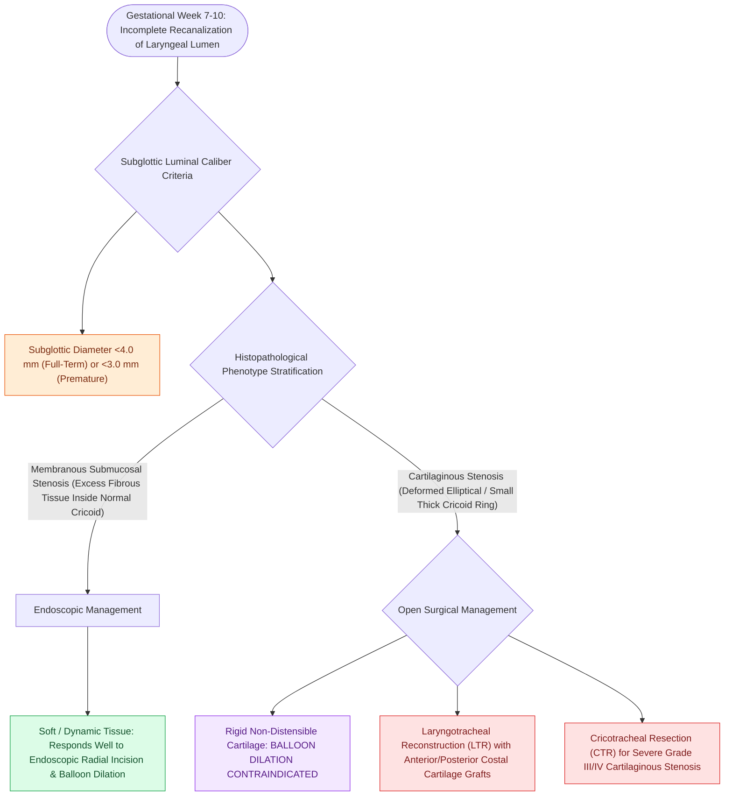

# Congenital subglottic stenosis results from incomplete recanalization of the laryngeal lumen during embryogenesis

## Active Recall

> [!question]- What subglottic diameter threshold defines congenital subglottic stenosis in a full-term newborn?
> *Answer / Clinical Rationale*: A subglottic diameter of **$<4.0\text{ mm}$** (or $<3.0\text{ mm}$ in a premature infant).

> [!question]- How do membranous and cartilaginous congenital subglottic stenosis differ in treatment response?
> *Answer / Clinical Rationale*: **Membranous stenosis responds well to endoscopic balloon dilation**; **cartilaginous stenosis is rigid and requires open surgical reconstruction (LTR/CTR)**.

## Core Clinical & Mechanistic Principles
**Congenital Subglottic Stenosis (SGS)** is the third most common congenital laryngeal anomaly, defined as subglottic narrowing in the absence of prior endotracheal intubation or trauma:
- **Diagnostic Lumen Diameter Criteria**:
  - Subglottic diameter **$<4.0\text{ mm}$ in a full-term infant** (or **$<3.0\text{ mm}$ in a premature infant**), measured at the level of the cricoid cartilage.
- **Embryological Pathogenesis**:
  - During the 6th gestational week, the epithelial lamina obliterates the laryngeal lumen.
  - In the 7th–10th weeks, the lumen recanalizes from inferior to superior.
  - **Arrested / Incomplete Recanalization** leaves residual connective tissue or an abnormally formed **elliptical, small, or deformed cricoid cartilage**.
- **Two Histopathological Types**:
  1. **Membranous (Submucosal) Stenosis**: Circumferential excess of dense fibrous tissue and hyperplastic submucosal mucous glands inside a normal cartilaginous cricoid ring. Often softens and responds well to [[Endoscopic balloon dilation with steroid injection manages early, soft, non-circumferential subglottic stenosis|balloon dilation]].
  2. **Cartilaginous Stenosis**: Malformed, small, thick, or elliptical cricoid cartilage; rigid, does NOT respond to balloon dilation, and requires open surgical expansion (LTR / CTR).

### Surgical Technique & Critical Safety Checks
- **Clinical Course**: Presents with [[Inspiratory, biphasic, and expiratory stridor localize pediatric airway obstruction to supraglottic, subglottic, and tracheobronchial subsites|biphasic stridor]] and recurrent "croup" episodes that fail to resolve by age 2–3 years.

## Connected Concepts & Graph Traversal
- **Myer-Cotton Grading**: [[Myer-Cotton grading system stratifies subglottic stenosis from Grade I less than fifty percent to Grade IV no lumen|Myer-Cotton Grading]]
- **Balloon Dilation**: [[Endoscopic balloon dilation with steroid injection manages early, soft, non-circumferential subglottic stenosis|Balloon Dilation]]
- **LTR Reconstruction**: [[Single-stage and double-stage laryngotracheal reconstruction LTR repair mature high-grade subglottic stenosis|LTR Reconstruction]]
- **Embryological & Sleep Foundation**: [[The Starling resistor model explains upper airway collapsibility and critical closing pressure Pcrit]]
- **Sleep Endoscopy & Airway Dynamics**: [[Drug-induced sleep endoscopy DISE evaluates dynamic multi-level upper airway collapse under sedation|Drug-Induced Sleep Endoscopy (DISE)]] [[Severe secondary post-tonsillectomy hemorrhage requires urgent airway stabilization and surgical electrocautery]]
- **Congenital Airway Pathology**: [[Viral laryngotracheobronchitis croup presents with a barking cough and subglottic steeple sign on radiography]]
- **Open Airway Reconstruction**: [[Cricotracheal resection CTR achieves primary end-to-end anastomosis for severe Grade III and IV subglottic stenosis]]
