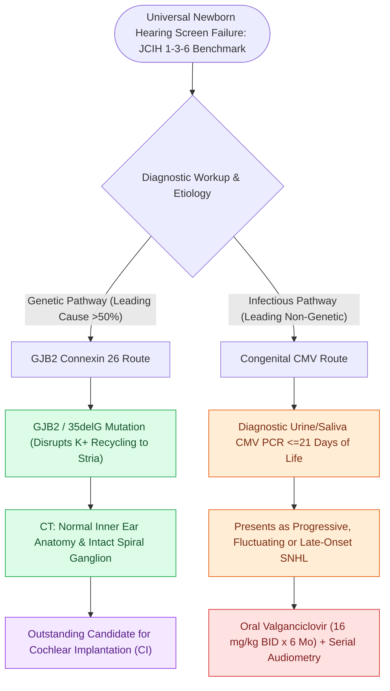

# Connexin 26 mutations in GJB2 and congenital CMV infection are leading causes of non-syndromic pediatric sensorineural hearing loss

## Active Recall

> [!question]- What is the cellular function of Connexin 26 encoded by the GJB2 gene, and why does its mutation cause hearing loss?
> *Answer / Clinical Rationale*: It forms **gap junction channels that recycle potassium ions ($K^+$)** from hair cells back to the stria vascularis; mutations disrupt potassium homeostasis and abolish the endocochlear potential.

> [!question]- Within what timeframe must urine or saliva CMV PCR be obtained to definitively diagnose congenital (rather than acquired) CMV infection?
> *Answer / Clinical Rationale*: Within the **first 21 days (3 weeks) of life**.

## Core Clinical & Mechanistic Principles
Non-syndromic genetic mutations and congenital viral infections account for the vast majority of non-syndromic pediatric sensorineural hearing loss:
- **GJB2 Mutation (Connexin 26) — The Leading Genetic Cause ($>50\%$ of Non-Syndromic SNHL)**:
  - *Genetics*: Autosomal recessive mutation in the **GJB2 gene** (chromosome 13q12), encoding the gap junction protein **Connexin 26**. (The 35delG mutation is the most common variant in Caucasian populations).
  - *Mechanism*: Connexin 26 forms hexameric gap junctions between supporting cells in the cochlea, essential for **potassium ($K^+$) recycling** from hair cells back to the stria vascularis to maintain the endocochlear potential.
  - *Clinical Course*: Typically non-progressive, bilateral, moderate-to-profound SNHL with completely **normal temporal bone CT imaging**.
  - *Prognosis*: Outstanding candidates for **cochlear implantation**, achieving superior speech outcomes because the spiral ganglion and auditory nerve fibers are intact.
- **Congenital Cytomegalovirus (cCMV) — The Leading Non-Genetic Infectious Cause**:
  - Acquired in utero via transplacental transmission.
  - *Manifestations*: Microcephaly, periventricular calcifications, chorioretinitis, hepatosplenomegaly, and **progressive, fluctuating, or delayed-onset unilateral or bilateral SNHL**.
  - *Diagnosis*: **CMV DNA PCR in urine or saliva obtained within the first 21 days of life** (testing after 3 weeks cannot distinguish congenital from acquired infection).
  - *Treatment*: Early initiation of oral **Valganciclovir ($16\text{ mg/kg/dose BID}$ for 6 months)** improves hearing and neurodevelopmental outcomes.

### Surgical Technique & Critical Safety Checks
- **Universal Newborn Hearing Screening (JCIH 1-3-6 Benchmark)**: Screen by 1 month, diagnose by 3 months, and initiate amplification/intervention by 6 months of age (see [[Newborn hearing screening follows the one-three-six EHDI timeline with early CMV testing|EHDI 1-3-6 Timeline]]).

## Connected Concepts & Graph Traversal
- **EHDI Screening Timeline**: [[Newborn hearing screening follows the one-three-six EHDI timeline with early CMV testing|EHDI 1-3-6 Timeline]]
- **Syndromic SNHL Entities**: [[Syndromic pediatric sensorineural hearing loss encompasses Pendred, Usher, Waardenburg, and Jervell and Lange-Nielsen syndromes|Syndromic Pediatric SNHL]]
- **Stickler SNHL Syndrome**: [[Stickler syndrome combines progressive sensorineural hearing loss, spondyloepiphyseal dysplasia, and retinal detachment|Stickler Syndrome]]
- **Treacher Collins Conductive Loss**: [[Treacher Collins syndrome results from TCOF1 mutations causing mandibulofacial dysostosis and conductive hearing loss|Treacher Collins Syndrome]]
- **Pediatric Mastoiditis**: [[Pediatric acute mastoiditis with subperiosteal abscess requires intravenous ceftriaxone, myringotomy tube placement, and cortical mastoidectomy|Pediatric Acute Mastoiditis]]
