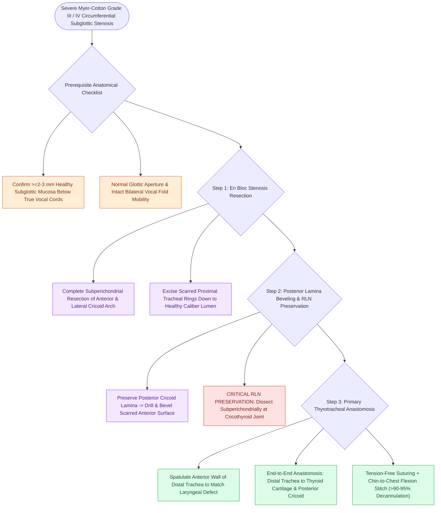

# Cricotracheal resection CTR achieves primary end-to-end anastomosis for severe Grade III and IV subglottic stenosis

## Active Recall

> [!question]- What is the minimum margin of healthy subglottic mucosa required below the vocal folds to perform a standard partial CTR?
> *Answer / Clinical Rationale*: At least **$2\text{ to }3\text{ mm}$ of healthy mucosa below the true vocal cords** (to preserve the anterior commissure and vocal fold function).

> [!question]- What are the major advantages of cricotracheal resection (CTR) over LTR for Myer-Cotton Grade IV stenosis?
> *Answer / Clinical Rationale*: CTR **completely removes the diseased scar tissue** rather than expanding it, yielding higher single-procedure decannulation rates ($>95\%$) and a lower rate of restenosis.

## Core Clinical & Mechanistic Principles
**Partial Cricotracheal Resection (CTR)** (pioneered by Pearson, Monnier, and Cotton) is the definitive surgical procedure for severe, mature **Myer-Cotton Grade III and IV subglottic stenosis**, achieving a **$>90\text{–}95\%$ decannulation rate**:
- **Core Surgical Concept**:
  - Rather than expanding scar with cartilage grafts (as in [[Single-stage and double-stage laryngotracheal reconstruction LTR repair mature high-grade subglottic stenosis|LTR]]), CTR **completely resects the entire stenotic subglottic segment** (the anterior and lateral cricoid arch and scarred upper tracheal rings) and performs a **primary end-to-end thyrotracheal anastomosis**.
- **Indications**:
  - Severe Myer-Cotton Grade III or IV subglottic stenosis.
  - Mature, dense, circumferential fibrous/cartilaginous stenosis.
  - Failed prior LTR with graft necrosis or severe recurrent scarring.
  - Preserved vocal fold mobility and normal glottic aperture (requires at least **$2\text{–}3\text{ mm}$ of healthy subglottic mucosa below the vocal cords**).
- **The Posterior Cricoid Plate Beveling**:
  - The anterior and lateral cricoid cartilage is completely resected.
  - The **posterior cricoid lamina is preserved**; its scarred anterior mucosa is drilled/denuded and bevelled.
  - The healthy distal trachea is spatulated and anastomosed to the bevelled posterior cricoid lamina and lower thyroid cartilage.

### Surgical Technique & Critical Safety Checks
- **Decannulation Rates**: CTR achieves significantly higher decannulation rates ($95\%$ vs. $75\%$) with fewer revision surgeries compared to LTR in high-grade Grade III/IV stenosis.

## Connected Concepts & Graph Traversal
- **RLN Preservation CTR**: [[Preserving the recurrent laryngeal nerves at the cricothyroid articulation is essential during cricotracheal resection|RLN Preservation CTR]]
- **Laryngeal Release**: [[Suprahyoid and infrahyoid laryngeal release maneuvers reduce anastomotic tension in tracheal surgery|Laryngeal Release]]
- **Chin-to-Chest Stitch**: [[Postoperative chin-to-chest flexion stitch prevents catastrophic neck extension and tracheal anastomotic dehiscence|Chin-to-Chest Stitch]]
- **Embryological & Sleep Foundation**: [[Nocturnal pulse oximetry McGill score stratifies pediatric obstructive sleep apnea severity]]
- **Sleep Endoscopy & Airway Dynamics**: [[Drug-induced sleep endoscopy DISE evaluates dynamic multi-level upper airway collapse under sedation|Drug-Induced Sleep Endoscopy (DISE)]] [[Rapid maxillary expansion widens the hard palate and nasal floor to improve pediatric nasal breathing and OSA]]
- **Congenital Airway Pathology**: [[Viral laryngotracheobronchitis croup presents with a barking cough and subglottic steeple sign on radiography]]
- **Open Airway Reconstruction**: [[Double-stage LTR maintains a tracheostomy and utilizes an endolaryngeal LT-Mold or Montgomery T-tube stent]]
