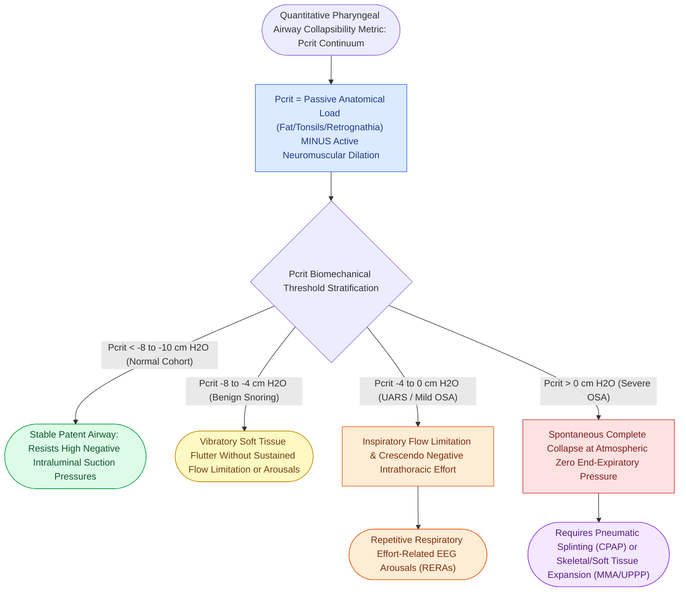

# Critical closing pressure Pcrit stratifies upper airway collapsibility from snorers to severe obstructive sleep apnea

## Active Recall

> [!question]- What is the typical $P_{\text{crit}}$ value in patients with severe obstructive sleep apnea compared to normal healthy individuals?
> *Answer / Clinical Rationale*: Severe OSA patients have a **positive $P_{\text{crit}} > 0\text{ cm H}_2\text{O}$**, whereas normal individuals have a **highly negative $P_{\text{crit}} < -8\text{ to }-10\text{ cm H}_2\text{O}$**.

> [!question]- What happens to the pharyngeal airway when $P_{\text{crit}}$ is greater than zero?
> *Answer / Clinical Rationale*: The airway **spontaneously collapses at atmospheric pressure**, requiring positive pressure (CPAP) or muscle activation to open.

## Core Clinical & Mechanistic Principles
The **critical closing pressure ($P_{\text{crit}}$)** is the quantitative gold standard biomechanical measure of intrinsic upper airway collapsibility:
- **Pcrit Spectrum Across Sleep-Disordered Breathing**:
  - **Normal Healthy Individuals**: $P_{\text{crit}} < -8\text{ to }-10\text{ cm H}_2\text{O}$ (highly negative; airway remains patent even under strong subatmospheric inspiratory suction).
  - **Benign Snorers**: $P_{\text{crit}} \approx -8\text{ to }-4\text{ cm H}_2\text{O}$ (vibration during inspiration without sustained flow limitation).
  - **Upper Airway Resistance Syndrome (UARS) / Mild OSA**: $P_{\text{crit}} \approx -4\text{ to }0\text{ cm H}_2\text{O}$ (flow limitation causing recurrent arousals).
  - **Severe Obstructive Sleep Apnea (OSA)**: $P_{\text{crit}} > 0\text{ to }+2\text{ cm H}_2\text{O}$ (positive pressure required just to keep the airway from spontaneously collapsing at end-expiration).
- **Factors Determining Pcrit**:
  - **Anatomical (Passive) Load**: Adipose tissue in lateral pharyngeal walls, tongue base volume, tonsillar hypertrophy, micrognathia/retrognathia, narrow hard palate.
  - **Neuromuscular (Active) Dilator Compensation**: Genioglossus and palatopharyngeus reflex activation during sleep.

### Surgical Technique & Critical Safety Checks
- **Therapeutic Impact**: Successful surgical airway expansion (UPPP, [[Maxillomandibular advancement MMA advances the skeletal framework by ten to twelve millimeters to expand the upper airway|MMA]], tonsillectomy) or weight loss lowers $P_{\text{crit}}$ by shifting it toward more negative values.

## Connected Concepts & Graph Traversal
- **Starling Resistor**: [[The Starling resistor model explains upper airway collapsibility and critical closing pressure Pcrit|Starling Resistor]]
- **Non-Anatomical Endotypes**: [[Loop gain, arousal threshold, and muscle responsiveness represent the non-anatomical endotypes of obstructive sleep apnea|Non-Anatomical Endotypes]]
- **Adult OSA Criteria**: [[Adult polysomnography criteria define obstructive sleep apnea severity by apnea-hypopnea index thresholds of five, fifteen, and thirty|Adult OSA Criteria]]
- **Disease Mechanism**: [[Upper airway resistance syndrome causes excessive daytime somnolence from repetitive respiratory effort-related arousals without overt desaturations|UARS as the Mild End of the Pcrit Continuum]]
