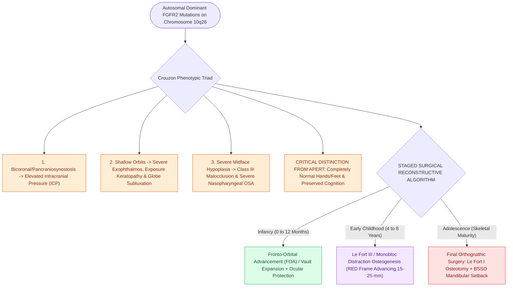

# Crouzon syndrome exhibits FGFR2-mediated craniosynostosis with ocular proptosis, midface hypoplasia, and normal extremities

## Active Recall

> [!question]- What is the genetic mutation in Crouzon syndrome, and what crucial physical finding differentiates Crouzon from Apert syndrome?
> *Answer / Clinical Rationale*: Crouzon syndrome is caused by gain-of-function mutations in **FGFR2** (Fibroblast Growth Factor Receptor 2, on chromosome 10q26). Unlike Apert syndrome, patients with Crouzon syndrome have **normal hands and feet (NO complex syndactyly)** and generally have **normal intelligence**.

> [!question]- What anatomical features cause obstructive sleep apnea (OSA) and ocular complications in Crouzon syndrome?
> *Answer / Clinical Rationale*: Premature fusion of the coronal, sagittal, and lambdoid sutures with severe **midface hypoplasia and maxillary retrusion** causes severe narrowing of the nasopharynx and velopharynx (severe OSA). Extremely shallow orbits produce **severe ocular proptosis (exophthalmos), exposure keratopathy, and risk of globe subluxation**.

> [!question]- What otologic abnormalities and hearing loss patterns are encountered in Crouzon syndrome?
> *Answer / Clinical Rationale*: **Conductive hearing loss** is present in $>50\%$ of patients due to external auditory canal stenosis/atresia, ossicular chain anomalies (malleus-incus fusion or stapes fixation), and chronic Eustachian tube dysfunction secondary to midface retrusion.

## Core Clinical & Mechanistic Principles
Crouzon syndrome (craniofacial dysostosis) represents the most common craniosynostosis syndrome, occurring in $1\text{ in }25,000$ live births:

### Staged Surgical Algorithm
1. **Infancy ($0\text{–}12\text{ months}$)**:
   - Cranial vault expansion / fronto-orbital advancement (FOA) to decompress elevated intracranial pressure and expand the superior orbital rims.
   - Aggressive ocular lubrication / tarsorrhaphy if globe exposure is severe.
   - Non-invasive respiratory support (CPAP/BiPAP) or tracheostomy for refractory obstructive sleep apnea.
2. **Early Childhood ($4\text{–}8\text{ years}$)**:
   - Monobloc advancement or **Le Fort III midface advancement with distraction osteogenesis** (using rigid external distractors / RED frame) to advance the orbits and maxilla $15\text{–}25\text{ mm}$, simultaneously resolving proptosis, expanding the pharyngeal airway, and correcting the Class III malocclusion.
3. **Adolescence**: Final orthognathic surgery (Le Fort I osteotomy and BSSO) and rhinoplasty (see [[Apert syndrome combines acrocephalosyndactyly from FGFR2 mutations with complex hand-foot syndactyly and cleft palate|Apert vs Crouzon Syndactyly Distinction]]).

## Connected Concepts & Graph Traversal
- **Syndromic Differential**: [[Apert syndrome combines acrocephalosyndactyly from FGFR2 mutations with complex hand-foot syndactyly and cleft palate|Apert vs Crouzon Syndactyly Distinction]]
- **Midface Reconstruction**: [[Isolated anterior table frontal sinus fractures require open reduction and microplate fixation for contour restoration|Craniofacial Osteosynthesis]]
- **Pediatric OSA Diagnostics**: [[Pediatric polysomnography criteria define obstructive sleep apnea with an obstructive apnea-hypopnea index exceeding one|Pediatric OSA & Polysomnography]]
- **Branchial Syndromic Differential**: [[Treacher Collins syndrome results from TCOF1 mutations causing mandibulofacial dysostosis and conductive hearing loss|Treacher Collins Comparison]]
- **Bone Conduction Hearing**: [[Bone-anchored hearing implants BAHA stimulate the cochlea directly via bone conduction pathways|BAHA Implants for EAC Stenosis]]
- **Disease Mechanism**: [[Pediatric skull base synchondroses guide craniofacial growth and ossify in a predictable sequence from anterior to posterior|Premature Synchondrosis Fusion in Crouzon]]
- **FGFR1/FGFR2 Syndromic Differential**: [[Pfeiffer syndrome features FGFR1 and FGFR2 mutations causing bicoronal craniosynostosis, broad thumbs and great toes, and severe midface hypoplasia|Pfeiffer Syndrome]]
