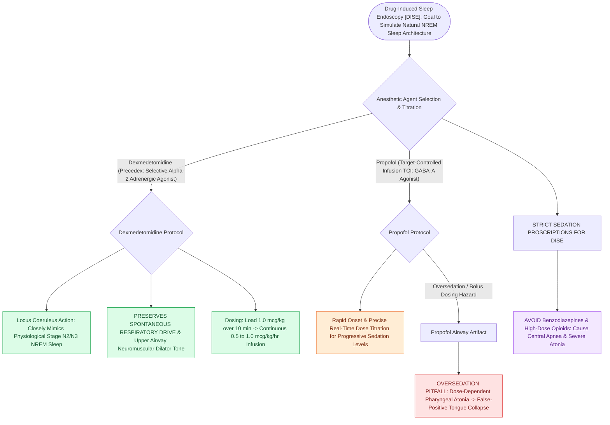

# Dexmedetomidine and propofol titrations simulate natural sleep architecture during DISE

## Active Recall

> [!question]- What is the pharmacological mechanism of dexmedetomidine and why is it favored in sleep endoscopy?
> *Answer / Clinical Rationale*: It is a **selective alpha-2 adrenergic agonist in the locus coeruleus** that mimics natural NREM sleep **without causing respiratory depression**.

> [!question]- What artifactual airway finding can be caused by oversedation with propofol during DISE?
> *Answer / Clinical Rationale*: False-positive **tongue base collapse and profound central hypoventilation**.

## Core Clinical & Mechanistic Principles
Selecting and titrating anesthetic agents during [[Drug-induced sleep endoscopy DISE evaluates dynamic multi-level upper airway collapse under sedation|Drug-Induced Sleep Endoscopy]] is critical to replicating physiological NREM sleep while avoiding artifactual airway collapse:
- **Dexmedetomidine (Precedex)**:
  - **Pharmacological Mechanism**: Highly selective **alpha-2 adrenergic receptor agonist** in the **locus coeruleus** of the brainstem.
  - **Sleep Simulation**: Produces electroencephalographic and behavioral sleep that closely mimics **natural Stage N2/N3 NREM sleep**.
  - **Key Advantages**: **Preserves spontaneous respiratory drive**; zero central respiratory depression; maintains endogenous upper airway dilator reflexes; allows transition to deeper sleep without apnea.
  - *Dosing*: Loading dose of $1.0\ \mu\text{g/kg}$ over 10 minutes, followed by continuous infusion of $0.5\text{–}1.0\ \mu\text{g/kg/hr}$.
- **Propofol (Target-Controlled Infusion - TCI)**:
  - **Mechanism**: **$\text{GABA}_{\text{A}}$ receptor agonist**.
  - *Advantages*: Rapid onset, precise dose-dependent titration, quick recovery.
  - *Disadvantages*: Causes dose-dependent respiratory depression and **hypotonia of upper airway musculature**, which [[High-stakes pediatric and adult sleep airway complications require rapid structured algorithmic emergency rescue|can]] cause false-positive tongue base collapse if oversedated.
- **Combined Regimens**: Dexmedetomidine background infusion combined with low-dose micro-titrations of Propofol or Ketamine provides optimal conditions for pediatric and adult DISE.

### Surgical Technique & Critical Safety Checks
- **Agents to Avoid**: Benzodiazepines and high-dose opioids cause profound pharyngeal atonia and central apneas, corrupting DISE findings.

## Connected Concepts & Graph Traversal
- **DISE Endoscopy**: [[Drug-induced sleep endoscopy DISE evaluates dynamic multi-level upper airway collapse under sedation|DISE Endoscopy]]
- **VOTE Classification**: [[VOTE classification standardizes drug-induced sleep endoscopy findings across velum, oropharynx, tongue base, and epiglottis|VOTE Classification]]
- **Pediatric DISE**: [[Pediatric DISE identifies persistent multi-level airway collapse following adenotonsillectomy|Pediatric DISE]]
- **Embryological & Sleep Foundation**: [[Third and fourth branchial pouch anomalies present as recurrent left thyroid bed abscesses and piriform sinus fistulas]]
- **Adenotonsillar & Endoscopic DISE**: [[High-risk pediatric criteria mandate overnight inpatient admission following adenotonsillectomy]]
- **Congenital Airway Pathology**: [[Congenital bilateral vocal fold paralysis presents with severe inspiratory stridor requiring airway protection]]
- **Open Airway Reconstruction**: [[Posterior costal cartilage grafts with a carved flange split the posterior cricoid lamina to expand the glottic lumen]]
