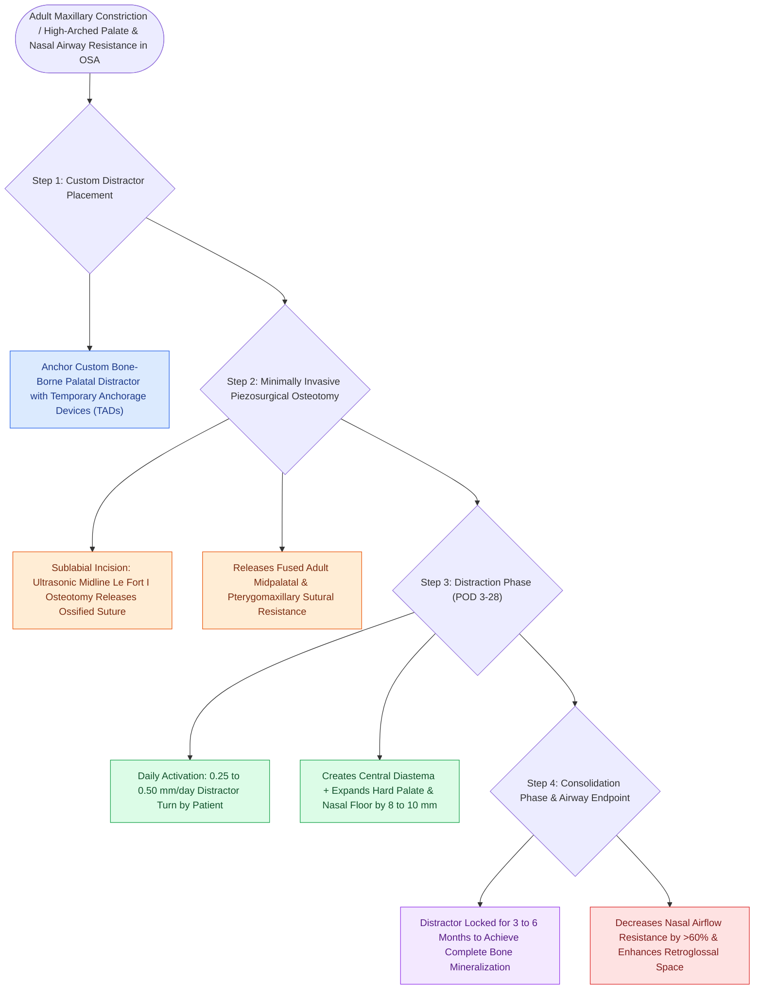

# Distraction osteogenesis maxillary expansion DOME expands the palatal vault in adults with narrow maxillae and OSA

## Active Recall

> [!question]- Why is a surgical osteotomy required for maxillary expansion in adults (DOME) compared to children (RME)?
> *Answer / Clinical Rationale*: Because adult **midpalatal and facial sutures are fully ossified and fused**, preventing skeletal expansion without surgical release.

> [!question]- How much expansion of the hard palate and nasal floor is typically achieved with DOME?
> *Answer / Clinical Rationale*: Approximately **$8\text{ to }10\text{ mm}$ of skeletal widening**.

## Core Clinical & Mechanistic Principles
**Distraction Osteogenesis Maxillary Expansion (DOME)** (pioneered by Stanley Liu and Audrey Yoon) is an outpatient, minimally invasive procedure to expand the constricted maxilla and nasal floor in skeletally mature adolescents and adults:
- **The Problem of the Adult Midpalatal Suture**:
  - In children, standard orthodontic RME readily opens the suture.
  - In adults, the **midpalatal and pterygomaxillary sutures are fully ossified and interdigitated**, causing dental tipping rather than skeletal expansion if forced.
- **Surgical-Orthodontic DOME Protocol**:
  1. A customized bone-borne maxillary distractor anchored by mini-implants (TADs) is placed along the hard palate.
  2. **Minimally Invasive Outpatient Osteotomy**:
     - Sublabial incision; perform a **midline Le Fort I maxillary osteotomy** through the anterior nasal spine and intermaxillary suture using an ultrasonic piezosurgical saw.
  3. **Distraction Phase**:
     - Suture activation begins on postoperative day 3–5.
     - Patient turns the distractor screw **$0.25\text{–}0.5\text{ mm/day}$ for 3–4 weeks**, creating a diastema between central incisors and widening the hard palate by **$8\text{ to }10\text{ mm}$**.
  4. **Consolidation Phase**: Distractor locked in place for 3–6 months for bone mineralization.

### Surgical Technique & Critical Safety Checks
- **Airway & OSA Impact**: Widens the nasal cavity floor, decreases nasal resistance by $>60\%$, and normalizes tongue posture, significantly reducing AHI and improving CPAP tolerance (see [[Rapid maxillary expansion widens the hard palate and nasal floor to improve pediatric nasal breathing and OSA|Rapid Maxillary Expansion]]).

## Connected Concepts & Graph Traversal
- **Rapid Maxillary Expansion**: [[Rapid maxillary expansion widens the hard palate and nasal floor to improve pediatric nasal breathing and OSA|Rapid Maxillary Expansion]]
- **Nasal Surgery OSA**: [[Nasal surgery alone improves CPAP compliance and subjective daytime somnolence without normalizing AHI|Nasal Surgery OSA]]
- **MMA Advancement**: [[Maxillomandibular advancement MMA advances the skeletal framework by ten to twelve millimeters to expand the upper airway|MMA Advancement]]
- **Embryological & Sleep Foundation**: [[Adult polysomnography criteria define obstructive sleep apnea severity by apnea-hypopnea index thresholds of five, fifteen, and thirty]]
- **Sleep Endoscopy & Airway Dynamics**: [[Drug-induced sleep endoscopy DISE evaluates dynamic multi-level upper airway collapse under sedation|Drug-Induced Sleep Endoscopy (DISE)]] [[Adenotonsillectomy is the first-line surgical treatment for pediatric obstructive sleep apnea]]
- **Congenital Airway Pathology**: [[Microdebrider debulking and intralesional cidofovir provide surgical and adjuvant control of RRP]]
- **Open Airway Reconstruction**: [[Anterior costal cartilage grafts expand the thyroid and cricoid cartilage framework]]
