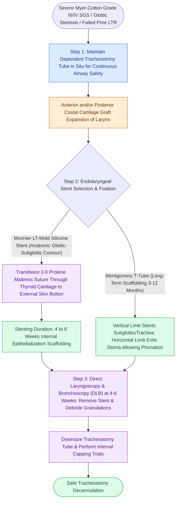

# Double-stage LTR maintains a tracheostomy and utilizes an endolaryngeal LT-Mold or Montgomery T-tube stent

## Active Recall

> [!question]- What is the standard stenting duration for an LT-Mold stent in double-stage LTR?
> *Answer / Clinical Rationale*: **$4\text{ to }6\text{ weeks}$**.

> [!question]- How is a Monnier LT-Mold endolaryngeal stent secured in position within the pediatric airway?
> *Answer / Clinical Rationale*: Via a **transfixion monofilament suture (2-0 Prolene)** passed through the thyroid cartilage and tied over a **silicone button on the external neck skin**.

## Core Clinical & Mechanistic Principles
**Double-Stage [[Single-stage and double-stage laryngotracheal reconstruction LTR repair mature high-grade subglottic stenosis|Laryngotracheal Reconstruction]] (DSLTR)** provides prolonged, rigid internal scaffolding for complex, unstable, or revision airway reconstructions while maintaining a secure tracheostomy:
- **Indications for Double-Stage LTR**:
  - Severe Myer-Cotton Grade III or IV subglottic stenosis.
  - Extensive posterior glottic stenosis requiring posterior graft and interarytenoid scar release.
  - Revision LTR after prior graft failure or infection.
  - Significant medical comorbidities (pulmonary bronchopulmonary dysplasia, neurological impairment).
- **Endolaryngeal Stenting Options**:
  1. **Monnier LT-Mold (Laryngotracheal Mold)**:
     - Soft silicone stent anatomically molded to the glottic and subglottic contours (triangular glottis, round subglottis).
     - Fixed with a **transcutaneous 2-0 Prolene or nylon mattress suture** through the thyroid cartilage tied over a silicone button on the neck skin.
     - Stenting duration: **$4\text{ to }6\text{ weeks}$**.
  2. **Montgomery T-Tube**:
     - Silicone T-tube where the vertical limb stents the subglottis/trachea and the horizontal limb exits the tracheostomy stoma.
     - Allows spontaneous phonation (plugging horizontal limb) while maintaining airway safety.
     - Stenting duration: **$3\text{ to }12\text{ months}$**.

### Surgical Technique & Critical Safety Checks
- **Decannulation Protocol**: After stent removal, interval direct laryngoscopy and bronchoscopy (DLB) is performed at 4–6 weeks; capping trials of the tracheostomy tube are initiated once mature epithelialization and airway stability are confirmed.

## Connected Concepts & Graph Traversal
- **Single-Stage LTR**: [[Single-stage LTR utilizes an endotracheal tube as a temporary stent avoiding tracheostomy placement|Single-Stage LTR]]
- **LTR Reconstruction**: [[Single-stage and double-stage laryngotracheal reconstruction LTR repair mature high-grade subglottic stenosis|LTR Reconstruction]]
- **Posterior Costal Graft**: [[Posterior costal cartilage grafts with a carved flange split the posterior cricoid lamina to expand the glottic lumen|Posterior Costal Cartilage Graft]]
- **Embryological & Sleep Foundation**: [[Critical closing pressure Pcrit stratifies upper airway collapsibility from snorers to severe obstructive sleep apnea]]
- **Sleep Endoscopy & Airway Dynamics**: [[Drug-induced sleep endoscopy DISE evaluates dynamic multi-level upper airway collapse under sedation|Drug-Induced Sleep Endoscopy (DISE)]] [[Severe secondary post-tonsillectomy hemorrhage requires urgent airway stabilization and surgical electrocautery]]
- **Congenital Airway Pathology**: [[Laryngomalacia is the most common cause of congenital pediatric stridor characterized by dynamic supraglottic collapse]]
- **Open Airway Reconstruction**: [[Slide tracheoplasty achieves immediate vascularized mucosal lumen doubling with lowest restenosis rates]]
