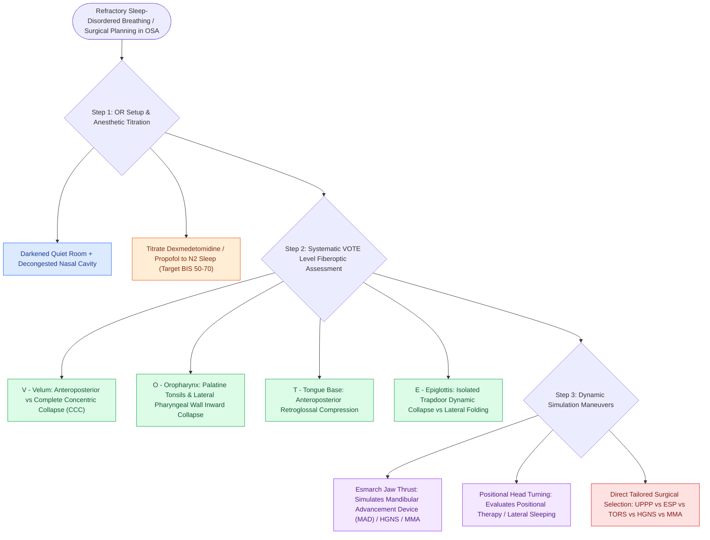

# Drug-induced sleep endoscopy DISE evaluates dynamic multi-level upper airway collapse under sedation

## Active Recall

> [!question]- What are the four anatomical levels systematically evaluated during DISE under the VOTE classification?
> *Answer / Clinical Rationale*: The **Velum (soft palate)**, **Oropharynx (lateral walls/tonsils)**, **Tongue base**, and **Epiglottis**.

> [!question]- What sedative agent is preferred in DISE to simulate natural NREM sleep with minimal respiratory depression?
> *Answer / Clinical Rationale*: **Dexmedetomidine** (alpha-2 adrenergic agonist) or titrated **Propofol**.

## Core Clinical & Mechanistic Principles
**Drug-Induced Sleep Endoscopy (DISE)** (introduced by Croft and Pringle in 1991) allows direct 3D fiberoptic visual assessment of dynamic upper airway collapse under pharmacologically induced sleep:
- **Core Clinical Rationale**:
  - Awake physical examination and static endoscopy fail to capture dynamic muscular atonia and negative-pressure collapse that occur during sleep.
  - DISE identifies the exact anatomical level(s), degree, and spatial orientation (anteroposterior, lateral, concentric) of obstruction.
- **Protocol & Anesthetic Titration**:
  - Performed in a quiet, darkened operating room.
  - **Sedation Regimen**: **Target-Controlled Infusion (TCI) of Propofol** ($2.0\text{–}4.0\ \mu\text{g/mL}$) or **Dexmedetomidine** ($1.0\ \mu\text{g/kg}$ bolus over 10 min, then $0.5\text{–}1.0\ \mu\text{g/kg/hr}$).
  - *Target Depth*: Transition from Stage N1 to N2 sleep (bispectral index BIS $50\text{–}70$); avoid oversedation (which induces artifactual tongue base collapse) or undersedation.
  - Flexible fiberoptic laryngoscope is passed through the decongested nasal cavity to systematically evaluate:
    1. **Velum (Soft Palate)**.
    2. **Oropharynx (Palatine Tonsils & Lateral Pharyngeal Walls)**.
    3. **Tongue Base**.
    4. **Epiglottis**.

### Surgical Technique & Critical Safety Checks
- **Jaw Thrust (Esmarch Maneuver)**: Manual anterior advancement of the mandible during DISE simulates the effect of a [[Mandibular advancement devices MAD advance the mandible to enlarge the retroglossal airway space|Mandibular Advancement Device]] (MAD) or [[Hypoglossal nerve stimulation HGNS activates the medial branch of CN XII to advance the tongue during inspiration|HGNS]]/[[Maxillomandibular advancement MMA advances the skeletal framework by ten to twelve millimeters to expand the upper airway|MMA]].

## Connected Concepts & Graph Traversal
- **VOTE Classification**: [[VOTE classification standardizes drug-induced sleep endoscopy findings across velum, oropharynx, tongue base, and epiglottis|VOTE Classification]]
- **Concentric Collapse**: [[Concentric velopharyngeal collapse on DISE is a contraindication to hypoglossal nerve stimulation|Concentric Collapse]]
- **Pediatric DISE**: [[Pediatric DISE identifies persistent multi-level airway collapse following adenotonsillectomy|Pediatric DISE]]
- **Embryological & Sleep Foundation**: [[Second branchial cleft anomalies represent the most common branchial anomaly situated anterior to the sternocleidomastoid]]
- **Adenotonsillar & Endoscopic DISE**: [[Severe secondary post-tonsillectomy hemorrhage requires urgent airway stabilization and surgical electrocautery]]
- **Congenital Airway Pathology**: [[Myer-Cotton grading system stratifies subglottic stenosis from Grade I less than fifty percent to Grade IV no lumen]]
- **Open Airway Reconstruction**: [[Aortopexy suspends the aorta to the sternum to relieve anterior vascular tracheal compression]]
- **Diagnostic Evaluation**: [[Upper airway resistance syndrome causes excessive daytime somnolence from repetitive respiratory effort-related arousals without overt desaturations|DISE Workup for Anatomic Flow Limitation in UARS]]
