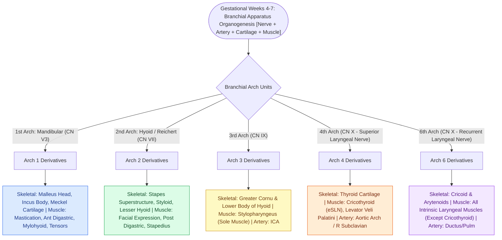

# Each branchial arch packages one nerve, one artery, one cartilage bar, and one muscle group

## Active Recall

> [!question]- Why do the anterior and posterior bellies of the digastric muscle have completely different cranial nerve innervations?
> *Answer / Clinical Rationale*: The **anterior belly derives from Arch 1 (innervated by $	ext{CN V}_3$ via the nerve to mylohyoid)**, whereas the **posterior belly derives from Arch 2 (innervated by $	ext{CN VII}$)**; they migrate from separate branchial compartments and fuse at a common intermediate fibrous tendon.

> [!question]- What CT skull base finding confirms a persistent stapedial artery when a pulsatile middle ear vascular mass is encountered?
> *Answer / Clinical Rationale*: An **absent foramen spinosum** on high-resolution temporal bone CT, because the middle meningeal artery arises directly from the persistent stapedial artery (Arch 2) traversing the obturator foramen of the stapes rather than ascending through foramen spinosum from the maxillary artery.

> [!question]- What embryologic vascular failure causes an arteria lusoria and its associated non-recurrent laryngeal nerve?
> *Answer / Clinical Rationale*: Involution of the **right 4th aortic arch vessel**, causing the right subclavian artery to arise anomalously from the descending thoracic aorta and course retroesophageally; without a right 4th arch vascular loop to pull the right RLN into the mediastinum during cardiac descent, the nerve travels directly transversely from the vagus into the larynx.

## Core Clinical & Mechanistic Principles
The **branchial (pharyngeal) apparatus** develops between the 4th and 7th gestational weeks from cephalic neural crest cells and lateral plate mesoderm. Every branchial arch develops as an invariant structural unit: **one cranial nerve, one aortic arch artery, one cartilaginous skeletal bar, and one muscle group**:

- **The Generative Arch Code**:
  - **1st Arch (Mandibular — $	ext{CN V}_3$)**:
    - *Skeletal*: Malleus head/neck, incus body, Meckel's cartilage template for the mandible, and sphenomandibular ligament.
    - *Muscles*: Muscles of mastication (masseter, temporalis, medial/lateral pterygoids), **mylohyoid**, **anterior belly of digastric**, **tensor tympani**, and **tensor veli palatini**.
    - *Arterial Fate*: Regresses; contributes to the **maxillary artery**.
  - **2nd Arch (Hyoid / Reichert's — $	ext{CN VII}$)**:
    - *Skeletal*: Stapes superstructure, styloid process, stylohyoid ligament, lesser cornu, and superior body of the hyoid bone.
    - *Muscles*: Muscles of facial expression, **posterior belly of digastric**, stylohyoid, and **stapedius**.
    - *Arterial Fate*: **Stapedial artery** (normally regresses; persistence produces pulsatile tinnitus over the promontory with absent foramen spinosum).
  - **3rd Arch ($	ext{CN IX}$)**:
    - *Skeletal*: Greater cornu and inferior body of the hyoid bone (the hyoid represents a 2nd/3rd arch fusion line).
    - *Muscles*: **Stylopharyngeus** (sole muscle).
    - *Arterial Fate*: Common carotid artery and proximal **internal carotid artery**.
  - **4th Arch ($\	ext{CN X}$ — External Branch of Superior Laryngeal Nerve)**:
    - *Skeletal*: **Thyroid cartilage (superior portion and alae)** and cuneiform cartilages. (Note: the thyroid cartilage has a dual-arch origin: 4th arch forms the upper thyroid alae/notch, while 6th arch forms the lower portion and inferior cornua).
    - *Muscles*: **Cricothyroid**, pharyngeal constrictors, and **levator veli palatini**.
    - *Arterial Fate*: Right proximal **subclavian artery**; Left **aortic arch**. (Regression failure produces arteria lusoria and nonrecurrent RLN).
  - **6th Arch ($\	ext{CN X}$ — Recurrent Laryngeal Nerve)**:
    - *Skeletal*: **Thyroid cartilage (inferior portion and inferior cornua)**, cricoid cartilage, arytenoid cartilages, and corniculate cartilages.
    - *Muscles*: All intrinsic laryngeal muscles (except cricothyroid).
    - *Arterial Fate*: Right pulmonary artery; Left **ductus arteriosus** (ligamentum arteriosum, which anchors the left RLN loop under the aorta).

### The Motor & Structural Pairing Rules
- **Tensors vs. Levators**: All *tensors* (tensor tympani, tensor veli palatini) originate from Arch 1 ($	ext{CN V}_3$). The *levator* (levator veli palatini) originates from Arch 4 ($	ext{CN X}$).
- **The Digastric Rule**: Anterior belly is Arch 1 ($	ext{CN V}_3$); Posterior belly is Arch 2 ($	ext{CN VII}$).
- **The Intrinsic Larynx Rule**: Cricothyroid is Arch 4 (eSLN); all other intrinsic muscles are Arch 6 (RLN) (see [[First branchial cleft anomalies present as periauricular cysts or sinus tracts parallel to the external auditory canal|First Branchial Cleft]]).

## Connected Concepts & Graph Traversal
- **First Cleft Anomalies**: [[First branchial cleft anomalies present as periauricular cysts or sinus tracts parallel to the external auditory canal|First Branchial Cleft]]
- **Second Cleft Anomalies**: [[Second branchial cleft anomalies represent the most common branchial anomaly situated anterior to the sternocleidomastoid|Second Branchial Cleft]]
- **Third & Fourth Pouch Anomalies**: [[Third and fourth branchial pouch anomalies present as recurrent left thyroid bed abscesses and piriform sinus fistulas|Third & Fourth Branchial Pouches]]
- **Parathyroid Descent Mechanics**: [[Superior and inferior parathyroid glands maintain constant anatomical relationships to the RLN and ITA|Parathyroid Embryology & Migration]]
- **Laryngeal Innervation**: [[The superior laryngeal nerve provides supraglottic sensation and cricothyroid motor control|SLN Anatomy & Arch 4]]
