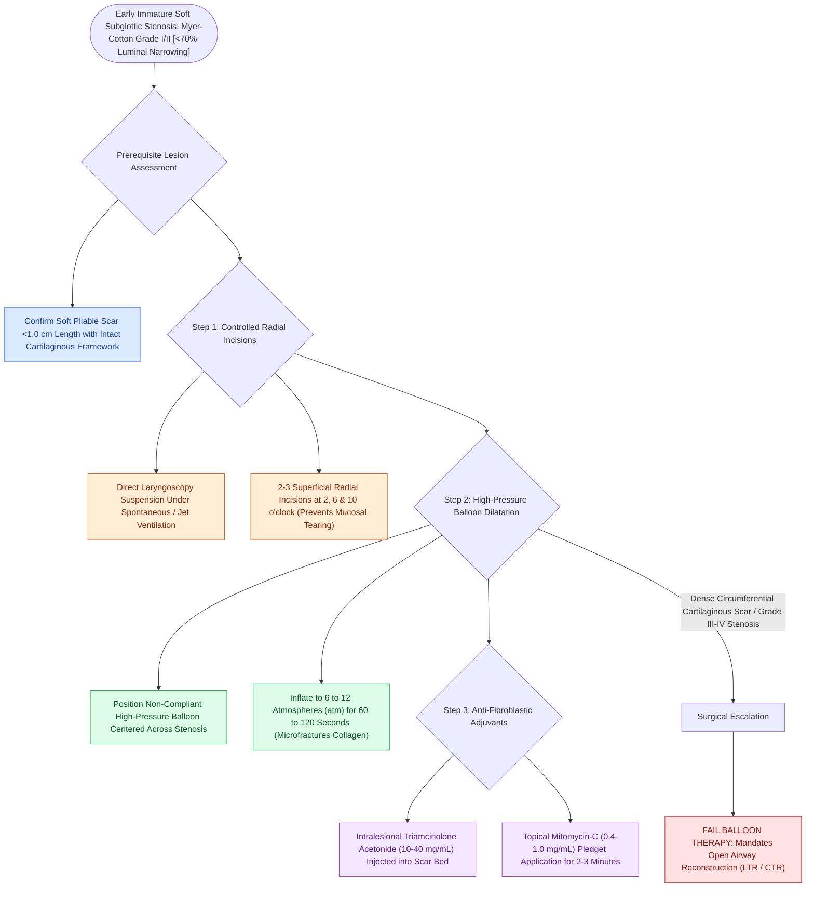

# Endoscopic balloon dilation with steroid injection manages early, soft, non-circumferential subglottic stenosis

## Active Recall

> [!question]- What are the ideal lesion characteristics for endoscopic balloon airway dilation?
> *Answer / Clinical Rationale*: **Myer-Cotton Grade I or II stenosis**, **immature/soft scar tissue**, **short length ($<1\text{ cm}$)**, and **intact cartilaginous framework**.

> [!question]- What topical anti-metabolite is applied to the dilated airway scar bed to inhibit fibroblast proliferation and restenosis?
> *Answer / Clinical Rationale*: **Mitomycin-C ($0.4\text{ to }1.0\text{ mg/mL}$)**.

## Core Clinical & Mechanistic Principles
**Endoscopic balloon laryngotracheoplasty (balloon dilation)** has become the primary minimally invasive treatment for early, immature, or soft pediatric subglottic and tracheal stenosis:
- **Ideal Candidacy Criteria**:
  - **Myer-Cotton Grade I or II stenosis** ($<70\%$ obstruction).
  - **Immature, soft, pliable, or inflammatory scar tissue** ($<6\text{–}12\text{ weeks}$ post-extubation).
  - Short craniocaudal length ($<1.0\text{ cm}$).
  - Intact cartilaginous framework (no cartilage fracture or malacia).
- **Surgical Technique & Biophysical Parameters**:
  1. **Direct Laryngoscopy Exposure**: Suspend airway; maintain spontaneous ventilation or use intermittent apnea / jet ventilation.
  2. **Radial Incisions**: Use a cold micro-sickle knife or CO2 laser at low power ($1\text{–}2\text{ W}$) to make 2–3 superficial radial incisions at 2, 6, and 10 o'clock (prevents uncontrolled tearing).
  3. **High-Pressure Balloon Inflation**:
     - Position non-compliant balloon catheter (e.g., Boston Scientific CRE or Acclarent balloon) across the stenosis.
     - Inflate with saline to **$6\text{ to }12\text{ atmospheres (atm)}$**; hold for **$60\text{ to }120\text{ seconds}$**.
     - Dilates tissue through micro-fracture of collagen bundles without mucosal shear injury.
  4. **Intralesional Adjuvants**: Inject **Triamcinolone acetonide ($10\text{–}40\text{ mg/mL}$)** into the scar bed and apply topical **Mitomycin-C ($0.4\text{–}1.0\text{ mg/mL}$)** for 2–3 minutes to inhibit fibroblast proliferation.

### Surgical Technique & Critical Safety Checks
- **Limitations**: Mature, dense, circumferential fibrous rings or thick cartilaginous stenoses fail balloon dilation and mandate open surgical reconstruction (LTR/[[Cricotracheal resection CTR achieves primary end-to-end anastomosis for severe Grade III and IV subglottic stenosis|CTR]]).

## Connected Concepts & Graph Traversal
- **Myer-Cotton Grading**: [[Myer-Cotton grading system stratifies subglottic stenosis from Grade I less than fifty percent to Grade IV no lumen|Myer-Cotton Grading]]
- **Subglottic Stenosis**: [[Congenital subglottic stenosis results from incomplete recanalization of the laryngeal lumen during embryogenesis|Subglottic Stenosis]]
- **LTR Reconstruction**: [[Single-stage and double-stage laryngotracheal reconstruction LTR repair mature high-grade subglottic stenosis|LTR Reconstruction]]
- **Embryological & Sleep Foundation**: [[High loop gain causes ventilatory instability and periodic breathing in sleep-disordered breathing]]
- **Sleep Endoscopy & Airway Dynamics**: [[Drug-induced sleep endoscopy DISE evaluates dynamic multi-level upper airway collapse under sedation|Drug-Induced Sleep Endoscopy (DISE)]] [[VOTE classification standardizes drug-induced sleep endoscopy findings across velum, oropharynx, tongue base, and epiglottis]]
- **Congenital Airway Pathology**: [[Laryngomalacia is the most common cause of congenital pediatric stridor characterized by dynamic supraglottic collapse]]
- **Open Airway Reconstruction**: [[Complete tracheal rings present with generalized tracheal stenosis and stovepipe appearance on imaging]]
