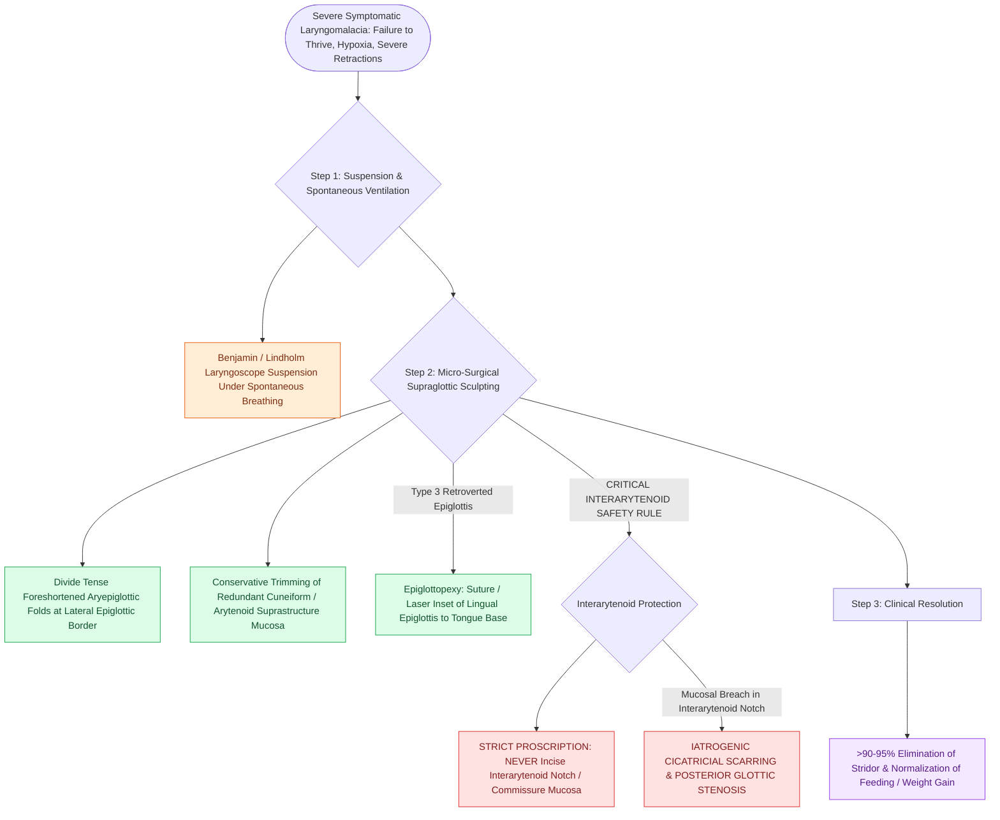

# Endoscopic supraglottoplasty cold-steel and laser division of aryepiglottic folds relieves severe laryngomalacia

## Active Recall

> [!question]- What catastrophic complication occurs if the interarytenoid notch mucosa is inadvertently incised during supraglottoplasty?
> *Answer / Clinical Rationale*: **Interarytenoid cicatricial scarring and posterior glottic stenosis**.

> [!question]- What are the two primary surgical maneuvers performed during a standard supraglottoplasty?
> *Answer / Clinical Rationale*: **Division of the foreshortened aryepiglottic folds** and **excision of redundant cuneiform/arytenoid mucosa**.

> [!question]- What preoperative endoscopic examination must be performed in all infants prior to supraglottoplasty?
> *Answer / Clinical Rationale*: Complete **direct laryngoscopy and rigid tracheobronchoscopy (DLB)** to survey the subglottis, trachea, and mainstem bronchi and rule out synchronous secondary airway lesions (present in **15%–20%** of infants, such as subglottic stenosis, vascular ring, or tracheomalacia).

## Core Clinical & Mechanistic Principles
[[Laryngomalacia is the most common cause of congenital pediatric stridor characterized by dynamic supraglottic collapse|Laryngomalacia]] accounts for $60\%\text{–}75\%$ of infant inspiratory stridor; while $>80\%\text{–}90\%$ of mild cases self-resolve by 18–24 months with conservative antireflux therapy, the **$10\%\text{–}15\%$ with severe disease** (failure to thrive, OSA with $\text{SpO}_2 < 85\%$ or cyanotic apnea, pectus excavatum, cor pulmonale/pulmonary hypertension, or BRUE/aspiration) require **Endoscopic Supraglottoplasty**, achieving a **$>90\text{–}95\%$ success rate**:
- **Surgical Step-by-Step Execution**:
  1. **DLB Survey & Spontaneous Ventilation**: Perform direct laryngoscopy and [[Tracheobronchial foreign body aspiration presents with choking and air trapping requiring rigid bronchoscopy|rigid bronchoscopy]] under spontaneous breathing anesthesia (avoid paralytics) to exclude synchronous secondary airway lesions ($15\%\text{–}20\%$ incidence, e.g., [[The Cotton-Myer classification grades subglottic stenosis by luminal reduction|subglottic stenosis]] or [[Tracheomalacia causes dynamic expiratory tracheal collapse and is managed with posterior tracheobronchopexy|tracheomalacia]]); suspend with a Benjamin, Parsons, or Lindholm pediatric laryngoscope.
  2. **Divide Foreshortened AE Folds**: Using cold micro-scissors (or superpulse $\text{CO}_2$ laser at $2\text{–}4\text{ W}$ / microdebrider), divide the tense aryepiglottic fold on each side at its lateral border near the epiglottis, allowing the epiglottis to spring anteriorly.
  3. **Excise Redundant Cuneiform/Corniculate Mucosa**: Gently grasp redundant mucosal tissue over the cuneiform/corniculate cartilage and excise conservatively.
  4. **The Interarytenoid Protection Rule**: **NEVER cut or laser-abrade across the interarytenoid notch / posterior commissure mucosa**. Denuding opposing posterior surfaces causes dense fibroblastic scar contracture, **posterior glottic stenosis**, and fixed vocal fold immobility.
  5. **Epiglottopexy (If Type 3)**: If the epiglottis collapses posteriorly, abrade the lingual surface of the epiglottis and base of tongue, and suture or laser weld them together.

### Surgical Technique & Critical Safety Checks
- **Complications**: Transient postoperative dysphagia / aspiration (resolves in 3–5 days) and supraglottic edema (managed with single-dose IV dexamethasone).

## Connected Concepts & Graph Traversal
- **Laryngomalacia Triad**: [[Omega-shaped epiglottis, foreshortened aryepiglottic folds, and redundant arytenoid mucosa define laryngomalacia|Laryngomalacia Triad]]
- **Laryngomalacia Overview**: [[Laryngomalacia is the most common cause of congenital pediatric stridor characterized by dynamic supraglottic collapse|Laryngomalacia Overview]]
- **Stridor Localization**: [[Inspiratory, biphasic, and expiratory stridor localize pediatric airway obstruction to supraglottic, subglottic, and tracheobronchial subsites|Stridor Localization]]
- **Synchronous Lesion**: [[The Cotton-Myer classification grades subglottic stenosis by luminal reduction|Cotton-Myer Subglottic Stenosis]]
- **Endoscopic Technique**: [[Rigid bronchoscopy technique for pediatric airway foreign body removal requires systematic distal-to-proximal examination|Pediatric Endoscopy Protocol]]
