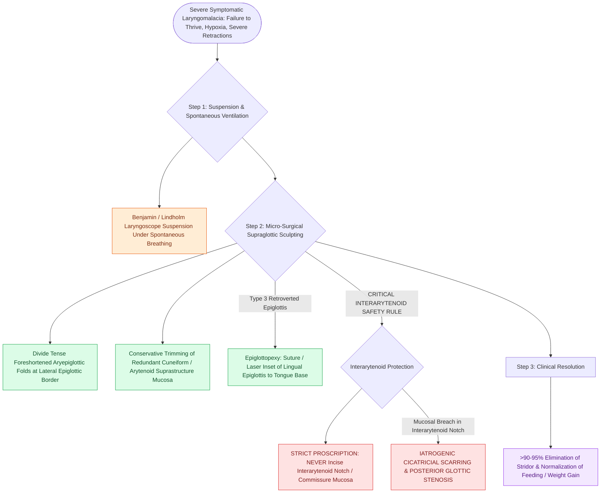

# Endoscopic supraglottoplasty cold-steel and laser division of aryepiglottic folds relieves severe laryngomalacia

## Active Recall

> [!question]- What catastrophic complication occurs if the interarytenoid notch mucosa is inadvertently incised during supraglottoplasty?
> *Answer / Clinical Rationale*: **Interarytenoid cicatricial scarring and posterior glottic stenosis**.

> [!question]- What are the two primary surgical maneuvers performed during a standard supraglottoplasty?
> *Answer / Clinical Rationale*: **Division of the foreshortened aryepiglottic folds** and **excision of redundant cuneiform/arytenoid mucosa**.

## Core Clinical & Mechanistic Principles
**Endoscopic Supraglottoplasty** is the surgical procedure of choice for severe, medically refractory [[Laryngomalacia is the most common cause of congenital pediatric stridor characterized by dynamic supraglottic collapse|laryngomalacia]], achieving a **$>90\text{–}95\%$ success rate**:
- **Surgical Step-by-Step Execution**:
  1. **Anesthesia & Exposure**: Spontaneous breathing anesthesia (avoid paralytics); suspend with a Benjamin or Lindholm pediatric laryngoscope.
  2. **Divide Foreshortened AE Folds**: Using cold micro-scissors (or CO2 laser / microdebrider at low settings), divide the tense aryepiglottic fold on each side at its lateral border near the epiglottis.
  3. **Excise Redundant Cuneiform Mucosa**: Gently grasp redundant mucosal tissue over the cuneiform cartilage and excise with micro-scissors.
  4. **The Interarytenoid Protection Rule**: **NEVER cut across the interarytenoid notch / posterior commissure mucosa**. Transgressing the interarytenoid space causes severe cicatricial scarring, resulting in **iatrogenic interarytenoid stenosis / posterior glottic web** and permanent airway obstruction.
  5. **Epiglottopexy (If Type 3)**: If the epiglottis collapses posteriorly, abrade the lingual surface of the epiglottis and base of tongue, and suture or laser weld them together.

### Surgical Technique & Critical Safety Checks
- **Complications**: Transient postoperative dysphagia / aspiration (resolves in 3–5 days) and supraglottic edema (managed with single-dose IV dexamethasone).

## Connected Concepts & Graph Traversal
- **Laryngomalacia Triad**: [[Omega-shaped epiglottis, foreshortened aryepiglottic folds, and redundant arytenoid mucosa define laryngomalacia|Laryngomalacia Triad]]
- **Laryngomalacia Overview**: [[Laryngomalacia is the most common cause of congenital pediatric stridor characterized by dynamic supraglottic collapse|Laryngomalacia Overview]]
- **Stridor Localization**: [[Inspiratory, biphasic, and expiratory stridor localize pediatric airway obstruction to supraglottic, subglottic, and tracheobronchial subsites|Stridor Localization]]
- **Embryological & Sleep Foundation**: [[High loop gain causes ventilatory instability and periodic breathing in sleep-disordered breathing]]
- **Sleep Endoscopy & Airway Dynamics**: [[Drug-induced sleep endoscopy DISE evaluates dynamic multi-level upper airway collapse under sedation|Drug-Induced Sleep Endoscopy (DISE)]] [[High-risk pediatric criteria mandate overnight inpatient admission following adenotonsillectomy]]
- **Congenital Airway Pathology**: [[Congenital subglottic stenosis results from incomplete recanalization of the laryngeal lumen during embryogenesis]]
- **Open Airway Reconstruction**: [[Suprahyoid and infrahyoid laryngeal release maneuvers reduce anastomotic tension in tracheal surgery]]
