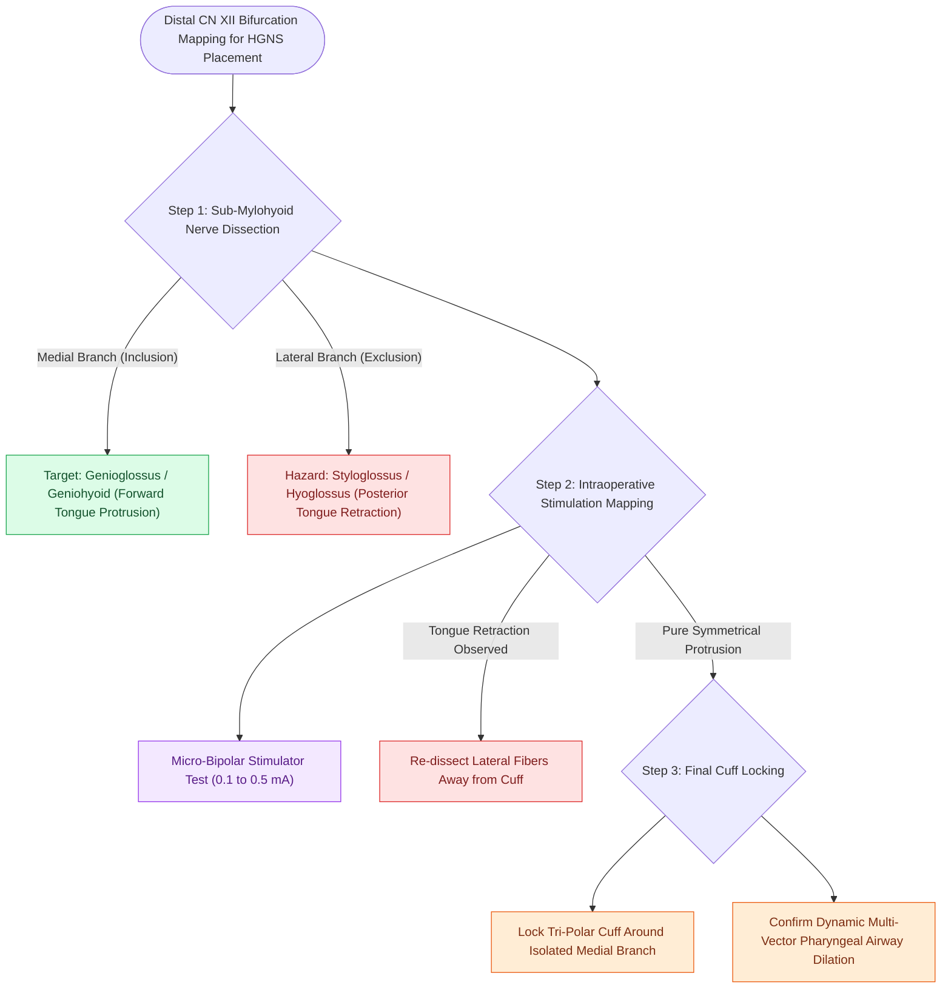

# Excluding the branch to the hyoglossus and styloglossus prevents tongue retraction during hypoglossal nerve stimulation

## Active Recall

> [!question]- What two muscles are the primary tongue retractors that must be excluded from the HGNS stimulation cuff?
> *Answer / Clinical Rationale*: The **hyoglossus muscle** and the **styloglossus muscle**.

> [!question]- What adverse physiological effect occurs if tongue retractor nerve fibers are included in the HGNS cuff?
> *Answer / Clinical Rationale*: Electrical stimulation causes **posterior tongue retraction and worsening of upper airway obstruction** during inspiration.

## Core Clinical & Mechanistic Principles
The success of [[Hypoglossal nerve stimulation HGNS activates the medial branch of CN XII to advance the tongue during inspiration|hypoglossal nerve stimulation]] depends strictly on separating the **tongue protractor muscles** from the **antagonistic tongue retractor muscles**:
- **The Two Functional Muscle Groups**:
  1. **Tongue Protractor (Airway Dilator)**:
     - **Genioglossus Muscle**: Innervated by the **medial branch of CN XII**. Contraction drives the tongue forward and downward, pulling the tongue base out of the retroglossal space.
  2. **Tongue Retractors (Airway Occluders)**:
     - **Hyoglossus Muscle** (pulls tongue inferiorly and posteriorly) and **Styloglossus Muscle** (pulls tongue superiorly and posteriorly).
     - Innervated by the **lateral branch (exclusion branch) of CN XII**.
- **The Biophysical Consequence of Inadvertent Retractor Inclusion**:
  - If the lateral branch fibers to the hyoglossus/styloglossus are accidentally enclosed within the stimulation cuff:
    - Electrical stimulation co-activates both protractor and retractor muscles simultaneously.
    - Because the retractor muscles are biomechanically powerful, the tongue **retracts posteriorly during inspiration**, causing **iatrogenic complete airway occlusion** during stimulation!
  - **Operating Room Rule**: If any tongue retraction or lateral curling is observed during intraoperative testing, the cuff must be opened and the lateral branch dissected further away.

### Surgical Technique & Critical Safety Checks
- **Micro-Bipolar Mapping**: A handheld nerve stimulator ($0.1\text{–}0.5\text{ mA}$) is used to individually test each distal nerve twig prior to cuff closure.

## Connected Concepts & Graph Traversal
- **HGNS Cuff Placement**: [[The stimulation cuff is placed selectively around the medial branch of the hypoglossal nerve to exclude retractor fibers|HGNS Cuff Placement]]
- **HGNS Overview**: [[Hypoglossal nerve stimulation HGNS activates the medial branch of CN XII to advance the tongue during inspiration|HGNS Overview]]
- **HGNS Sensing Lead**: [[The respiratory sensing lead is placed between the internal and external intercostal muscles to detect inspiratory effort|HGNS Sensing Lead]]
- **Embryological & Sleep Foundation**: [[First branchial cleft anomalies present as periauricular cysts or sinus tracts parallel to the external auditory canal]]
- **Sleep Endoscopy & Airway Dynamics**: [[Drug-induced sleep endoscopy DISE evaluates dynamic multi-level upper airway collapse under sedation|Drug-Induced Sleep Endoscopy (DISE)]] [[Nasal steroid sprays and montelukast provide medical therapy for mild pediatric sleep-disordered breathing]]
- **Congenital Airway Pathology**: [[Laryngomalacia is the most common cause of congenital pediatric stridor characterized by dynamic supraglottic collapse]]
- **Open Airway Reconstruction**: [[Posterior costal cartilage grafts with a carved flange split the posterior cricoid lamina to expand the glottic lumen]]
