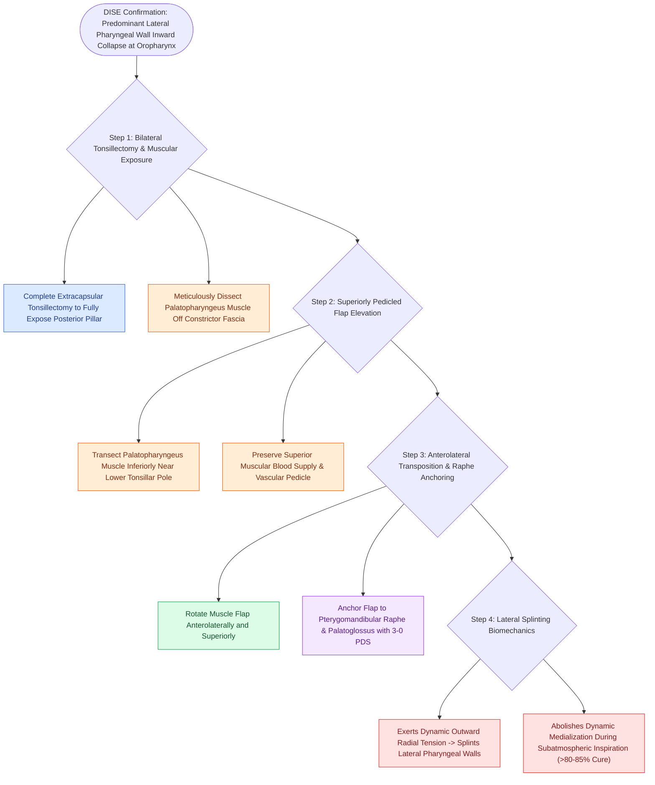

# Expansion sphincter pharyngoplasty ESP rotates the palatopharyngeus muscle to stabilize lateral pharyngeal wall collapse

## Active Recall

> [!question]- What specific anatomical collapse pattern during DISE indicates the need for an Expansion Sphincter Pharyngoplasty (ESP)?
> *Answer / Clinical Rationale*: **Lateral pharyngeal wall collapse** (at the oropharyngeal 'O' level).

> [!question]- Where is the transected palatopharyngeus muscle flap sutured during an ESP?
> *Answer / Clinical Rationale*: **Anterolaterally and superiorly to the pterygomandibular raphe**.

## Core Clinical & Mechanistic Principles
**Expansion [[Sphincter pharyngoplasties transpose bilateral palatopharyngeus flaps to narrow the lateral velopharyngeal port in sagittal insufficiency|Sphincter Pharyngoplasty]] (ESP)** (described by Kenny Pang in 2007) is designed specifically to correct **lateral pharyngeal wall collapse** in obstructive sleep apnea:
- **Pathophysiology of Lateral Pharyngeal Wall Collapse**:
  - In many OSA patients, airway collapse is not anteroposterior but **lateral**, driven by hypotonia and inward collapse of the **palatopharyngeus muscles** and superior pharyngeal constrictors.
  - Standard UPPP fails to address lateral wall collapse.
- **Surgical Step-by-Step Execution**:
  1. Complete bilateral extracapsular **palatine tonsillectomy**.
  2. Identify the **palatopharyngeus muscle** in the posterior tonsillar pillar.
  3. Dissect and isolate the muscle bundle down to the lower tonsillar pole, preserving its superior attachment.
  4. Transect the muscle inferiorly, creating a **superiorly pedicled palatopharyngeus muscular flap**.
  5. **Anterolateral Transposition**: Rotate and suture the muscle flap **anterolaterally and superiorly to the pterygomandibular raphe** and palatoglossus muscle with 3-0 Vicryl/PDS.
  6. Tensions the lateral pharyngeal walls, pulling them outward and preventing inward collapse during negative-pressure inspiration.

### Surgical Technique & Critical Safety Checks
- **Clinical Outcomes**: Achieves a surgical success rate of **$>80\text{–}85\%$** in patients with documented lateral pharyngeal wall collapse on [[Drug-induced sleep endoscopy DISE evaluates dynamic multi-level upper airway collapse under sedation|DISE]], vastly outperforming classic UPPP.

## Connected Concepts & Graph Traversal
- **Modified UPPP**: [[Modified uvulopalatopharyngoplasty UPPP resects redundant palatal tissue while preserving muscular function|Modified UPPP]]
- **Relocating Palatopharyngeus**: [[Relocating the palatopharyngeus anterolaterally splints the lateral pharyngeal walls in expansion pharyngoplasty|Relocating Palatopharyngeus]]
- **Barbed Pharyngoplasty**: [[Barbed suture suspension pharyngoplasty achieves tension-distributed palatopharyngoplasty without mucosal resection|Barbed Pharyngoplasty]]
- **Embryological & Sleep Foundation**: [[Second branchial cleft anomalies represent the most common branchial anomaly situated anterior to the sternocleidomastoid]]
- **Adenotonsillar & Endoscopic DISE**: [[Post-tonsillectomy hemorrhage is classified into primary within twenty-four hours and secondary beyond twenty-four hours]]
- **Congenital Airway Pathology**: [[Laryngomalacia is the most common cause of congenital pediatric stridor characterized by dynamic supraglottic collapse]]
- **Open Airway Reconstruction**: [[Aortopexy suspends the aorta to the sternum to relieve anterior vascular tracheal compression]]
