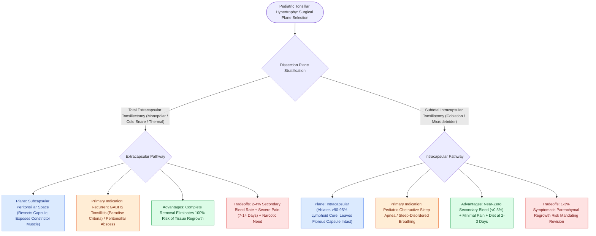

# Extracapsular total tonsillectomy and intracapsular subtotal tonsillotomy differ in postoperative hemorrhage and recovery

## Active Recall

> [!question]- What is the primary anatomical difference between total extracapsular tonsillectomy and intracapsular tonsillotomy?
> *Answer / Clinical Rationale*: Extracapsular removes the **entire tonsil and capsule, exposing pharyngeal constrictor muscle**; intracapsular removes $>90\%$ of lymphoid tissue while **leaving the fibrous capsule intact over the muscle**.

> [!question]- What are the two major clinical advantages of intracapsular tonsillotomy in pediatric OSA?
> *Answer / Clinical Rationale*: Significantly **reduced postoperative pain/recovery time** and a **dramatically lower secondary hemorrhage rate ($<0.5\%$)**.

## Core Clinical & Mechanistic Principles
Surgical debulking/removal of the palatine tonsils in children is performed via two fundamentally distinct surgical planes:
- **Total (Extracapsular) Tonsillectomy**:
  - The tonsil is completely dissected out of the fossa along the **subcapsular peritonsillar plane**, removing the fibrous capsule and exposing the underlying superior pharyngeal constrictor muscle.
  - *Methods*: Monopolar electrocautery, cold knife/snare, harmonic scalpel, thermal welding.
  - *Advantages*: Zero risk of tonsillar tissue regrowth; definitive cure for recurrent tonsillitis.
  - *Disadvantages*: Exposes large branches of the facial/lingual arteries; causes significant muscular thermal injury, resulting in **severe postoperative pain (7–14 days)** and a **$2\text{–}4\%$ secondary [[Post-tonsillectomy hemorrhage is classified into primary within twenty-four hours and secondary beyond twenty-four hours|post-tonsillectomy hemorrhage]] rate**.
- **Intracapsular (Subtotal) Tonsillotomy**:
  - Debulks **$>90\text{–}95\%$ of the tonsillar lymphoid parenchyma** using **Coblation (plasma-mediated radiofrequency)** or microdebrider, leaving a thin protective biological layer of tonsil tissue and the **fibrous capsule intact over the constrictor muscle**.
  - *Advantages*: **Near-zero secondary hemorrhage rate ($<0.5\%$ vs. $3\%$)**, drastically reduced pain, return to normal diet in 2–3 days, minimal opioid requirement.
  - *Disadvantages*: Small risk ($1\text{–}3\%$) of symptomatic **tonsillar regrowth** requiring revision.

### Surgical Technique & Critical Safety Checks
- **Indication Selection**: Intracapsular tonsillotomy is the preferred procedure for children undergoing surgery **primarily for sleep-disordered breathing / OSA**; extracapsular is preferred for **recurrent severe GABHS tonsillitis**.

## Connected Concepts & Graph Traversal
- **Post-Tonsillectomy Bleed**: [[Post-tonsillectomy hemorrhage is classified into primary within twenty-four hours and secondary beyond twenty-four hours|Post-Tonsillectomy Bleed]]
- **Adenotonsillectomy**: [[Adenotonsillectomy is the first-line surgical treatment for pediatric obstructive sleep apnea|Adenotonsillectomy]]
- **Paradise Criteria**: [[Paradise criteria define evidence-based indications for pediatric tonsillectomy in recurrent throat infections|Paradise Criteria]]
- **Embryological & Sleep Foundation**: [[First branchial cleft anomalies present as periauricular cysts or sinus tracts parallel to the external auditory canal]]
- **Sleep Endoscopy & Airway Dynamics**: [[Drug-induced sleep endoscopy DISE evaluates dynamic multi-level upper airway collapse under sedation|Drug-Induced Sleep Endoscopy (DISE)]] [[High-risk pediatric criteria mandate overnight inpatient admission following adenotonsillectomy]]
- **Congenital Airway Pathology**: [[Viral laryngotracheobronchitis croup presents with a barking cough and subglottic steeple sign on radiography]]
- **Open Airway Reconstruction**: [[Slide tracheoplasty expands complete tracheal rings by oblique division and sliding longitudinal reconstruction]]
