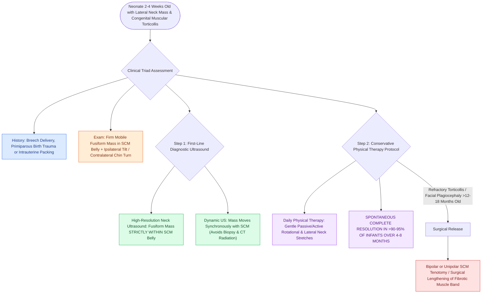

# Fibromatosis coli presents as a benign neonatal sternocleidomastoid mass causing congenital muscular torticollis

## Active Recall

> [!question]- What is the head posture seen in congenital muscular torticollis from fibromatosis coli?
> *Answer / Clinical Rationale*: The infant's head is **tilted toward the ipsilateral side** of the lesion and the **chin is rotated to the contralateral side**.

> [!question]- What is the primary diagnostic imaging modality of choice for fibromatosis coli, and what does it show?
> *Answer / Clinical Rationale*: **High-resolution neck ultrasound**, showing a fusiform mass contained entirely **within the belly of the sternocleidomastoid muscle**.

## Core Clinical & Mechanistic Principles
**Fibromatosis Coli (Pseudotumor of Infancy)** is a benign, self-limiting fibroblastic lesion of the sternocleidomastoid (SCM) muscle, representing the most common cause of **congenital muscular torticollis** in neonates ($0.4\text{–}1.3\%$ of births):
- **Etiology & Pathogenesis**:
  - Associated with **birth trauma, breech presentation, primiparous delivery, or intrauterine malpositioning**.
  - Localized ischemic necrosis and compartment syndrome within the SCM muscle leads to interstitial edema, muscle fiber atrophy, and reactive **fibroblastic and myofibroblastic proliferation** with dense collagen deposition.
- **Clinical Presentation**:
  - A firm, non-tender, mobile, fusiform mass located within the lower two-thirds of the **SCM muscle body**, typically appearing at **$2\text{ to }4\text{ weeks}$ of age**.
  - **Torticollis Head Posture**: The infant tilts the head toward the ipsilateral affected shoulder and rotates the chin toward the contralateral side.
- **Diagnostic Confirmation on Ultrasound**:
  - **High-Resolution Neck Ultrasound**: Demonstrates a characteristic fusiform, mixed hyperechoic/hypoechoic mass contained strictly **within the belly of the SCM muscle**, moving synchronously with the muscle on real-time dynamic imaging.
  - Avoids ionizing radiation and unnecessary surgical biopsy.
- **Conservative Management Protocol ($>90\text{–}95\%$ Resolution)**:
  - Reassurance; **physical therapy with active and passive neck stretching exercises** initiated early.
  - Spontaneously resolves completely over $4\text{ to }8\text{ months}$ without surgical intervention.

### Surgical Technique & Critical Safety Checks
- **Surgical Release**: Reserved for refractory torticollis persisting beyond $12\text{ to }18\text{ months}$ of age with craniofacial asymmetry (plagiocephaly); performed via open bipolar or unipolar SCM tenotomy (see [[Second branchial cleft anomalies represent the most common branchial anomaly situated anterior to the sternocleidomastoid|Second Branchial Cleft Anomalies]]).

## Connected Concepts & Graph Traversal
- **Second Branchial Anomalies**: [[Second branchial cleft anomalies represent the most common branchial anomaly situated anterior to the sternocleidomastoid|Second Branchial Cleft Anomalies]]
- **Thyroglossal Cyst Resection**: [[Sistrunk procedure resects the thyroglossal duct cyst with the central body of the hyoid bone and foramen cecum core|Sistrunk Procedure]]
- **Third & Fourth Branchial Fistulas**: [[Third and fourth branchial pouch anomalies present as recurrent left thyroid bed abscesses and piriform sinus fistulas|Piriform Sinus Fistulas]]
- **Infantile Hemangioma**: [[Oral propranolol is the first-line pharmacotherapy for proliferating infantile hemangiomas|Infantile Hemangiomas]]
- **Thyroglossal Duct Embryology**: [[Thyroglossal duct cyst tract tracks from the foramen cecum through the hyoid bone to the anterior neck|Thyroglossal Duct Tract]]
