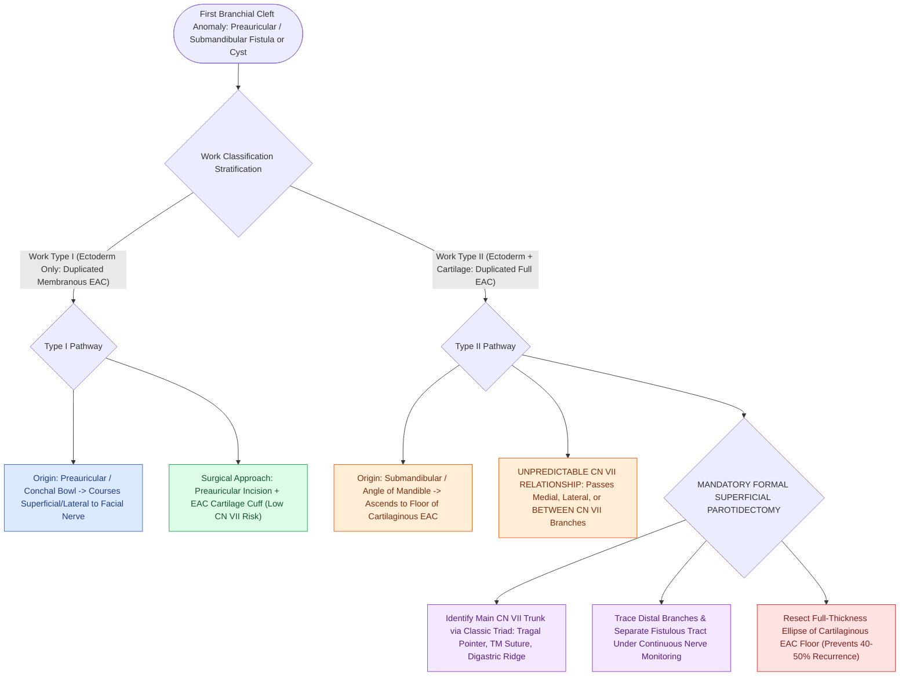

# First branchial cleft Work Type I and Type II anomalies require superficial parotidectomy with facial nerve dissection

## Active Recall

> [!question]- Why is superficial parotidectomy with facial nerve dissection mandatory for Work Type II anomalies but not routine preauricular pits?
> *Answer / Clinical Rationale*: Work Type II tracts traverse the parotid gland with an **unpredictable relationship to CN VII** (passing medial, lateral, or between branches), whereas preauricular pits represent failed fusion of the **hillocks of His** that track strictly to auricular perichondrium without parotid or CN VII involvement.

> [!question]- What anatomical triad defines safe localization of the main facial nerve trunk during parotidectomy for first cleft anomalies?
> *Answer / Clinical Rationale*: The **tragal pointer** (nerve is ~1 cm deep and inferior), the **tympanomastoid suture line** (nerve is within millimeters of its medial end), and the **posterior belly of the digastric muscle** (nerve lies just superior at the same depth).

## Core Clinical & Mechanistic Principles
Surgical excision of **First Branchial Cleft Anomalies (Work Type I and Type II)** requires formal parotidectomy and complete [[The facial nerve main trunk is localized using the tragal pointer, tympanomastoid suture, and digastric ridge|facial nerve identification]] to achieve total eradication without nerve injury:
- **Work Type I vs Type II Discriminating Relationships**:
  - **Work Type I (Ectoderm Only)**:
    - Duplicated membranous EAC presenting as a preauricular or postauricular cyst/sinus; frequently misdiagnosed as recurrent "parotid abscess" in a child.
    - Runs **lateral/superficial to the main trunk and branches of the facial nerve**.
    - Preauricular incision; dissected off the cartilaginous EAC with an attached cuff of EAC cartilage/skin.
  - **Work Type II (Ectoderm + Cartilage / Mesoderm)**:
    - Duplicated membranous and cartilaginous EAC originating near the angle of the mandible and extending superiorly toward the EAC floor.
    - **Relationship to CN VII is unpredictable**: The tract may pass **lateral to, medial to, or weave directly between the bifurcating branches of CN VII**.
    - Mandates formal **superficial parotidectomy with facial nerve trunk identification** using the classic anatomical triad: **tragal pointer** (~1 cm deep/inferior), **tympanomastoid suture line** (most reliable bony landmark), and **posterior belly of the digastric muscle**.
  - **Preauricular Pits (Lineage Distinction)**:
    - Preauricular pits/sinuses arise from failed fusion of the **hillocks of His** (Hillocks 1–3 from Arch 1 forming tragus, helical crus, helix; Hillocks 4–6 from Arch 2 forming antihelix, antitragus, lobule).
    - They sit at the anterior helical root and track toward auricular perichondrium (not the EAC), carrying **no facial nerve risk** — distinguishing them completely from first branchial cleft anomalies.

### Surgical Technique & Critical Safety Checks
- **Complete Internal Terminus Excision**: Always resect a **full-thickness ellipse of cartilaginous EAC skin and cartilage** at the internal terminus to eliminate the epithelial lining.
- **Recurrence Risk**: Incomplete excision or simple incision/drainage carries a $>40\text{–}50\%$ recurrence rate and severe scar entrapment of CN VII during revision surgery.

## Connected Concepts & Graph Traversal
- **First Branchial Cleft**: [[First branchial cleft anomalies present as periauricular cysts or sinus tracts parallel to the external auditory canal|First Branchial Cleft Anomalies]]
- **Facial Nerve Trunk Localization**: [[The facial nerve main trunk is localized using the tragal pointer, tympanomastoid suture, and digastric ridge|Facial Nerve Trunk Landmarks]]
- **Superficial Parotidectomy**: [[Superficial parotidectomy dissects the facial nerve branches to resect the lateral salivary lobe|Superficial Parotidectomy Craft]]
- **Second Branchial Cleft**: [[Second branchial cleft anomalies represent the most common branchial anomaly situated anterior to the sternocleidomastoid|Second Branchial Cleft Anomalies]]
- **Third & Fourth Branchial Pouch**: [[Third and fourth branchial pouch anomalies present as recurrent left thyroid bed abscesses and piriform sinus fistulas|Third & Fourth Pouch Anomalies]]
- **Embryological Foundations**: [[Each branchial arch packages one nerve, one artery, one cartilage bar, and one muscle group|Branchial Apparatus Derivatives]]
