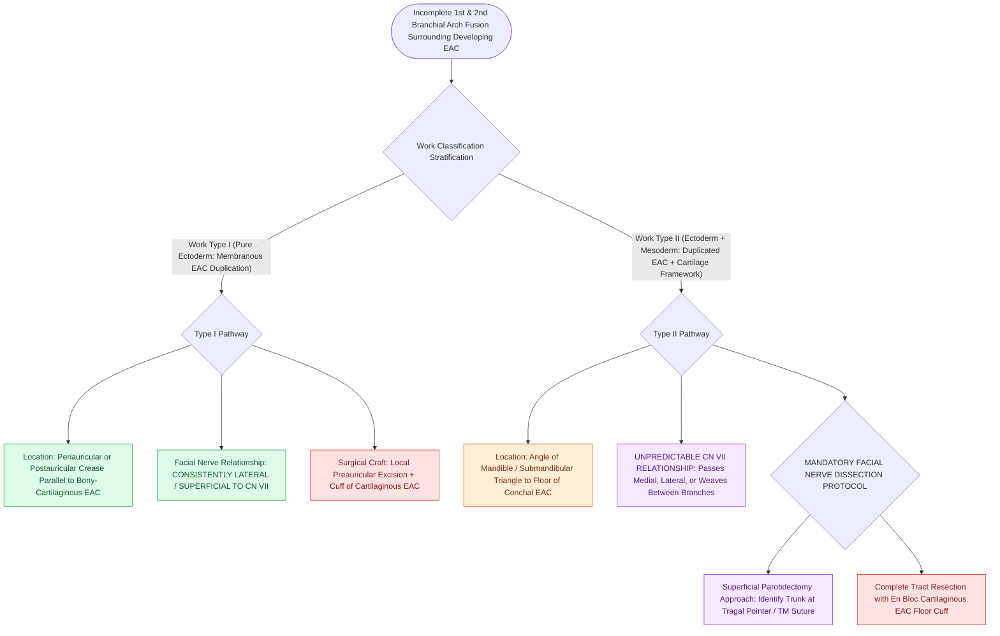

# First branchial cleft anomalies present as periauricular cysts or sinus tracts parallel to the external auditory canal

## Active Recall

> [!question]- How does a Work Type I first branchial cleft anomaly differ in tissue composition from a Work Type II anomaly?
> *Answer / Clinical Rationale*: **Type I is purely ectodermal** (membranous duplication of EAC); **Type II is both ectodermal and mesodermal** (contains skin, adnexa, and cartilage).

> [!question]- Why is formal facial nerve dissection mandatory during surgical excision of a Type II first branchial cleft anomaly?
> *Answer / Clinical Rationale*: Because the tract traverses the parotid gland and has an unpredictable relationship to CN VII, **passing lateral, medial, or directly between the branches of the facial nerve**.

## Core Clinical & Mechanistic Principles
**First branchial cleft anomalies** account for $<5\text{–}8\%$ of all branchial apparatus anomalies, arising from incomplete fusion of the 1st and 2nd branchial arches around the developing external auditory canal (EAC):
- **Work Classification System (1972)**:
  - **Type I (Ectodermal Only - EAC Duplication)**:
    - Purely ectodermal origin; cystic duplication of the membranous EAC.
    - Located periauricularly or in the postauricular crease; runs medial and parallel to the EAC; ends blindly near the bony-cartilaginous junction of the canal.
    - **Lies LATERAL to the facial nerve (CN VII)**.
  - **Type II (Ectodermal + Mesodermal - Duplication of EAC & Pinna)**:
    - Contains both squamous epithelium and adnexal skin structures with cartilaginous elements.
    - Presents as a cyst or draining sinus pit in the **submandibular triangle / angle of the mandible** and extends superiorly toward the floor of the cartilaginous EAC.
    - **Variable relationship to the Facial Nerve**: May run **lateral, medial, or split between the branches of CN VII**.

### Surgical Technique & Critical Safety Checks
- **Surgical Mandate**: Complete surgical excision requires a **superficial parotidectomy incision with formal facial nerve identification and dissection** to avoid permanent facial paralysis (see [[Each branchial arch packages one nerve, one artery, one cartilage bar, and one muscle group|Branchial Apparatus]]).

## Connected Concepts & Graph Traversal
- **Branchial Apparatus**: [[Each branchial arch packages one nerve, one artery, one cartilage bar, and one muscle group|Branchial Apparatus]]
- **Second Branchial Cleft**: [[Second branchial cleft anomalies represent the most common branchial anomaly situated anterior to the sternocleidomastoid|Second Branchial Cleft]]
- **Sistrunk Procedure**: [[Sistrunk procedure resects the thyroglossal duct cyst with the central body of the hyoid bone and foramen cecum core|Sistrunk Procedure]]
- **Embryological & Sleep Foundation**: [[Adult polysomnography criteria define obstructive sleep apnea severity by apnea-hypopnea index thresholds of five, fifteen, and thirty]]
- **Sleep Endoscopy & Airway Dynamics**: [[Drug-induced sleep endoscopy DISE evaluates dynamic multi-level upper airway collapse under sedation|Drug-Induced Sleep Endoscopy (DISE)]] [[Extracapsular total tonsillectomy and intracapsular subtotal tonsillotomy differ in postoperative hemorrhage and recovery]]
- **Congenital Airway Pathology**: [[Congenital bilateral vocal fold paralysis presents with severe inspiratory stridor requiring airway protection]]
- **Open Airway Reconstruction**: [[Single-stage LTR utilizes an endotracheal tube as a temporary stent avoiding tracheostomy placement]]
