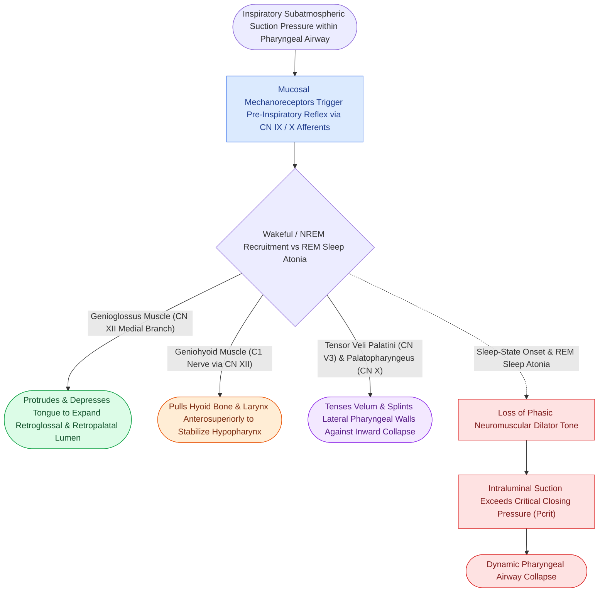

# Geniohyoid and genioglossus muscles are primary upper airway dilators maintaining pharyngeal patency

## Active Recall

> [!question]- Which nerve provides motor innervation to the genioglossus muscle to drive tongue protrusion?
> *Answer / Clinical Rationale*: The **medial branch of the hypoglossal nerve (CN XII)**.

> [!question]- What is the physiological role of the negative pressure reflex in upper airway stability?
> *Answer / Clinical Rationale*: It detects inspiratory subatmospheric pressure and **reflexively activates the genioglossus and pharyngeal dilators** to prevent airway collapse.

## Core Clinical & Mechanistic Principles
Pharyngeal patency during inspiration relies on the active phasic contraction of **upper airway dilator muscles** to counteract subatmospheric negative intraluminal suction:
- **The Primary Upper Airway Dilators**:
  1. **Genioglossus Muscle (CN XII - Medial Branch)**:
     - The largest and most powerful pharyngeal dilator.
     - Originates from the superior mental spine of the mandible; inserts into the tongue body and hyoid.
     - **Contraction protrudes and depresses the tongue anteriorly**, enlarging the retroglossal and retropalatal pharyngeal lumen.
  2. **Geniohyoid Muscle (C1 via CN XII)**:
     - Originates from inferior mental spine; inserts on hyoid body.
     - Pulls hyoid bone and larynx **anteriorly and superiorly**, stabilizing the hypopharyngeal airway.
  3. **Tensor Veli Palatini (CN V3)**:
     - Stiffens and elevates the soft palate, preventing retropalatal collapse.
  4. **Palatopharyngeus & Palatoglossus (CN X)**:
     - Stiffens the lateral pharyngeal walls.
- **Negative Pressure Reflex (Pharyngeal Mechanoreceptor Reflex)**:
  - Subatmospheric pressure during inspiration stimulates mucosal mechanoreceptors in the larynx/pharynx, triggering **reflex phasic activation of the genioglossus preceding diaphragmatic movement**.

### Surgical Technique & Critical Safety Checks
- **Sleep-State Depletion**: In OSA patients, this reflex is blunted during sleep onset and completely abolished during REM sleep, permitting airway collapse (see [[Hypoglossal nerve stimulation HGNS activates the medial branch of CN XII to advance the tongue during inspiration|HGNS Stimulation]]).

## Connected Concepts & Graph Traversal
- **HGNS Stimulation**: [[Hypoglossal nerve stimulation HGNS activates the medial branch of CN XII to advance the tongue during inspiration|HGNS Stimulation]]
- **Sleep Architecture**: [[Non-rapid eye movement and rapid eye movement sleep architecture dictate pharyngeal muscle tone|Sleep Architecture]]
- **MMA Advancement**: [[Maxillomandibular advancement MMA advances the skeletal framework by ten to twelve millimeters to expand the upper airway|MMA Advancement]]
- **Embryological & Sleep Foundation**: [[High loop gain causes ventilatory instability and periodic breathing in sleep-disordered breathing]]
- **Sleep Endoscopy & Airway Dynamics**: [[Drug-induced sleep endoscopy DISE evaluates dynamic multi-level upper airway collapse under sedation|Drug-Induced Sleep Endoscopy (DISE)]] [[Paradise criteria define evidence-based indications for pediatric tonsillectomy in recurrent throat infections]]
- **Congenital Airway Pathology**: [[Congenital subglottic stenosis results from incomplete recanalization of the laryngeal lumen during embryogenesis]]
- **Open Airway Reconstruction**: [[Slide tracheoplasty achieves immediate vascularized mucosal lumen doubling with lowest restenosis rates]]
