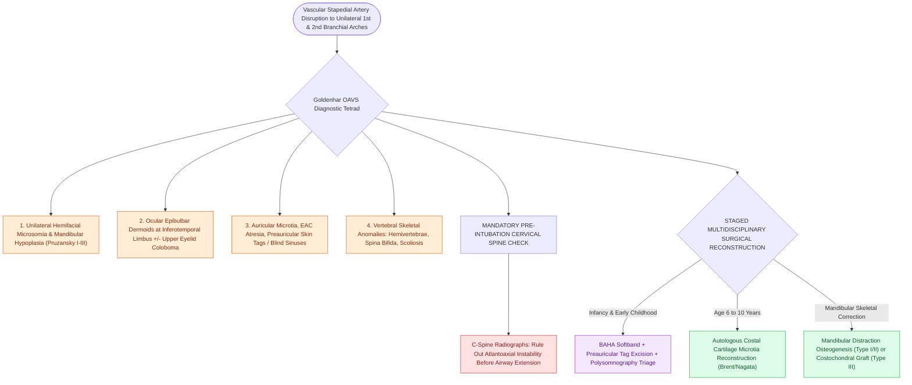

# Goldenhar syndrome exhibits hemifacial microsomia, epibulbar dermoids, preauricular appendages, and vertebral anomalies

## Active Recall

> [!question]- What is the hallmark diagnostic tetrad of Goldenhar syndrome (Oculo-Auriculo-Vertebral Spectrum / OAVS)?
> *Answer / Clinical Rationale*: (1) **Unilateral hemifacial microsomia / mandibular hypoplasia** (asymmetric micrognathia), (2) **Ocular epibulbar dermoids** (benign choristomas located at the inferotemporal limbus) $\pm$ upper eyelid colobomas, (3) **Auricular anomalies** (microtia, external auditory canal atresia, preauricular skin tags/appendages, and blind fistulas along a line from tragus to oral commissure), and (4) **Vertebral skeletal defects** (hemivertebrae, fused vertebrae, scoliosis).

> [!question]- What is the embryological pathogenesis of Goldenhar syndrome, and how is it distinguished from Treacher Collins syndrome?
> *Answer / Clinical Rationale*: Pathogenesis is attributed to **stapedial artery hemorrhage / vascular disruption** during weeks 4–8 of gestation, impairing neural crest cell proliferation to the **unilateral 1st and 2nd branchial arches**. It is distinguished from Treacher Collins by its **asymmetry / unilaterality ($>85\%$ unilateral)**, presence of **epibulbar dermoids and vertebral anomalies**, and normal eyelid cilia (vs bilateral symmetric lower colobomas in Treacher Collins).

> [!question]- What otolaryngologic and systemic evaluations are mandatory at the time of initial diagnosis?
> *Answer / Clinical Rationale*: (1) Complete audiometric evaluation (ABR/OAE) and temporal bone CT to assess asymmetric conductive or mixed hearing loss, (2) **Cervical spine radiographs** to evaluate for atlantoaxial instability / hemivertebrae before any neck extension for intubation, (3) **Echocardiogram** (high incidence of VSD, tetralogy of Fallot, coarctation), and (4) **Renal ultrasound**.

## Core Clinical & Mechanistic Principles
Goldenhar syndrome represents the severe phenotypic presentation of the Oculo-Auriculo-Vertebral Spectrum (OAVS), affecting $1\text{ in }3,500\text{–}5,600$ births, with male predominance ($3:2$):

### Staged Surgical Reconstruction
1. **Airway & Mandible**:
   - For Pruzansky Type I/IIa: Mandibular distraction osteogenesis (MDO) during childhood to level the occlusal cant and expand the airway.
   - For Pruzansky Type III: Costochondral rib graft reconstruction to construct an absent mandibular ramus and temporomandibular joint.
2. **Auricular Reconstruction**:
   - Excision of preauricular skin tags in infancy.
   - Autologous rib cartilage microtia reconstruction (Nagata/Brent technique) or porous polyethylene implant at age $6\text{–}10\text{ years}$.
3. **Auditory Rehabilitation**:
   - Unilateral or bilateral bone-conduction hearing aids (BAHA softband in infancy $\rightarrow$ osseointegrated implant at $\ge 5\text{ years}$).
4. **Facial Nerve Involvement**:
   - Unilateral facial nerve hypoplasia/palsy occurs in $20\text{–}30\%$ of cases, managed with facial reanimation (masseteric nerve transfer or gracilis free muscle transfer) (see [[Each branchial arch packages one nerve, one artery, one cartilage bar, and one muscle group|First and Second Branchial Arch Derivations]]).

## Connected Concepts & Graph Traversal
- **Branchial Arch Embryology**: [[Each branchial arch packages one nerve, one artery, one cartilage bar, and one muscle group|First and Second Branchial Arch Derivations]]
- **Microtia Reconstruction**: [[Microtia reconstruction spans staged autologous costal cartilage frameworks and porous polyethylene implants|Microtia Repair Protocols]]
- **Differential Craniofacial Dysostosis**: [[Treacher Collins syndrome results from TCOF1 mutations causing mandibulofacial dysostosis and conductive hearing loss|Treacher Collins vs Goldenhar Comparison]]
- **Bone Conduction Hearing**: [[Bone-anchored hearing implants BAHA stimulate the cochlea directly via bone conduction pathways|BAHA Implantation in Microtia]]
- **Facial Nerve Reanimation**: [[Facial synkinesis is managed with selective neurolysis, myectomy, and botulinum toxin titration|Facial Nerve Reanimation Principles]]
- **Craniofacial Cleft Classification**: [[Tessier classification organizes craniofacial clefts from zero to fourteen based on orbital and facial anatomical axes radiating from the palpebral fissure|Tessier Craniofacial Cleft Classification]]
