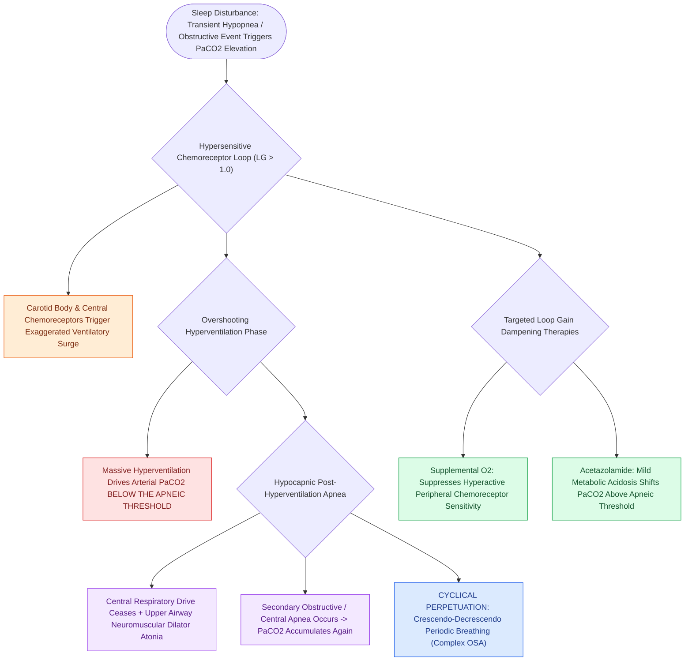

# High loop gain causes ventilatory instability and periodic breathing in sleep-disordered breathing

## Active Recall

> [!question]- What is high loop gain in the context of sleep-disordered breathing?
> *Answer / Clinical Rationale*: An **exaggerated, overshooting ventilatory response** to minor blood gas disturbances, causing $\text{PaCO}_2$ to drop below the apneic threshold and triggering recurrent apneas.

> [!question]- What pharmacological agent stabilizes high loop gain by inducing mild metabolic acidosis?
> *Answer / Clinical Rationale*: **Acetazolamide** (carbonic anhydrase inhibitor).

## Core Clinical & Mechanistic Principles
**Loop Gain (LG)** is an engineering term describing the sensitivity of the negative feedback chemoreceptor loop controlling ventilation:
- **Biophysical Definition**:
  $$\text{Loop Gain} = \frac{\text{Ventilatory Response}}{\text{Disturbance (Apnea / Hypopnea)}}$$
- **Pathophysiology of High Loop Gain ($\text{LG} > 1.0$)**:
  1. An obstructive apnea or hypopnea occurs, causing a modest rise in arterial $\text{PaCO}_2$.
  2. Hypersensitive central and peripheral chemoreceptors mount an **exaggerated, oversized hyperventilatory response**.
  3. The massive hyperventilation rapidly drives $\text{PaCO}_2$ below the **apneic threshold**.
  4. With $\text{PaCO}_2$ below threshold, central respiratory drive ceases, inducing **central apnea or profound upper airway hypotonia**, which initiates another obstructive collapse.
  5. Creates self-sustaining, cyclical **periodic breathing (crescendo-decrescendo pattern)**.
- **Treatment of High Loop Gain**:
  - **Supplemental Oxygen**: Suppresses hyperactive carotid body chemoreceptor sensitivity.
  - **Carbonic Anhydrase Inhibitors (Acetazolamide $250\text{–}500\text{ mg}$)**: Induces mild metabolic acidosis, shifting resting $\text{PaCO}_2$ further above the apneic threshold.

### Surgical Technique & Critical Safety Checks
- **Treatment-Emergent Central Sleep Apnea (Complex Sleep Apnea)**: Seen in patients with high loop gain initiated on CPAP, where relieving obstruction unmasks pure central apneas (see [[Loop gain, arousal threshold, and muscle responsiveness represent the non-anatomical endotypes of obstructive sleep apnea|Non-Anatomical Endotypes]]).

## Connected Concepts & Graph Traversal
- **Non-Anatomical Endotypes**: [[Loop gain, arousal threshold, and muscle responsiveness represent the non-anatomical endotypes of obstructive sleep apnea|Non-Anatomical Endotypes]]
- **Low Arousal Threshold**: [[Low arousal threshold causes premature awakening before airway stabilization in obstructive sleep apnea|Low Arousal Threshold]]
- **Adult OSA Criteria**: [[Adult polysomnography criteria define obstructive sleep apnea severity by apnea-hypopnea index thresholds of five, fifteen, and thirty|Adult OSA Criteria]]
- **Embryological & Sleep Foundation**: [[The Starling resistor model explains upper airway collapsibility and critical closing pressure Pcrit]]
- **Sleep Endoscopy & Airway Dynamics**: [[Drug-induced sleep endoscopy DISE evaluates dynamic multi-level upper airway collapse under sedation|Drug-Induced Sleep Endoscopy (DISE)]] [[Rapid maxillary expansion widens the hard palate and nasal floor to improve pediatric nasal breathing and OSA]]
- **Congenital Airway Pathology**: [[Type I through Type IV laryngeal clefts represent congenital tracheoesophageal communication defects]]
- **Open Airway Reconstruction**: [[Single-stage LTR utilizes an endotracheal tube as a temporary stent avoiding tracheostomy placement]]
