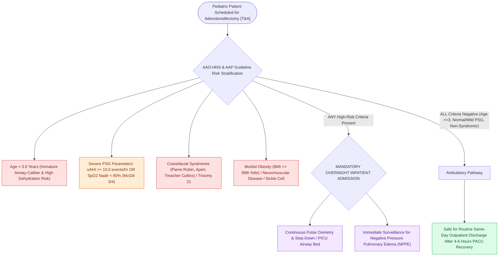

# High-risk pediatric criteria mandate overnight inpatient admission following adenotonsillectomy

## Active Recall

> [!question]- What polysomnographic severity thresholds mandate overnight inpatient admission following pediatric adenotonsillectomy?
> *Answer / Clinical Rationale*: An **$\text{oAHI} \ge 10.0\text{ events per hour}$** or an **oxygen saturation nadir $<80\%$**.

> [!question]- What age threshold automatically mandates overnight inpatient admission post-tonsillectomy regardless of PSG findings?
> *Answer / Clinical Rationale*: **Age $<3\text{ years}$**.

## Core Clinical & Mechanistic Principles
While elective [[Adenotonsillectomy is the first-line surgical treatment for pediatric obstructive sleep apnea|adenotonsillectomy]] is routinely performed as ambulatory outpatient surgery, children with specific medical comorbidities or severe sleep apnea are at high risk for **postoperative respiratory compromise (airway obstruction, desaturation, pulmonary edema)**:
- **AAO-HNS & AAP Clinical Practice Guideline Inpatient Criteria**:
  1. **Age $<3\text{ Years}$**: Higher risk of airway edema, dehydration, and respiratory events.
  2. **Severe Obstructive Sleep Apnea on PSG**:
     - **$\text{oAHI} \ge 10.0\text{ events/hour}$**, OR
     - **Oxygen saturation nadir $<80\%$**, OR
     - **[[Nocturnal pulse oximetry McGill score stratifies pediatric obstructive sleep apnea severity|McGill Oximetry Score]] 3 or 4**.
  3. **Craniofacial Anomalies**: Pierre Robin sequence, Treacher Collins, Apert, Crouzon, cleft palate.
  4. **Down Syndrome (Trisomy 21)**: Generalized hypotonia, macroglossia, midface hypoplasia, and subglottic stenosis.
  5. **Morbid Obesity**: $\text{BMI} \ge 99\text{th percentile}$ or $\text{BMI } z\text{-score} > 2.5$.
  6. **Neuromuscular Disorders**: Cerebral palsy, muscular dystrophy, spinal muscular atrophy.
  7. **Cardiovascular / Pulmonary Complications**: Cor pulmonale, pulmonary hypertension, congenital heart disease.
  8. **Sickle Cell Disease / Coagulopathies**.

### Surgical Technique & Critical Safety Checks
- **Postobstructive Pulmonary Edema (Negative Pressure Pulmonary Edema)**: Occurs immediately after relief of chronic upper airway obstruction due to massive transcapillary hydrostatic fluid shifts; treated with CPAP/PEEP and diuresis.

## Connected Concepts & Graph Traversal
- **Pediatric PSG**: [[Pediatric polysomnography criteria define obstructive sleep apnea with an obstructive apnea-hypopnea index exceeding one|Pediatric PSG]]
- **Adenotonsillectomy**: [[Adenotonsillectomy is the first-line surgical treatment for pediatric obstructive sleep apnea|Adenotonsillectomy]]
- **McGill Oximetry**: [[Nocturnal pulse oximetry McGill score stratifies pediatric obstructive sleep apnea severity|McGill Oximetry]]
- **Embryological & Sleep Foundation**: [[Second branchial cleft anomalies represent the most common branchial anomaly situated anterior to the sternocleidomastoid]]
- **Sleep Endoscopy & Airway Dynamics**: [[Drug-induced sleep endoscopy DISE evaluates dynamic multi-level upper airway collapse under sedation|Drug-Induced Sleep Endoscopy (DISE)]] [[Paradise criteria define evidence-based indications for pediatric tonsillectomy in recurrent throat infections]]
- **Congenital Airway Pathology**: [[Subglottic hemangiomas present as biphasic stridor in infants and respond to systemic oral propranolol]]
- **Open Airway Reconstruction**: [[Preserving the recurrent laryngeal nerves at the cricothyroid articulation is essential during cricotracheal resection]]
