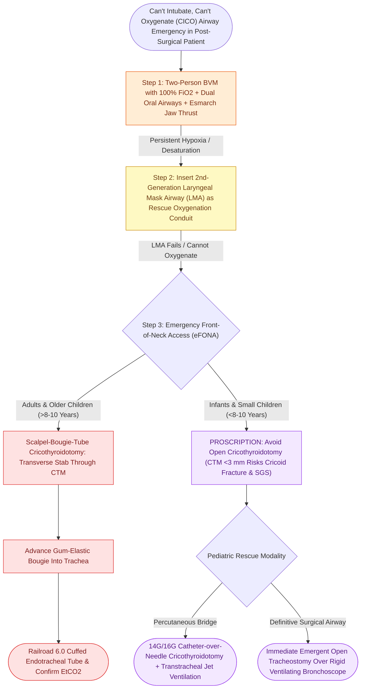

# High-stakes pediatric and adult sleep airway complications require rapid structured algorithmic emergency rescue

## Active Recall

> [!question]- What is the preferred emergency front-of-neck access (eFONA) technique for an adult in a 'Can't Intubate, Can't Oxygenate' crisis?
> *Answer / Clinical Rationale*: The **scalpel-bougie-tube cricothyroidotomy** technique.

> [!question]- Why is surgical cricothyroidotomy avoided in infants and small children under 8–10 years of age during an airway crisis?
> *Answer / Clinical Rationale*: Because the **cricothyroid membrane is too small ($<3\text{ mm}$)** and the **funnel-shaped larynx makes cricoid cartilage fracture and subglottic stenosis almost inevitable**; needle cricothyroidotomy or emergent tracheostomy is preferred.

## Core Clinical & Mechanistic Principles
Acute loss of the airway following pediatric airway reconstruction or adult sleep surgery represents the highest-stakes emergency in Otolaryngology:
- **The "Can't Intubate, Can't Oxygenate" (CICO) Algorithm**:
  1. **Immediate Multi-Handbag Ventilation with 100% O2**: Two-person bag-valve-mask with oral airway and jaw thrust; elevate head of bed.
  2. **Supraglottic Airway (LMA)**: Insert second-generation laryngeal mask airway (LMA) as a temporary oxygenation rescue conduit.
  3. **Video Laryngoscopy / Rigid Bronchoscopy**: Attempt direct visualization with Glidescope or rigid ventilating bronchoscope.
  4. **Emergency Front-of-Neck Access (eFONA)**:
     - **Adults & Older Children**: **Scalpel-Bougie-Tube Cricothyroidotomy** (horizontal stab through cricothyroid membrane $\r\r\rightarrow$ insert bougie $\r\r\rightarrow$ railroad 6.0 cuffed ETT).
     - **Infants & Small Children ($<8\text{–}10\text{ Years}$)**: Cricothyroid membrane is too small ($<3\text{ mm}$) and high; **needle cricothyroidotomy with jet ventilation** or **emergent open tracheostomy** is mandatory.
- **Specific Sleep Surgery Postoperative Crises**:
  - **TORS Tongue Base Hematoma**: Rapid expanding tongue swelling; release transoral sutures $\r\r\rightarrow$ immediate rigid intubation or awake fiberoptic intubation $\r\r\rightarrow$ emergent tracheostomy.
  - **Post-T&A Bleed**: RSI with two working suctions and immediate blood transfusion.

### Surgical Technique & Critical Safety Checks
- **Bedside Safety Mandate**: Every post-airway reconstruction patient must have a tracheostomy tray, tracheal hook, Trousseau dilator, and spare tracheostomy tubes at the bedside (see [[Postoperative airway management in sleep surgery requires continuous pulse oximetry and avoidance of oversedation|Postoperative Airway]]).

## Connected Concepts & Graph Traversal
- **Postoperative Airway**: [[Postoperative airway management in sleep surgery requires continuous pulse oximetry and avoidance of oversedation|Postoperative Airway]]
- **Severe Tonsil Bleed**: [[Severe secondary post-tonsillectomy hemorrhage requires urgent airway stabilization and surgical electrocautery|Severe Tonsil Bleed]]
- **Tracheostomy in OSA**: [[Tracheostomy provides immediate definitive relief for severe life-threatening refractory obstructive sleep apnea|Tracheostomy in OSA]]
- **Embryological & Sleep Foundation**: [[Low arousal threshold causes premature awakening before airway stabilization in obstructive sleep apnea]]
- **Sleep Endoscopy & Airway Dynamics**: [[Drug-induced sleep endoscopy DISE evaluates dynamic multi-level upper airway collapse under sedation|Drug-Induced Sleep Endoscopy (DISE)]] [[High-risk pediatric criteria mandate overnight inpatient admission following adenotonsillectomy]]
- **Congenital Airway Pathology**: [[Congenital subglottic stenosis results from incomplete recanalization of the laryngeal lumen during embryogenesis]]
- **Open Airway Reconstruction**: [[Anterior costal cartilage grafts expand the thyroid and cricoid cartilage framework]]
