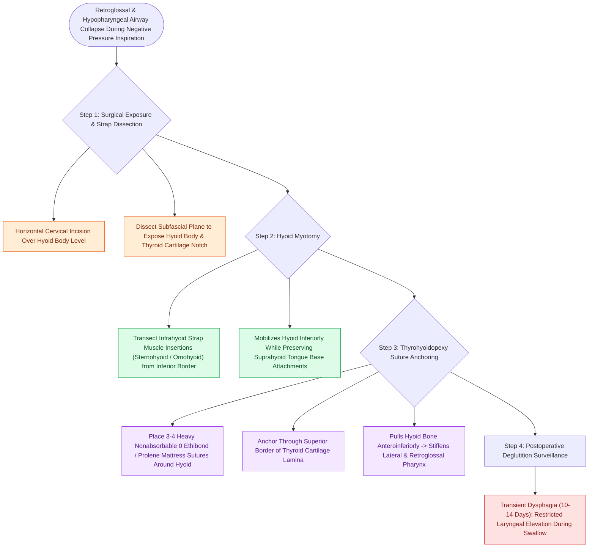

# Hyoid suspension thyrohyoidopexy anchors the hyoid bone to the thyroid cartilage to stabilize the hypopharynx

## Active Recall

> [!question]- What anatomical structures are tensioned and stabilized by a hyoid suspension?
> *Answer / Clinical Rationale*: The **tongue base (via hyoglossus/genioglossus)** and the **lateral hypopharyngeal walls (via middle constrictors)**.

> [!question]- What is the most common temporary postoperative side effect following hyoid suspension?
> *Answer / Clinical Rationale*: **Transient dysphagia (swallowing difficulty)**, lasting 1 to 2 weeks due to temporary restriction of swallowing-induced laryngeal elevation.

## Core Clinical & Mechanistic Principles
**Hyoid Suspension (Thyrohyoidopexy / Hyoid Myotomy and Suspension)** is designed to expand and stabilize the **hypopharyngeal and retroglossal airway** by repositioning the hyoid bone:
- **Biomechanical Mechanism**:
  - The hyoid bone is the anatomical anchor for the base of the tongue (genioglossus/hyoglossus), the pharynx (middle pharyngeal constrictor), and the larynx (thyrohyoid membrane/muscles).
  - In retroglossal OSA, the hyoid sits low and posterior.
  - **Thyrohyoidopexy**: Pulls the hyoid bone **inferiorly and anteriorly**, anchoring it directly to the superior border of the **thyroid cartilage lamina**.
  - Tensions the lateral and anterior hypopharyngeal walls, preventing retroglossal and lateral hypopharyngeal collapse during negative inspiratory pressure.
- **Surgical Step-by-Step Execution**:
  1. Horizontal cervical incision at the level of the hyoid bone.
  2. Dissect strap muscles to expose the hyoid body and superior border of the thyroid cartilage.
  3. Perform a **hyoid myotomy** (transect the infrahyoid strap muscles inserting on the inferior border of the hyoid).
  4. Place **3 to 4 heavy non-absorbable (0 or 2-0 Ethibond / Prolene) mattress sutures** around the hyoid bone body and pass them through the upper border of the thyroid cartilage lamina.
  5. Tie sutures securely, drawing the hyoid bone flush with the superior thyroid notch.

### Surgical Technique & Critical Safety Checks
- **Complications**: Transient dysphagia ($10\text{–}14$ days, due to restriction of laryngeal elevation during deglutition) and seroma/hematoma (see [[Transoral robotic surgery TORS tongue base reduction debulks lingual tonsil and midline tongue musculature in OSA|TORS Tongue Base]]).

## Connected Concepts & Graph Traversal
- **TORS Tongue Base**: [[Transoral robotic surgery TORS tongue base reduction debulks lingual tonsil and midline tongue musculature in OSA|TORS Tongue Base]]
- **Epiglottopexy**: [[Partial epiglottectomy and epiglottopexy correct dynamic epiglottic retroversion during inspiration|Epiglottopexy]]
- **HGNS Stimulation**: [[Hypoglossal nerve stimulation HGNS activates the medial branch of CN XII to advance the tongue during inspiration|HGNS Stimulation]]
- **Embryological & Sleep Foundation**: [[Third and fourth branchial pouch anomalies present as recurrent left thyroid bed abscesses and piriform sinus fistulas]]
- **Sleep Endoscopy & Airway Dynamics**: [[Drug-induced sleep endoscopy DISE evaluates dynamic multi-level upper airway collapse under sedation|Drug-Induced Sleep Endoscopy (DISE)]] [[Post-tonsillectomy hemorrhage is classified into primary within twenty-four hours and secondary beyond twenty-four hours]]
- **Congenital Airway Pathology**: [[Endoscopic balloon dilation with steroid injection manages early, soft, non-circumferential subglottic stenosis]]
- **Open Airway Reconstruction**: [[Preserving the recurrent laryngeal nerves at the cricothyroid articulation is essential during cricotracheal resection]]
