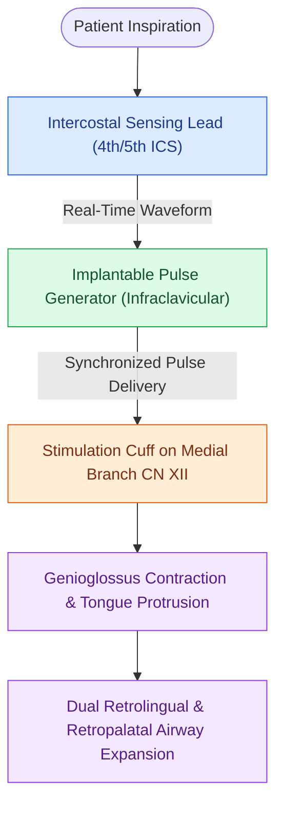

# Hypoglossal nerve stimulation HGNS activates the medial branch of CN XII to advance the tongue during inspiration

## Active Recall

> [!question]- What are the three implanted components of the Inspire hypoglossal nerve stimulation system?
> *Answer / Clinical Rationale*: The **respiratory sensing lead (intercostal)**, the **implantable pulse generator (IPG)**, and the **stimulation cuff lead (on CN XII)**.

> [!question]- How does selective hypoglossal nerve stimulation achieve dual-level (palatal and tongue base) airway opening?
> *Answer / Clinical Rationale*: Tongue protrusion directly opens the **retroglossal airway** and mechanically tensions the **palatoglossus muscle to pull the soft palate forward**.

## Core Clinical & Mechanistic Principles
**Hypoglossal Nerve Stimulation (HGNS / Inspire UAS)** (approved by FDA following the STAR Trial in 2014) is an implantable neuromodulation system that restores [[Geniohyoid and genioglossus muscles are primary upper airway dilators maintaining pharyngeal patency|pharyngeal patency]] during sleep by electrically driving tongue protrusion in synchrony with respiration:

- **The Three Implanted System Components**:
  1. **Respiratory Sensing Lead**: Placed between the internal and external intercostal muscles in the 4th/5th right intercostal space; detects chest wall expansion and provides real-time inspiratory timing signals.
  2. **Implantable Pulse Generator (IPG)**: Subcutaneous generator placed in a right infraclavicular pocket; processes respiratory waveforms and delivers synchronized electrical pulses.
  3. **Stimulation Lead (Cuff Electrode)**: Tri-polar silicone cuff placed selectively around the [[The stimulation cuff is placed selectively around the medial branch of the hypoglossal nerve to exclude retractor fibers|medial (inclusion) branch of the right hypoglossal nerve (CN XII)]] in the submandibular neck.
- **Biomechanical Mechanism of Airway Expansion**:
  - Electrical stimulation activates the **genioglossus muscle**, driving tongue protrusion and anterior displacement.
  - Creates a **two-level opening effect**: Directly expands the **retroglossal airway** and mechanically tensions the palatoglossus muscle to draw the soft palate anteriorly, opening the **retropalatal airway** simultaneously (contraindicated if [[Concentric velopharyngeal collapse on DISE is a contraindication to hypoglossal nerve stimulation|complete concentric collapse]] is present).

### Surgical Technique & Critical Safety Checks
- **STAR Trial Long-Term Results**: Demonstrates a **$>70\text{–}80\%$ reduction in median AHI** (from 29 to $<9\text{ events/hr}$) maintained at 5-year follow-up, with dramatic improvements in quality of life.

## Connected Concepts & Graph Traversal
- **Implantation Inclusion Criteria**: [[Inclusion criteria for hypoglossal nerve stimulation include BMI less than thirty-five and absence of complete concentric collapse|HGNS Candidacy Criteria]]
- **Surgical Cuff Placement**: [[The stimulation cuff is placed selectively around the medial branch of the hypoglossal nerve to exclude retractor fibers|Selective Medial Branch Cuffing]]
- **Retractor Exclusion**: [[Excluding the branch to the hyoglossus and styloglossus prevents tongue retraction during hypoglossal nerve stimulation|Excluding Hyoglossus & Styloglossus]]
- **Surgical Contraindication**: [[Concentric velopharyngeal collapse on DISE is a contraindication to hypoglossal nerve stimulation|Complete Concentric Velopharyngeal Collapse]]
- **Endoscopic Screening**: [[Drug-induced sleep endoscopy DISE evaluates dynamic multi-level upper airway collapse under sedation|Drug-Induced Sleep Endoscopy]]
