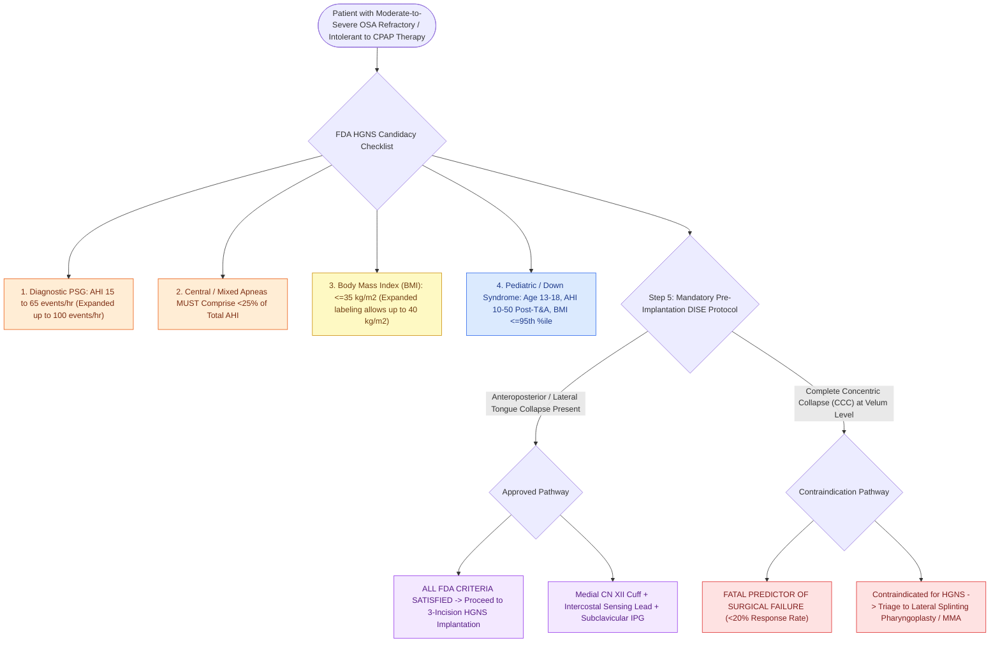

# Inclusion criteria for hypoglossal nerve stimulation include BMI less than thirty-five and absence of complete concentric collapse

## Active Recall

> [!question]- What is the standard BMI cutoff threshold for hypoglossal nerve stimulation?
> *Answer / Clinical Rationale*: A **$\text{BMI} \le 35\text{ kg/m}^2$** (with expanded criteria allowing up to $40\text{ kg/m}^2$).

> [!question]- What is the maximum percentage of central/mixed apneas permitted for HGNS candidacy?
> *Answer / Clinical Rationale*: Central and mixed apneas must comprise **$<25\%$ of the total AHI**.

## Core Clinical & Mechanistic Principles
The FDA-approved and clinical practice guidelines define precise patient selection criteria for [[Hypoglossal nerve stimulation HGNS activates the medial branch of CN XII to advance the tongue during inspiration|Hypoglossal Nerve Stimulation]] (HGNS):
- **Core Adult Candidacy Criteria**:
  1. **Moderate-to-Severe OSA on Diagnostic PSG**:
     - **Apnea-Hypopnea Index (AHI) between $15\text{ and }65\text{ events/hour}$** (expanded in 2023 up to $\text{AHI } 100$ in select guidelines).
  2. **Central / Mixed Apnea Component $<25\%$**:
     - Central apneas must account for $<25\%$ of the total AHI (HGNS cannot treat central respiratory drive failure).
  3. **Body Mass Index (BMI) Threshold**:
     - **$\text{BMI} \le 35\text{ kg/m}^2$** (or $\le 40\text{ kg/m}^2$ in expanded 2023 labeling). Higher BMI correlates with severe [[Expansion sphincter pharyngoplasty ESP rotates the palatopharyngeus muscle to stabilize lateral pharyngeal wall collapse|lateral pharyngeal wall collapse]] that overcomes tongue protrusion.
  4. **CPAP Failure or Intolerance**: Documented inability to tolerate CPAP ($>4$ hours/night on $\ge 70\%$ of nights).
  5. **Absence of Complete Concentric Collapse (CCC)**:
     - Mandatory pre-implantation **[[Drug-induced sleep endoscopy DISE evaluates dynamic multi-level upper airway collapse under sedation|Drug-Induced Sleep Endoscopy]] (DISE)** confirming the absence of complete concentric collapse at the soft palate / velum.
- **Pediatric Indications (Down Syndrome Cohort)**:
  - FDA-approved for adolescents with **Down syndrome (ages 13–18)** with persistent severe OSA ($\text{AHI } 10\text{–}50$) post-[[Adenotonsillectomy is the first-line surgical treatment for pediatric obstructive sleep apnea|adenotonsillectomy]] and $\text{BMI} \le 95\text{th percentile}$.

### Surgical Technique & Critical Safety Checks
- **Contraindications**: Implantable pacemakers/defibrillators (unless MRI/sensing compatible), active pregnancy, neuromuscular disease, and anatomical retrognathia requiring skeletal reconstruction.

## Connected Concepts & Graph Traversal
- **HGNS Overview**: [[Hypoglossal nerve stimulation HGNS activates the medial branch of CN XII to advance the tongue during inspiration|HGNS Overview]]
- **Concentric Collapse**: [[Concentric velopharyngeal collapse on DISE is a contraindication to hypoglossal nerve stimulation|Concentric Collapse]]
- **HGNS Cuff Placement**: [[The stimulation cuff is placed selectively around the medial branch of the hypoglossal nerve to exclude retractor fibers|HGNS Cuff Placement]]
- **Embryological & Sleep Foundation**: [[Adult polysomnography criteria define obstructive sleep apnea severity by apnea-hypopnea index thresholds of five, fifteen, and thirty]]
- **Adenotonsillar & Endoscopic DISE**: [[Nasal steroid sprays and montelukast provide medical therapy for mild pediatric sleep-disordered breathing]]
- **Congenital Airway Pathology**: [[Type I through Type IV laryngeal clefts represent congenital tracheoesophageal communication defects]]
- **Open Airway Reconstruction**: [[Anterior costal cartilage grafts expand the thyroid and cricoid cartilage framework]]
