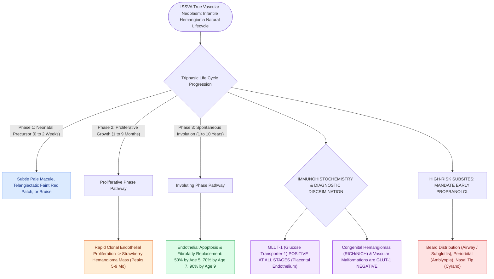

# Infantile hemangiomas exhibit rapid neonatal proliferation followed by slow involution driven by GLUT-1 positivity

## Active Recall

> [!question]- What immunohistochemical marker definitively differentiates infantile hemangiomas from vascular malformations?
> *Answer / Clinical Rationale*: **Glucose Transporter-1 (GLUT-1)** (intensely positive in infantile hemangiomas, negative in vascular malformations).

> [!question]- What percentage of infantile hemangiomas spontaneously involute by 5 years and 9 years of age?
> *Answer / Clinical Rationale*: Approximately **$50\%$ by age 5** and **$90\%$ by age 9**.

## Core Clinical & Mechanistic Principles
**Infantile Hemangiomas (IH)** are the most common benign vascular tumors of infancy ($4\text{–}10\%$ of Caucasian infants), classified as true vascular neoplasms in the **ISSVA / Mulliken classification**:
- **Triphasic Natural Life Cycle**:
  1. **Early Neonatal Phase (0–2 Weeks)**: Absent or present as a subtle precursor lesion (pale macule, telangiectatic patch, or bruise).
  2. **Proliferative Phase (1–9 Months)**: Rapid clonal endothelial cell proliferation, forming a bright red, raised "strawberry" [[Distraction osteogenesis maxillary expansion DOME expands the palatal vault in adults with narrow maxillae and OSA|dome]] or firm subcutaneous mass; peaks at **$5\text{ to }9\text{ months}$**.
  3. **Involuting Phase (1–10 Years)**: Spontaneous slow regression; endothelial apoptosis and replacement by fibrofatty tissue. ($50\%$ resolved by age 5, $70\%$ by age 7, $90\%$ by age 9).
- **The Pathognomonic Histochemical Marker: GLUT-1**:
  - **Glucose Transporter-1 (GLUT-1)** is intensely positive on immunohistochemistry at **all stages of infantile hemangiomas** (derived from placental-like microvascular endothelium).
  - *Distinction*: Congenital hemangiomas (RICH, NICH) and vascular malformations are **strictly GLUT-1 NEGATIVE**.

### Surgical Technique & Critical Safety Checks
- **High-Risk Locations**: "Beard distribution" (airway hemangioma risk), periorbital (amblyopia/astigmatism), nasal tip (Cyrano deformity), lip, and lumbosacral region (LUMBAR syndrome).

## Connected Concepts & Graph Traversal
- **Propranolol Therapy**: [[Oral propranolol is the first-line pharmacotherapy for proliferating infantile hemangiomas|Propranolol Therapy]]
- **Subglottic Hemangioma**: [[Subglottic hemangiomas present as biphasic stridor in infants and respond to systemic oral propranolol|Subglottic Hemangioma]]
- **Lymphatic Malformations**: [[Lymphatic malformations are slow-flow vascular anomalies classified into macrocystic and microcystic lesions|Lymphatic Malformations]]
- **Embryological & Sleep Foundation**: [[Thyroglossal duct cyst tract tracks from the foramen cecum through the hyoid bone to the anterior neck]]
- **Sleep Endoscopy & Airway Dynamics**: [[Drug-induced sleep endoscopy DISE evaluates dynamic multi-level upper airway collapse under sedation|Drug-Induced Sleep Endoscopy (DISE)]] [[Adenotonsillectomy is the first-line surgical treatment for pediatric obstructive sleep apnea]]
- **Congenital Airway Pathology**: [[Recurrent respiratory papillomatosis RRP is driven by HPV six and eleven causing recurrent laryngeal lesions]]
- **Open Airway Reconstruction**: [[Single-stage and double-stage laryngotracheal reconstruction LTR repair mature high-grade subglottic stenosis]]
