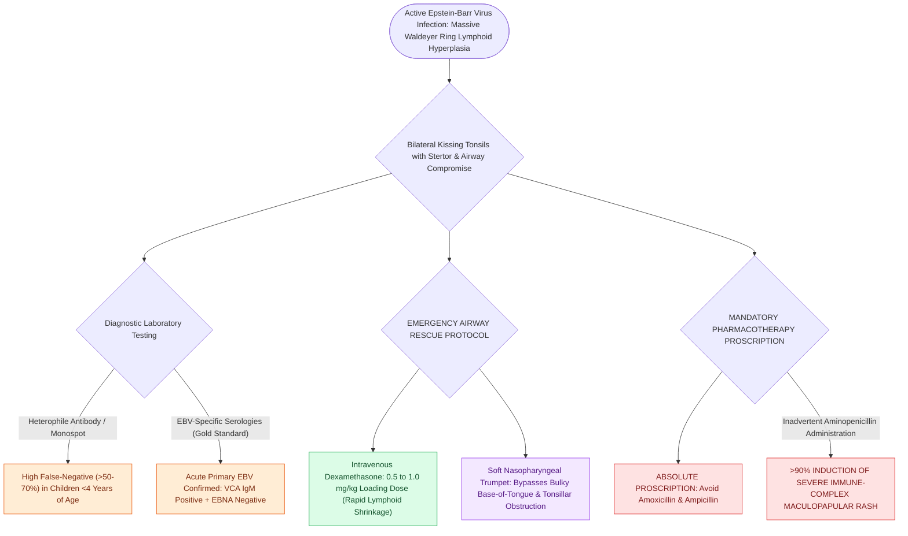

# Infectious mononucleosis with severe tonsillar hypertrophy requires systemic corticosteroids and avoidance of amoxicillin to prevent rash

## Active Recall

> [!question]- Why does administering amoxicillin to a patient with acute infectious mononucleosis cause a diffuse maculopapular rash in over 90% of cases?
> *Answer / Clinical Rationale*: EBV drives intense polyclonal B-cell activation and T-cell hyper-responsiveness. Aminopenicillins act as haptens, forming drug-antibody immune complexes with transient circulating IgM/IgG antibodies that deposit in dermal post-capillary venules, producing a non-allergic, immune complex-mediated cutaneous rash.

> [!question]- Why is a negative Monospot test unreliable in a 2-year-old child with suspected acute EBV tonsillitis?
> *Answer / Clinical Rationale*: Children under 4 years of age have an immature immune response that fails to produce heterophile antibodies in response to EBV infection, resulting in a false-negative Monospot rate exceeding 50% to 70%. Specific EBV serologies (VCA IgM and VCA IgG) are required for definitive diagnosis.

## Core Clinical & Mechanistic Principles
Infectious mononucleosis, caused primarily by **Epstein-Barr virus (EBV)** infection of B lymphocytes and secondary vigorous reactive CD8+ T-cell proliferation (atypical lymphocytes), produces marked lymphoid hyperplasia throughout Waldeyer's ring. In adolescents and young children, intense bilateral enlargement of the palatine and pharyngeal (adenoid) tonsils creates "kissing tonsils," causing severe odynophagia, [[Pediatric stertor and stridor differentiate upper supraglottic airway obstruction from intrathoracic tracheobronchial disease|stertor]], and impending upper airway obstruction.

Administration of aminopenicillins (such as ampicillin or amoxicillin) to patients with active EBV infection triggers a characteristic **maculopapular, pruritic copper-colored cutaneous eruption in $>90\%$ of patients** due to virus-induced immune complex hypersensitivity (distinct from true IgE-mediated penicillin allergy). When massive tonsillar swelling compromises the airway or causes dehydration, targeted systemic corticosteroids provide rapid lymphoid shrinkage.

### Diagnostic Workup & Clinical Protocol
1. **Diagnostic Modalities**:
   - **Heterophile Antibody Test (Monospot)**: Rapid agglutination assay; highly specific but carries a false-negative rate of up to $25\%$ during the first week of illness and $>50\%$ in children younger than 4 years.
   - **EBV-Specific Serologies (Gold Standard for Early/Pediatric Cases)**:
     - *Viral Capsid Antigen (VCA) IgM*: Indicates acute, primary infection (persists 2–3 months).
     - *VCA IgG*: Appears early and persists for life.
     - *EBV Nuclear Antigen (EBNA)*: Appears late ($>6\text{ to }8\text{ weeks}$); absence of EBNA with positive VCA IgM confirms acute primary EBV.
   - **Complete Blood Count (CBC)**: Demonstrates absolute lymphocytosis ($>50\%$) with $>10\%$ atypical reactive lymphocytes on peripheral blood smear.
2. **Airway Management & Steroid Regimen**:
   - **Intravenous Dexamethasone ($0.5\text{ to }1.0\text{ mg/kg}$ IV load, followed by $0.25\text{ mg/kg}$ q8h)**: Rapidly reduces lymphoid edema within 12 to 24 hours, aborting the need for emergent tracheostomy or intubation.
   - Placement of a soft, lubricated **nasopharyngeal airway (trumpet)**: Bypasses bulky tonsillar and base-of-tongue obstruction in patients with positional sleep apnea.
## References
1. Christian, J.M., Felts, C.B., Beckman, N.A., et al. (2020). Deep Neck and Odontogenic Infections. In Flint, P.W., et al. (Eds.), *Cummings Otolaryngology Head and Neck Surgery* 7e (pp. 141-154). Philadelphia, PA: Elsevier.
2. Jeyakumar, A., Miller, S., Mitchell, R.B. (2013). Adenotonsillar Disease in Children. In Johnson, J.J., Rosen, C.A. (Eds.), *Bailey’s Head and Neck Surgery-Otolaryngology* 5e (pp. 1430-1444). Baltimore, MD: Lippincott Williams & Wilkins.
3. Mitchell, R.B., Archer, S.M., Ishman, S.L., et al. (2019). Clinical Practice Guideline: Tonsillectomy in Children (Update). *Otolaryngol Head Neck Surg*, 160(1_suppl):S1-S42.

## Connected Concepts & Graph Traversal
- **Physiological Basis**: [[Pediatric acute bacterial tonsillitis is differentiated from viral pharyngitis using modified Centor criteria|Pediatric Centor Criteria]]
- **Differential Pathology**: [[Peritonsillar abscess needle aspiration and incision and drainage require superior pole local anesthetic and landmark-guided needle guard protection|Peritonsillar Abscess]]
- **Airway Stridor**: [[Pediatric stertor and stridor differentiate upper supraglottic airway obstruction from intrathoracic tracheobronchial disease|Pediatric Stertor & Stridor]]
- **Acute Surgical Rescue**: [[Quinsy tonsillectomy provides immediate abscess drainage and definitive tonsillar extirpation for refractory peritonsillar infection|Quinsy Tonsillectomy]]
- **Deep Space Spread**: [[The parapharyngeal space is an inverted pyramid connecting peritonsillar, masticator, parotid, and retropharyngeal spaces|Parapharyngeal Space]]
- **Differential Diagnosis**: [[Pediatric head and neck lymphomas present as painless cervical lymphadenopathy staged by Ann Arbor and St Jude systems|EBV-Associated Lymphoma vs Mononucleosis]]
