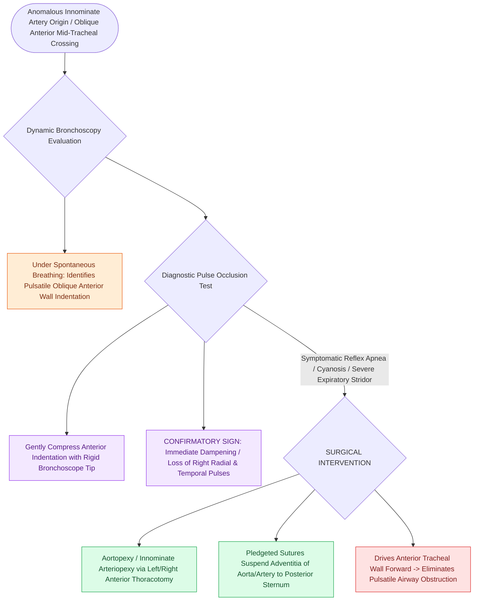

# Innominate artery compression syndrome causes dynamic anterior tracheal pulsatile collapse

## Active Recall

> [!question]- What physical finding during bronchoscopy confirms that an anterior tracheal compression is caused by the innominate artery?
> *Answer / Clinical Rationale*: Gentle pressure with the bronchoscope against the anterior compression **temporarily dampens or obliterates the right radial pulse**.

> [!question]- What surgical procedure is the definitive treatment for severe innominate artery compression syndrome?
> *Answer / Clinical Rationale*: **Aortopexy (or innominate arteriopexy)**, suspending the vessels anteriorly to the sternum.

## Core Clinical & Mechanistic Principles
**Innominate Artery Compression Syndrome (Brachiocephalic Artery Compression)** occurs when an anomalously originating or coursing innominate artery compresses the anterior wall of the trachea:
- **Anatomical Relationships**:
  - The innominate (brachiocephalic) artery originates further to the left on the aortic arch than normal and crosses **obliquely from left to right directly across the anterior surface of the mid-trachea**.
  - As the heart pulsates and intrathoracic pressure fluctuates, the rigid artery indents and compresses the compliant anterior tracheal cartilage.
- **Diagnostic Confirmation via Dynamic Bronchoscopy**:
  - Under spontaneous ventilation, rigid or flexible bronchoscopy reveals a **pulsatile, oblique, anterior-to-posterior indentation of the anterior tracheal wall** typically $1.0\text{–}2.0\text{ cm}$ above the carina.
  - **The "Temporal / Radial Pulse Occlusion Test"**: Applying gentle forward pressure with the tip of the bronchoscope against the pulsating anterior indentation temporarily **diminishes or obliterates the right radial and right temporal pulses**, confirming the artery's identity.
- **Clinical Presentation**:
  - [[Inspiratory, biphasic, and expiratory stridor localize pediatric airway obstruction to supraglottic, subglottic, and tracheobronchial subsites|Expiratory stridor]], brassy cough, recurrent respiratory infections, and severe apnea/cyanosis during feeding.

### Surgical Technique & Critical Safety Checks
- **Surgical Solution**: **Aortopexy / Arteriopexy**, which suspends the aorta and innominate artery anteriorly to the posterior periosteum of the sternum.

## Connected Concepts & Graph Traversal
- **Aortopexy**: [[Aortopexy suspends the aorta to the sternum to relieve anterior vascular tracheal compression|Aortopexy]]
- **Tracheomalacia**: [[Tracheomalacia causes dynamic expiratory tracheal collapse and is managed with posterior tracheobronchopexy|Tracheomalacia]]
- **Complete Tracheal Rings**: [[Complete tracheal rings present with generalized tracheal stenosis and stovepipe appearance on imaging|Complete Tracheal Rings]]
- **Embryological & Sleep Foundation**: [[Non-rapid eye movement and rapid eye movement sleep architecture dictate pharyngeal muscle tone]]
- **Adenotonsillar & Endoscopic DISE**: [[Drug-induced sleep endoscopy DISE evaluates dynamic multi-level upper airway collapse under sedation]]
- **Congenital Airway Pathology**: [[Congenital subglottic stenosis results from incomplete recanalization of the laryngeal lumen during embryogenesis]]
- **Open Airway Reconstruction**: [[Cricotracheal resection CTR achieves primary end-to-end anastomosis for severe Grade III and IV subglottic stenosis]]
