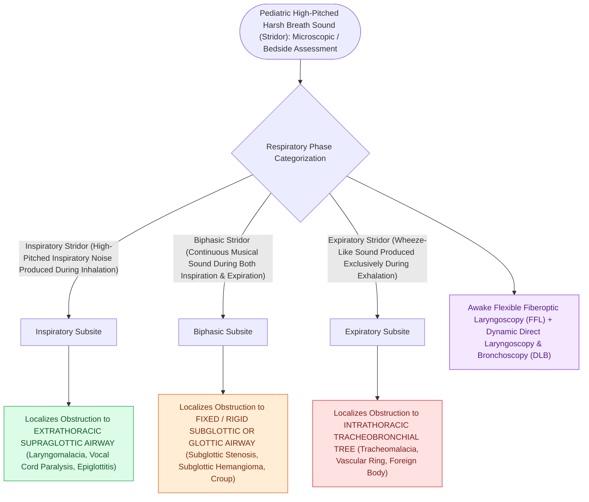

# Inspiratory, biphasic, and expiratory stridor localize pediatric airway obstruction to supraglottic, subglottic, and tracheobronchial subsites

## Active Recall

> [!question]- Why does subglottic pathology (such as croup or subglottic stenosis) produce biphasic stridor rather than isolated inspiratory stridor?
> *Answer / Clinical Rationale*: The subglottis is circumferentially encaged by the rigid, non-compliant **cricoid cartilage ring**. Because the framework cannot dynamically expand or collapse with intrathoracic pressure shifts, the luminal narrowing presents a fixed structural bottleneck that generates turbulent acoustic vibrations equally during both inspiration and expiration.

> [!question]- What does a sudden decrease in stridor intensity in an infant with severe retractions and lethargy signify?
> *Answer / Clinical Rationale*: It is an ominous sign of **impending respiratory arrest**. The decrease in acoustic volume reflects profound respiratory muscle exhaustion and severely diminished tidal volume (inability to generate enough turbulent airflow velocity to produce sound), demanding immediate emergency airway intervention.

## Core Clinical & Mechanistic Principles
Stridor is a harsh, high-pitched musical respiratory sound produced by turbulent airflow through a partially obstructed airway segment. In pediatric patients, the phase of the respiratory cycle during which stridor occurs provides precise topographical anatomical localization of the lesion based on dynamic pressure gradients between the airway lumen and ambient/pleural environments (the **Bernoulli principle** and transmural airway compliance):

1. **Inspiratory Stridor (Supraglottic & Extrathoracic Glottic Obstruction)**:
   - During inspiration, negative intraluminal pressure generated by diaphragm contraction causes compliant, extrathoracic supraglottic structures to collapse inward.
   - *Hallmark Pathologies*: [[Laryngomalacia is the most common cause of congenital pediatric stridor characterized by dynamic supraglottic collapse|Laryngomalacia]], [[Acute epiglottitis presents with rapid-onset odynophagia, fever, and the tripod sign requiring immediate airway protection|acute epiglottitis]], retropharyngeal abscess, vocal fold abductor paralysis, and vallecular cysts.
2. **Biphasic Stridor (Fixed Glottic, Subglottic & Upper Cervical Tracheal Obstruction)**:
   - Fixed, non-compliant cartilaginous rings restrict airflow equally during both inspiration and expiration.
   - *Hallmark Pathologies*: [[The Cotton-Myer classification grades subglottic stenosis by luminal reduction|Subglottic stenosis]], [[Nebulized racemic epinephrine and oral dexamethasone provide rapid treatment for acute croup|acute croup (laryngotracheobronchitis)]], [[Subglottic hemangiomas present as biphasic stridor in infants and respond to systemic oral propranolol|subglottic hemangioma]], anterior glottic web, and severe post-extubation glottic edema.
3. **Expiratory Stridor / Wheezing (Intrathoracic Tracheobronchial Obstruction)**:
   - During expiration, positive intrathoracic pleural pressure compresses the intrathoracic trachea and mainstem bronchi, narrowing the airway lumen against intraluminal resistance.
   - *Hallmark Pathologies*: [[Tracheobronchial foreign body aspiration presents with choking and air trapping requiring rigid bronchoscopy|Tracheobronchial foreign body]], [[Tracheomalacia causes dynamic expiratory tracheal collapse and is managed with posterior tracheobronchopexy|tracheomalacia]], vascular rings (double aortic arch, [[Complete tracheal rings present with generalized tracheal stenosis and stovepipe appearance on imaging|pulmonary artery sling]]), and bronchogenic cysts.

### Bedside Triage & Physical Examination
- **Acoustic Differentiation**:
  - *Stertor*: Low-pitched, heavy snoring sound arising above the larynx (nasopharynx, adenoids, tonsillar hypertrophy, base of tongue).
  - *Stridor*: High-pitched, musical sound originating at the larynx, subglottis, or trachea.
  - *Wheezing*: Polyphonic or monophonic musical sound originating in smaller distal bronchioles.
- **Red Flag Signs of Impending Respiratory Failure**:
  - Paradoxical "see-saw" abdominal-chest wall breathing.
## References
1. Carter, J., Rahbar, R., Brigger, M., et al. (2016). International Pediatric ORL Group (IPOG) laryngomalacia consensus recommendations. *Int J Pediatr Otorhinolaryngol*, 86:256-261.
2. Dohar, J.E., Anne, S. (2013). Stridor, Aspiration, and Cough. In Johnson, J.J., Rosen, C.A. (Eds.), *Bailey’s Head and Neck Surgery-Otolaryngology* 5e (pp. 1338-1355). Baltimore, MD: Lippincott Williams & Wilkins.
3. Sidell, D.R., Messner, A.H. (2020). Evaluation and Management of the Pediatric Airway. In Flint, P.W., et al. (Eds.), *Cummings Otolaryngology Head and Neck Surgery* 7e (pp. 3053-3067). Philadelphia, PA: Elsevier.

## Connected Concepts & Graph Traversal
- **Physiological Basis**: [[Pediatric stertor and stridor differentiate upper supraglottic airway obstruction from intrathoracic tracheobronchial disease|Pediatric Stridor & Stertor Mechanics]]
- **Supraglottic Pathology**: [[Laryngomalacia is the most common cause of congenital pediatric stridor characterized by dynamic supraglottic collapse|Laryngomalacia Dynamics]]
- **Subglottic Pathology**: [[Nebulized racemic epinephrine and oral dexamethasone provide rapid treatment for acute croup|Acute Croup & Racemic Epinephrine]]
- **Fixed Stenosis**: [[The Cotton-Myer classification grades subglottic stenosis by luminal reduction|Cotton-Myer Subglottic Stenosis]]
- **Intrathoracic Foreign Body**: [[Tracheobronchial foreign body aspiration presents with choking and air trapping requiring rigid bronchoscopy|Pediatric Foreign Body Retrieval]]
