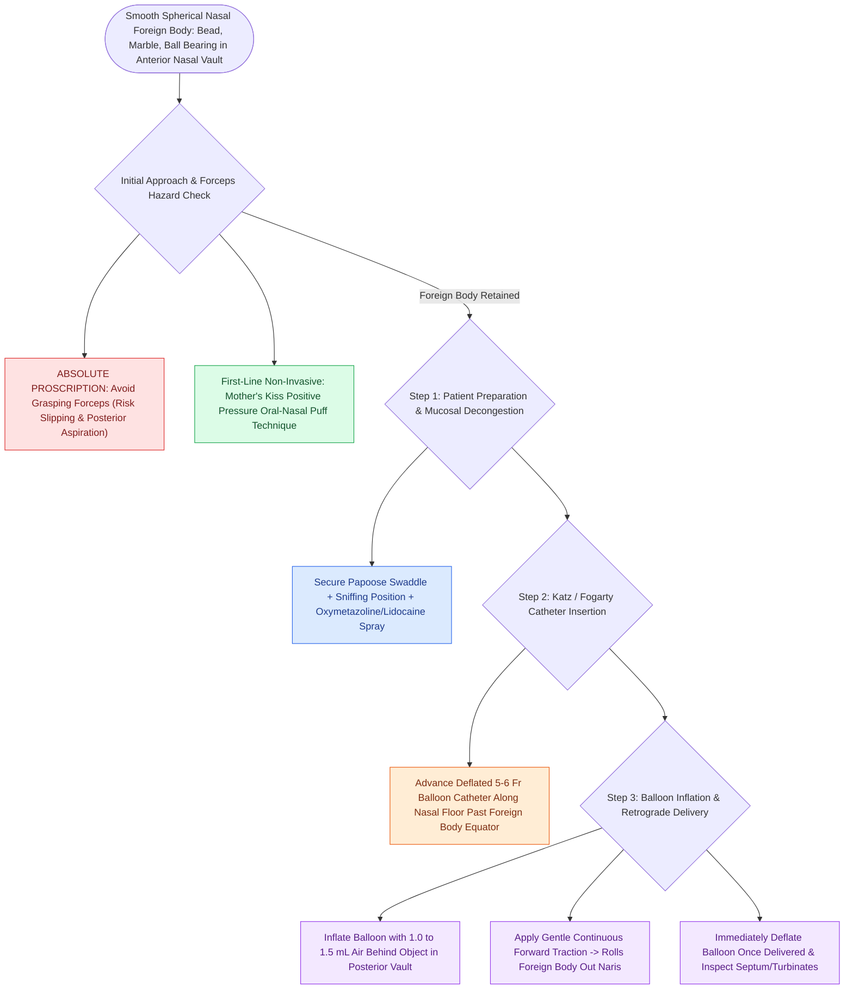

# Katz extractor and balloon catheter extraction technique removes smooth spherical nasal foreign bodies atraumatically

## Active Recall

> [!question]- Why are standard grasping forceps (such as alligators) strictly avoided for smooth spherical nasal foreign bodies in children?
> *Answer / Clinical Rationale*: Forceps apply compressive forces against the slippery convex curvature of the sphere, causing the instrument to slip off and propel the object posteriorly through the choana into the hypopharynx, risking sudden laryngeal impact and fatal tracheobronchial aspiration.

> [!question]- What non-invasive positive pressure technique can be attempted by a parent before invasive catheter instrumentation?
> *Answer / Clinical Rationale*: The **"Mother's Kiss" (parent's kiss)** technique: The parent places their mouth over the child's open mouth, occludes the unaffected nostril with a finger, and delivers a quick, forceful puff of air into the oral cavity. Increased nasopharyngeal pressure pops the foreign body out through the open anterior naris.

## Core Clinical & Mechanistic Principles
Smooth, spherical, or hard [[Nasal foreign bodies presenting with unilateral foul-smelling rhinorrhea mandate urgent removal with particular vigilance for button batteries|nasal foreign bodies]] (such as beads, marbles, ball bearings, and smooth seeds) pose a high risk of iatrogenic displacement when instrumented with standard grasping forceps (alligator, Hartmann, or bayonet forceps). Forceps tips slip off the convex surface of spherical objects, pushing the foreign body posteriorly past the choana into the pharynx, where it risks catastrophic aspiration into the pediatric airway.

The **Katz extractor** (or a 5 French / 6 French Fogarty vascular balloon catheter) overcomes this hazard via a retrograde balloon traction mechanism. A deflated, flexible, low-profile silicone catheter is smoothly advanced along the nasal floor superior or medial to the object, past its posterior equator. Once positioned in the nasopharynx or posterior nasal cavity, the balloon is inflated with $1.0\text{ to }2.0\text{ mL}$ of air or sterile water, creating a mechanical barrier that rolls and drags the foreign body forward along the nasal floor and out through the anterior nares upon gentle catheter withdrawal.

### Procedural Steps & Craft Nuances
1. **Topical Preparation & Immobilization**:
   - Swaddle the pediatric patient securely in a bedsheet ("papoose") with the caregiver or assistant firmly stabilizing the head in the sniffing position.
   - Apply 1 to 2 sprays of $0.05\%$ oxymetazoline mixed with $1\%$ to $2\%$ lidocaine to the affected nasal cavity to decongest the mucosal turbinates and achieve topical anesthesia. *(Caution: Avoid aqueous sprays if a button battery is suspected to prevent accelerating electrolytic injury).*
2. **Catheter Introduction**:
   - Inspect the nasal cavity with a bright headlight and nasal speculum or $0^\circ$ rigid endoscope.
   - Test balloon integrity prior to insertion by inflating and deflating $1.5\text{ mL}$ of air.
   - Lubricate the deflated tip with water-soluble surgical jelly.
   - Advance the catheter tip along the floor of the nose beneath the inferior turbinate, sliding gently *over or medial to* the foreign body into the posterior vault.
3. **Inflation & Extraction Maneuver**:
   - Slowly inflate the balloon with **$1.0\text{ to }1.5\text{ mL}$ of air** (or saline).
   - Apply steady, gentle forward traction on the catheter. The inflated balloon engages the posterior pole of the foreign body, drawing it smoothly forward out of the anterior naris.
   - Immediately deflate the balloon once the object is successfully delivered.
## References
1. Baranowski, K., Al-Aaraj, M.S., Sinha, V. (2020). Nasal Foreign Body. In: *StatPearls*. Treasure Island, FL: StatPearls Publishing.
2. Friedman, E.M. (2016). Videos in Clinical Medicine: Removal of Foreign Bodies from the Ear and Nose. *N Engl J Med*, 374(7):e7.
3. Kiger, J.R., et al. (2008). Nasal foreign bodies in children. *Pediatr Emerg Care*, 24(11):785-792.

## Connected Concepts & Graph Traversal
- **Physiological Basis**: [[Nasal foreign bodies presenting with unilateral foul-smelling rhinorrhea mandate urgent removal with particular vigilance for button batteries|Pediatric Nasal Foreign Bodies]]
- **Critical Battery Emergency**: [[Tracheobronchial foreign body aspiration presents with choking and air trapping requiring rigid bronchoscopy|Button Battery & Airway Hazards]]
- **Bleeding Management**: [[Kiesselbach plexus anterior epistaxis is managed with cautery and anterior nasal packing|Epistaxis Cautery & Packing]]
- **Ear Canal Counterpart**: [[External auditory canal foreign bodies require atraumatic extraction under microscopic guidance to protect the tympanic membrane|EAC Foreign Body Extraction]]
- **Endoscopic Retrieval**: [[Rigid bronchoscopy technique for pediatric airway foreign body removal requires systematic distal-to-proximal examination|Rigid Bronchoscopy Protocol]]
