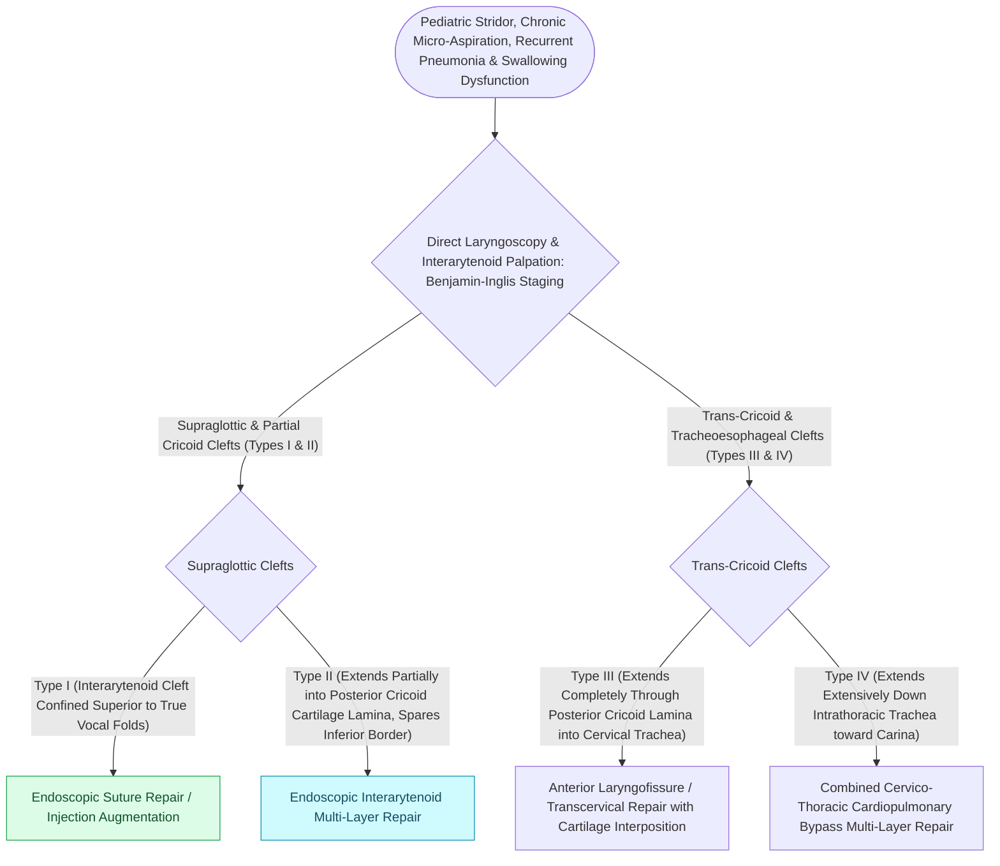

# Laryngeal clefts are graded by the Benjamin-Inglis classification from interarytenoid notch to intrathoracic extension

## Active Recall

> [!question]- Why does a type I cleft evade the standard airway exam?
> *Answer / Clinical Rationale*: The redundant interarytenoid mucosa apposes at rest; only palpation/probing of the interarytenoid groove under rigid exposure reveals the deficient height.

> [!question]- What is the logic of injection laryngoplasty of the interarytenoid area in type I clefts?
> *Answer / Clinical Rationale*: A temporary bulk trial: if augmenting the deficient party wall stops the aspiration, a definitive endoscopic repair is justified.

## Core Clinical & Mechanistic Principles
- **Benjamin-Inglis**: type I interarytenoid cleft to the level of the vocal folds; type II into the cricoid; type III through the cricoid into cervical trachea; type IV into intrathoracic trachea — depth tracks directly with aspiration severity and mortality.
- Presentation by grade: type I is the great mimic — chronic cough with feeds, recurrent 'reflux' pneumonias, thin-liquid aspiration on VFSS; III-IV present as neonatal respiratory crisis.
- Diagnosis requires suspicion plus **rigid laryngoscopy with interarytenoid palpation** — flexible scope and even casual rigid inspection miss a type I whose mucosa falls together.
- Associations: tracheoesophageal fistula, Opitz G/BBB and CHARGE, [[Laryngomalacia is the most common cause of congenital pediatric stridor characterized by dynamic supraglottic collapse|laryngomalacia]] co-existence — a cleft found is a syndrome screen begun.

### Management & Critical Safety Checks
- Type I: feeding therapy and thickening first; **interarytenoid injection augmentation** as a diagnostic-therapeutic trial; endoscopic suture repair for persistent aspiration. Types II-III: endoscopic or open repair; type IV: complex open/thoracic reconstruction.
- The swallow team owns half this disease: instrumental swallow studies gate diet before and after every intervention.

## Connected Concepts & Graph Traversal
- **Type I-IV Cleft Staging**: [[Type I through Type IV laryngeal clefts represent congenital tracheoesophageal communication defects|Type I-IV Laryngeal Clefts]]
- **Laryngomalacia Supraglottoplasty**: [[Supraglottoplasty corrects severe laryngomalacia with failure to thrive, apnea, or cor pulmonale by dividing shortened aryepiglottic folds|Supraglottoplasty]]
- **Subglottic Stenosis Sizing**: [[Myer-Cotton grading system stratifies subglottic stenosis from Grade I less than fifty percent to Grade IV no lumen|Myer-Cotton Grading]]
- **Slide Tracheoplasty**: [[Slide tracheoplasty achieves immediate vascularized mucosal lumen doubling with lowest restenosis rates|Slide Tracheoplasty]]
- **Tracheomalacia Tracheobronchopexy**: [[Tracheomalacia causes dynamic expiratory tracheal collapse and is managed with posterior tracheobronchopexy|Tracheomalacia Tracheobronchopexy]]
- **Congenital Glottic Differential**: [[Congenital laryngeal webs are classified by the Cohen system based on glottic luminal occlusion and anterior cartilaginous subglottic extension|Congenital Laryngeal Webs (Cohen Classification)]]
