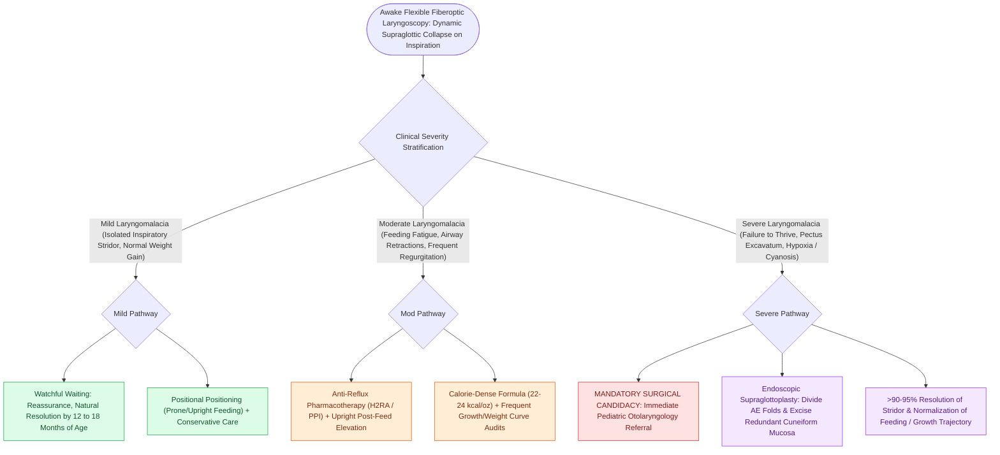

# Laryngomalacia is the most common cause of congenital pediatric stridor characterized by dynamic supraglottic collapse

## Active Recall

> [!question]- What is the typical clinical timeline for the onset, peak, and spontaneous resolution of laryngomalacia?
> *Answer / Clinical Rationale*: Onset at **$2\text{–}4\text{ weeks}$**, peak at **$4\text{–}8\text{ months}$**, and spontaneous resolution by **$12\text{–}18\text{ months}$**.

> [!question]- What clinical indicators define severe laryngomalacia requiring surgical supraglottoplasty?
> *Answer / Clinical Rationale*: **Failure to thrive**, **severe feeding exhaustion**, **persistent retractions with pectus excavatum**, **cyanotic episodes**, and **cor pulmonale**.

## Core Clinical & Mechanistic Principles
**Laryngomalacia** is the most common congenital laryngeal anomaly ($60\text{–}70\%$ of all congenital stridor), characterized by dynamic collapse of supraglottic structures into the laryngeal inlet during inspiration:
- **Clinical Presentation & Natural History**:
  - **High-pitched, "fluttering" inspiratory stridor**, appearing in the first **$2\text{ to }4\text{ weeks}$ of life**, peaking at **$4\text{ to }8\text{ months}$**, and spontaneously resolving by **$12\text{ to }24\text{ months}$** in $>80\text{–}90\%$ of infants.
  - *Positional Variation*: Stridor worsens in the **supine position**, during **crying, feeding, and upper respiratory infections**, and improves when prone or with neck extension.
- **Underlying Pathophysiology**:
  - **Sensorimotor Neuromuscular Immaturity**: Delayed integration of brainstem laryngeal adductor/abductor reflex loops and decreased baseline muscular tone.
  - **Histological Chondromalacia**: Excessively compliant, pliable supraglottic cartilage.
  - **Gastroesophageal Reflux (GERD)**: Present in $>80\%$; acid-peptic exposure causes supraglottic edema, worsening collapsibility.

### Surgical Technique & Critical Safety Checks
- **Flexible Fiberoptic Laryngoscopy**: Diagnostic gold standard performed in the awake, upright infant without sedation to observe spontaneous breathing and crying dynamics (see [[Omega-shaped epiglottis, foreshortened aryepiglottic folds, and redundant arytenoid mucosa define laryngomalacia|Laryngomalacia Triad]]).

## Connected Concepts & Graph Traversal
- **Laryngomalacia Triad**: [[Omega-shaped epiglottis, foreshortened aryepiglottic folds, and redundant arytenoid mucosa define laryngomalacia|Laryngomalacia Triad]]
- **Supraglottoplasty**: [[Endoscopic supraglottoplasty cold-steel and laser division of aryepiglottic folds relieves severe laryngomalacia|Supraglottoplasty]]
- **Stridor Localization**: [[Inspiratory, biphasic, and expiratory stridor localize pediatric airway obstruction to supraglottic, subglottic, and tracheobronchial subsites|Stridor Localization]]
- **Embryological & Sleep Foundation**: [[Thyroglossal duct cyst tract tracks from the foramen cecum through the hyoid bone to the anterior neck]]
- **Sleep Endoscopy & Airway Dynamics**: [[Drug-induced sleep endoscopy DISE evaluates dynamic multi-level upper airway collapse under sedation|Drug-Induced Sleep Endoscopy (DISE)]] [[Rapid maxillary expansion widens the hard palate and nasal floor to improve pediatric nasal breathing and OSA]]
- **Congenital Airway Pathology**: [[Microdebrider debulking and intralesional cidofovir provide surgical and adjuvant control of RRP]]
- **Open Airway Reconstruction**: [[Cricotracheal resection CTR achieves primary end-to-end anastomosis for severe Grade III and IV subglottic stenosis]]
