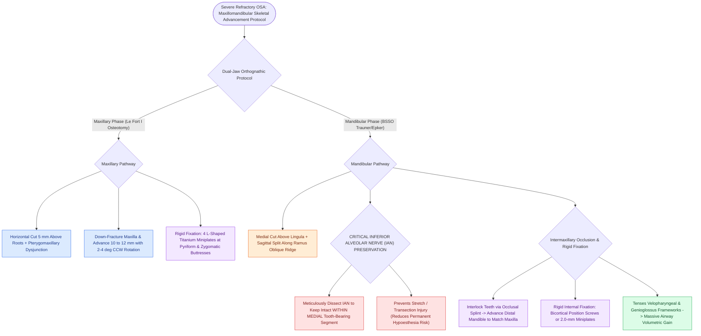

# Le Fort I osteotomy and bilateral sagittal split osteotomy BSSO achieve rigid skeletal advancement in MMA

## Active Recall

> [!question]- What nerve is at risk of stretch or transection injury during a Bilateral Sagittal Split Osteotomy (BSSO)?
> *Answer / Clinical Rationale*: The **inferior alveolar nerve (branch of CN V3)**.

> [!question]- Why is counter-clockwise rotation of the maxillomandibular complex often incorporated into MMA?
> *Answer / Clinical Rationale*: Because counter-clockwise rotation **maximizes anterior advancement of the chin and tongue base** while maintaining a harmonious aesthetic facial profile.

## Core Clinical & Mechanistic Principles
The technical execution of [[Maxillomandibular advancement MMA advances the skeletal framework by ten to twelve millimeters to expand the upper airway|Maxillomandibular Advancement]] combines a **Le Fort I maxillary osteotomy** with a **Bilateral Sagittal Split Osteotomy (BSSO)** of the mandible:
- **Le Fort I Maxillary Osteotomy Protocol**:
  1. Maxillary vestibular incision; expose anterior and lateral maxillary walls, pyriform aperture, and pterygomaxillary junction.
  2. Horizontal osteotomy cut from pyriform rim to pterygomaxillary fissure, $5\text{ mm}$ above tooth roots.
  3. Pterygomaxillary dysjunction with curved osteotome; down-fracture maxilla.
  4. Mobilize maxilla anteriorly by **$10\text{–}12\text{ mm}$** (often with **$2\text{–}4^\circ$ of counter-clockwise rotation** to maximize mandibular advancement).
  5. Fix with four $1.5\text{–}2.0\text{-mm}$ L-shaped titanium miniplates at the pyriform and zygomatic buttresses.
- **Bilateral Sagittal Split Osteotomy (BSSO) Protocol (Epker / Trauner)**:
  1. Mandibular vestibular incision along the external oblique ridge.
  2. Medial horizontal cut above the mandibular foramen (lingula); vertical lateral cut through buccal cortex at the 1st/2nd molar; sagittal connecting cut along anterior border of ramus.
  3. **Preserve Inferior Alveolar Nerve (IAN)**: Split the ramus into a medial (tooth-bearing) and lateral (condyle-bearing) segment, keeping the IAN strictly within the medial segment.
  4. Advance distal mandible into occlusion with the advanced maxilla using an intermediate/final surgical splint.
  5. Fix with bicortical screws or titanium miniplates.

### Surgical Technique & Critical Safety Checks
- **Inferior Alveolar Nerve Safety**: Permanent IAN hypoesthesia occurs in $5\text{–}10\%$ of cases; careful visualization of the nerve within the mandibular canal during split minimizes stretch injury.

## Connected Concepts & Graph Traversal
- **MMA Advancement**: [[Maxillomandibular advancement MMA advances the skeletal framework by ten to twelve millimeters to expand the upper airway|MMA Advancement]]
- **MMA Success Rates**: [[Maxillomandibular advancement achieves the highest surgical cure rate among all non-CPAP sleep apnea interventions|MMA Success Rates]]
- **Virtual Surgical Planning**: [[Virtual surgical planning and splint-guided fixation optimize dental occlusion and airway expansion in MMA|Virtual Surgical Planning]]
- **Embryological & Sleep Foundation**: [[Each branchial arch packages one nerve, one artery, one cartilage bar, and one muscle group]]
- **Sleep Endoscopy & Airway Dynamics**: [[Drug-induced sleep endoscopy DISE evaluates dynamic multi-level upper airway collapse under sedation|Drug-Induced Sleep Endoscopy (DISE)]] [[Coblation lingual tonsillectomy debulks tongue base lymphoid tissue while preserving the lingual neurovascular bundles]]
- **Congenital Airway Pathology**: [[Myer-Cotton grading system stratifies subglottic stenosis from Grade I less than fifty percent to Grade IV no lumen]]
- **Open Airway Reconstruction**: [[Tracheomalacia causes dynamic expiratory tracheal collapse and is managed with posterior tracheobronchopexy]]
