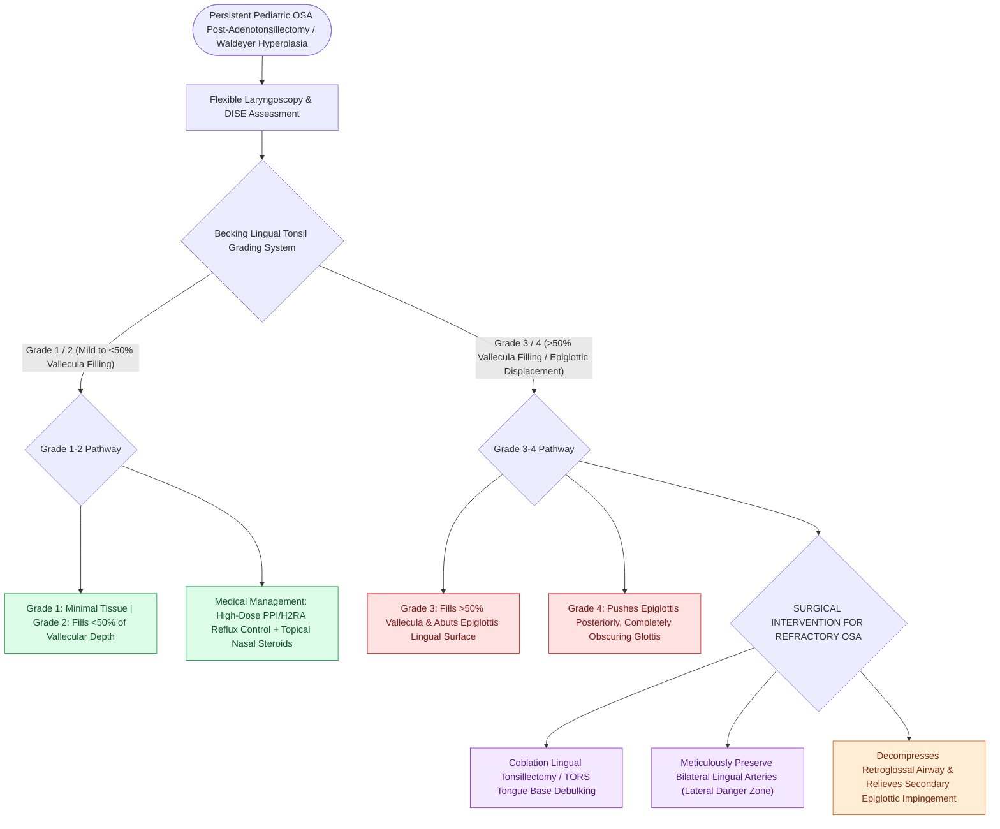

# Lingual tonsil hypertrophy causes persistent pediatric obstructive sleep apnea and base of tongue collapse

## Active Recall

> [!question]- Why does lingual tonsil hypertrophy frequently develop following pediatric [[Adenotonsillectomy is the first-line surgical treatment for pediatric obstructive sleep apnea|adenotonsillectomy]]?
> *Answer / Clinical Rationale*: Due to **compensatory lymphoid hyperplasia** of the remaining Waldeyer's ring tissue combined with chronic reflux/inflammatory exposure.

> [!question]- What anatomical structure is displaced posteriorly by severe lingual tonsil hypertrophy to obstruct the airway?
> *Answer / Clinical Rationale*: The **epiglottis** (pushed down over the laryngeal inlet).

## Core Clinical & Mechanistic Principles
**Lingual tonsil hypertrophy (LTH)** refers to pathological enlargement of the lymphoid tissue situated on the posterior third of the tongue base (the inferior component of Waldeyer's ring):
- **Etiological Mechanisms**:
  - **Compensatory Hyperplasia**: Following palatine tonsillectomy and adenoidectomy, the remaining lingual lymphoid tissue often undergoes compensatory hyperplasia.
  - **Chronic Inflammation**: Gastroesophageal / Laryngopharyngeal Reflux (GERD/LPR), chronic allergic rhinitis, and obesity.
- **Clinical Presentation & Diagnosis**:
  - Persistent snoring, witnessed apneas, and daytime fatigue despite prior T&A.
  - "Hot potato" voice, chronic globus sensation, dysphagia, or difficult intubation.
  - **Flexible Fiberoptic Laryngoscopy & DISE**: Direct visualization of lobulated lymphoid tissue filling the vallecula and retroglossal space, pushing the epiglottis posteriorly into the laryngeal inlet during inspiration.
- **Becking Lingual Tonsil Grading Scale**:
  - **Grade 1**: Minimal lymphoid tissue on tongue base.
  - **Grade 2**: Lymphoid tissue fills $<50\%$ of the vallecula.
  - **Grade 3**: Lymphoid tissue completely fills the vallecula ($>50\%$) and abuts the lingual surface of the epiglottis.
  - **Grade 4**: Lymphoid tissue pushes epiglottis posteriorly, obscuring the vocal cords.

### Surgical Technique & Critical Safety Checks
- **Management**: Medical therapy (anti-reflux meds, nasal steroids) for Grade 1/2; **Coblation or TORS lingual tonsillectomy** for Grade 3/4 with severe OSA (see [[Coblation lingual tonsillectomy debulks tongue base lymphoid tissue while preserving the lingual neurovascular bundles|Coblation Lingual Tonsillectomy]]).

## Connected Concepts & Graph Traversal
- **Coblation Lingual Tonsils**: [[Coblation lingual tonsillectomy debulks tongue base lymphoid tissue while preserving the lingual neurovascular bundles|Coblation Lingual Tonsillectomy]]
- **Pediatric DISE**: [[Pediatric DISE identifies persistent multi-level airway collapse following adenotonsillectomy|Pediatric DISE]]
- **Supraglottoplasty**: [[Endoscopic supraglottoplasty cold-steel and laser division of aryepiglottic folds relieves severe laryngomalacia|Supraglottoplasty]]
- **Embryological & Sleep Foundation**: [[High loop gain causes ventilatory instability and periodic breathing in sleep-disordered breathing]]
- **Adenotonsillar & Endoscopic DISE**: [[Drug-induced sleep endoscopy DISE evaluates dynamic multi-level upper airway collapse under sedation]]
- **Congenital Airway Pathology**: [[Type I through Type IV laryngeal clefts represent congenital tracheoesophageal communication defects]]
- **Open Airway Reconstruction**: [[Posterior costal cartilage grafts with a carved flange split the posterior cricoid lamina to expand the glottic lumen]]
