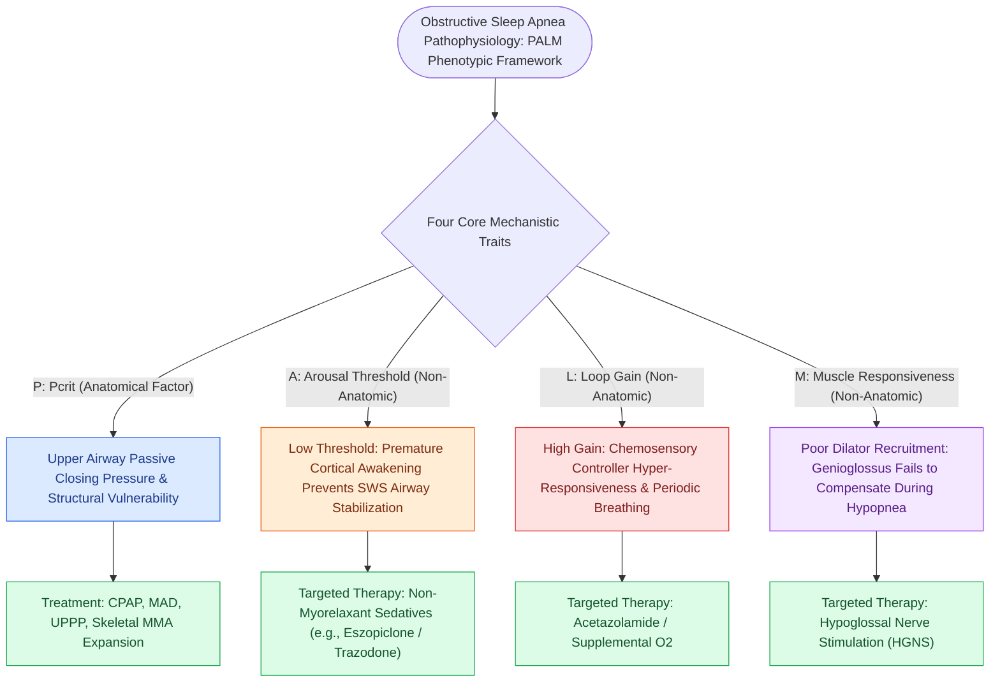

# Loop gain, arousal threshold, and muscle responsiveness represent the non-anatomical endotypes of obstructive sleep apnea

## Active Recall

> [!question]- What are the four components of the PALM classification of OSA endotypes?
> *Answer / Clinical Rationale*: **Pcrit (anatomy)**, **Arousal threshold**, **Loop gain**, and **Muscle responsiveness**.

> [!question]- Why does a patient with high loop gain or low arousal threshold experience persistent OSA despite surgical airway widening?
> *Answer / Clinical Rationale*: Because **ventilatory control instability and premature waking** perpetuate cyclic breathing and prevent stable dilator muscle recruitment.

## Core Clinical & Mechanistic Principles
Obstructive Sleep Apnea is not purely an anatomical disease; up to $70\%$ of patients have contributing **non-anatomical physiological endotypes** (the **PALM Classification**):
- **The Four Phenotypic Traits of the PALM Scale**:
  1. **P - Pcrit (Anatomical Collapsibility - $P_{\text{crit}}$)**: The passive vulnerability of the upper airway to collapse.
  2. **A - Arousal Threshold (Low Arousal Threshold)**: Tendency to wake up too easily from sleep in response to minor respiratory airway narrowing.
  3. **L - Loop Gain (High Loop Gain)**: An exaggerated, hypersensitive ventilatory response to minor fluctuations in blood $\text{CO}_2$ and $\text{O}_2$.
  4. **M - Muscle Responsiveness (Poor Muscle Compensation)**: Inability of upper airway dilator muscles (genioglossus) to activate sufficiently during airway narrowing.
- **Clinical Importance in Surgical Failure**:
  - Patients with anatomically successful surgery (UPPP / [[Maxillomandibular advancement MMA advances the skeletal framework by ten to twelve millimeters to expand the upper airway|MMA]]) may fail to cure OSA if they have **high loop gain or low arousal threshold**, which perpetuate ventilatory instability.

### Surgical Technique & Critical Safety Checks
- **Endotype-Directed Precision Medicine**: Identifying non-anatomical traits allows targeted medical therapy (e.g., Acetazolamide for high loop gain, sedative hypnotics for low arousal threshold).

## Connected Concepts & Graph Traversal
- **High Loop Gain**: [[High loop gain causes ventilatory instability and periodic breathing in sleep-disordered breathing|High Loop Gain]]
- **Low Arousal Threshold**: [[Low arousal threshold causes premature awakening before airway stabilization in obstructive sleep apnea|Low Arousal Threshold]]
- **Pcrit Stratification**: [[Critical closing pressure Pcrit stratifies upper airway collapsibility from snorers to severe obstructive sleep apnea|Pcrit Stratification]]
- **Embryological & Sleep Foundation**: [[The Starling resistor model explains upper airway collapsibility and critical closing pressure Pcrit]]
- **Sleep Endoscopy & Airway Dynamics**: [[Drug-induced sleep endoscopy DISE evaluates dynamic multi-level upper airway collapse under sedation|Drug-Induced Sleep Endoscopy (DISE)]] [[Extracapsular total tonsillectomy and intracapsular subtotal tonsillotomy differ in postoperative hemorrhage and recovery]]
- **Congenital Airway Pathology**: [[Nebulized racemic epinephrine and oral dexamethasone provide rapid treatment for acute croup]]
- **Open Airway Reconstruction**: [[Slide tracheoplasty achieves immediate vascularized mucosal lumen doubling with lowest restenosis rates]]
