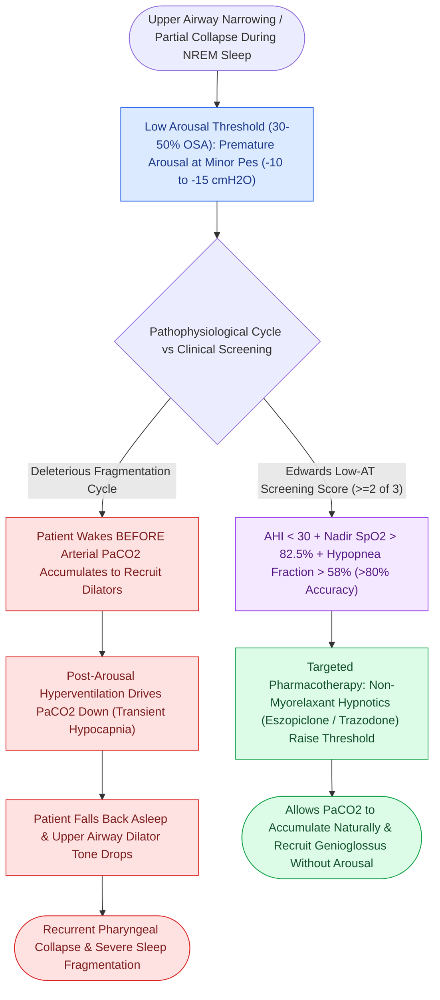

# Low arousal threshold causes premature awakening before airway stabilization in obstructive sleep apnea

## Active Recall

> [!question]- What is a low arousal threshold in obstructive sleep apnea?
> *Answer / Clinical Rationale*: A condition where a patient **wakes up too easily to minimal respiratory effort**, preventing $\text{CO}_2$ from rising enough to naturally recruit upper airway dilator muscles.

> [!question]- What class of medications can be used to raise the arousal threshold in selected OSA patients?
> *Answer / Clinical Rationale*: **Non-myorelaxant sedative hypnotics** (e.g., Eszopiclone, Trazodone).

## Core Clinical & Mechanistic Principles
The **respiratory arousal threshold** is the level of negative intrathoracic pressure / ventilatory drive required to wake an individual from sleep during an obstructive event:
- **Pathophysiology of Low Arousal Threshold (Low-AT)**:
  - Present in **$30\text{–}50\%$ of patients with OSA**.
  - These individuals awaken prematurely to very small increases in respiratory effort (e.g., at only $-10\text{ to }-15\text{ cm H}_2\text{O}$ of esophageal pressure, compared to $-30\text{ to }-40\text{ cm H}_2\text{O}$ in normal sleepers).
- **The Deleterious Cycle**:
  1. Airway narrows $\r\r\rightarrow$ small rise in respiratory drive.
  2. Patient **wakes up prematurely (arousal)** *before* chemical drive ($\text{CO}_2$) [[High-stakes pediatric and adult sleep airway complications require rapid structured algorithmic emergency rescue|can]] rise sufficiently to recruit upper airway dilator muscles (genioglossus).
  3. Arousal causes hyperventilation $\r\r\rightarrow$ hypocapnia $\r\r\rightarrow$ patient falls back asleep $\r\r\rightarrow$ dilators relax $\r\r\rightarrow$ airway collapses again.
  4. Results in severe **sleep fragmentation, absence of restorative slow-wave sleep (N3), and worsening AHI**.
- **Clinical Score (Edwards Score for Low-AT)**:
  - Criteria: AHI $<30$, Nadir $\text{SpO}_2 > 82.5\%$, and Hypopnea fraction $>58\%$. Meeting $\ge 2$ criteria predicts low arousal threshold with $>80\%$ accuracy.

### Surgical Technique & Critical Safety Checks
- **Targeted Therapy**: Non-myorelaxant sedative hypnotics (e.g., **Eszopiclone, Zolpidem, Trazodone**) raise the arousal threshold, allowing $\text{CO}_2$ to rise and recruit dilators without causing arousals.

## Connected Concepts & Graph Traversal
- **Non-Anatomical Endotypes**: [[Loop gain, arousal threshold, and muscle responsiveness represent the non-anatomical endotypes of obstructive sleep apnea|Non-Anatomical Endotypes]]
- **High Loop Gain**: [[High loop gain causes ventilatory instability and periodic breathing in sleep-disordered breathing|High Loop Gain]]
- **Sleep Architecture**: [[Non-rapid eye movement and rapid eye movement sleep architecture dictate pharyngeal muscle tone|Sleep Architecture]]
- **Embryological & Sleep Foundation**: [[Thyroglossal duct cyst tract tracks from the foramen cecum through the hyoid bone to the anterior neck]]
- **Sleep Endoscopy & Airway Dynamics**: [[Drug-induced sleep endoscopy DISE evaluates dynamic multi-level upper airway collapse under sedation|Drug-Induced Sleep Endoscopy (DISE)]] [[Extracapsular total tonsillectomy and intracapsular subtotal tonsillotomy differ in postoperative hemorrhage and recovery]]
- **Congenital Airway Pathology**: [[Myer-Cotton grading system stratifies subglottic stenosis from Grade I less than fifty percent to Grade IV no lumen]]
- **Open Airway Reconstruction**: [[Slide tracheoplasty achieves immediate vascularized mucosal lumen doubling with lowest restenosis rates]]
