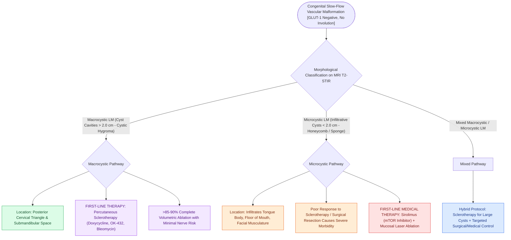

# Lymphatic malformations are slow-flow vascular anomalies classified into macrocystic and microcystic lesions

## Active Recall

> [!question]- How do macrocystic and microcystic lymphatic malformations differ in cyst size and sclerotherapy response?
> *Answer / Clinical Rationale*: **Macrocystic LMs have cysts $>2.0\text{ cm}$ and respond excellently to sclerotherapy ($>85\%$)**; **microcystic LMs have cysts $<2.0\text{ cm}$ and respond poorly to sclerotherapy** (requiring Sirolimus).

> [!question]- Do lymphatic malformations spontaneously involute over time like infantile hemangiomas?
> *Answer / Clinical Rationale*: **No**, lymphatic malformations are permanent structural malformations that never undergo spontaneous involution.

## Core Clinical & Mechanistic Principles
**Lymphatic Malformations (LMs / Cystic Hygromas)** are congenital, slow-flow vascular malformations resulting from abnormal sequestration of embryonic lymphatic channels:
- **Core Biological Characteristics**:
  - Present at birth (though may expand later); grow proportionally with the child; **NEVER spontaneously involute** (unlike hemangiomas).
  - **GLUT-1 Negative**.
  - **Acute Swelling Trigger**: Rapid, painful enlargement occurs during viral upper respiratory infections or following intralesional hemorrhage.
- **Morphological Classification (Macrocystic vs. Microcystic)**:
  1. **Macrocystic LM ($>2.0\text{ cm}$ Cyst Cavities - "Cystic Hygroma")**:
     - Large, discrete, fluid-filled cystic spaces; typically located in the **posterior cervical triangle and submandibular space**.
     - *Treatment*: **Highly responsive to percutaneous [[Bleomycin and OK-432 picibanil sclerotherapy provide targeted ablation of macrocystic lymphatic malformations|sclerotherapy]] ($>85\text{–}90\%$ response)**; surgical excision.
  2. **Microcystic LM ($<2.0\text{ cm}$ Cysts / Sponge-like)**:
     - Diffuse, infiltrative, honeycomb network of tiny cysts permeating normal muscle, tongue, floor of mouth, and cranial nerves.
     - *Treatment*: Poor response to sclerotherapy; managed with **Sirolimus (mTOR inhibitor)**, bleomycin, CO2/radiofrequency mucosal ablation, or targeted partial debulking.

### Surgical Technique & Critical Safety Checks
- **De Serres Staging (Stage I to V)**: Grades LMs based on unilateral vs. bilateral and suprahyoid vs. infrahyoid involvement; predicts surgical complication rates and tracheostomy requirements.

## Connected Concepts & Graph Traversal
- **Sclerotherapy**: [[Bleomycin and OK-432 picibanil sclerotherapy provide targeted ablation of macrocystic lymphatic malformations|Sclerotherapy]]
- **Infantile Hemangiomas**: [[Infantile hemangiomas exhibit rapid neonatal proliferation followed by slow involution driven by GLUT-1 positivity|Infantile Hemangiomas]]
- **First Branchial Cleft**: [[First branchial cleft Work Type I and Type II anomalies require superficial parotidectomy with facial nerve dissection|First Branchial Cleft]]
- **🔗 Fast-Flow Vascular Anomaly Differential (Head & Neck)**: [[Head and neck arteriovenous malformations are staged by the Schobinger classification to guide embolization and complete surgical nidus resection|AVM & Schobinger Staging]]
- **Slow-Flow Venous Differential**: [[Venous malformations are slow-flow vascular anomalies characterized by bluish compressible swelling, dependent engorgement, and pathognomonic phleboliths|Venous Malformations]]
