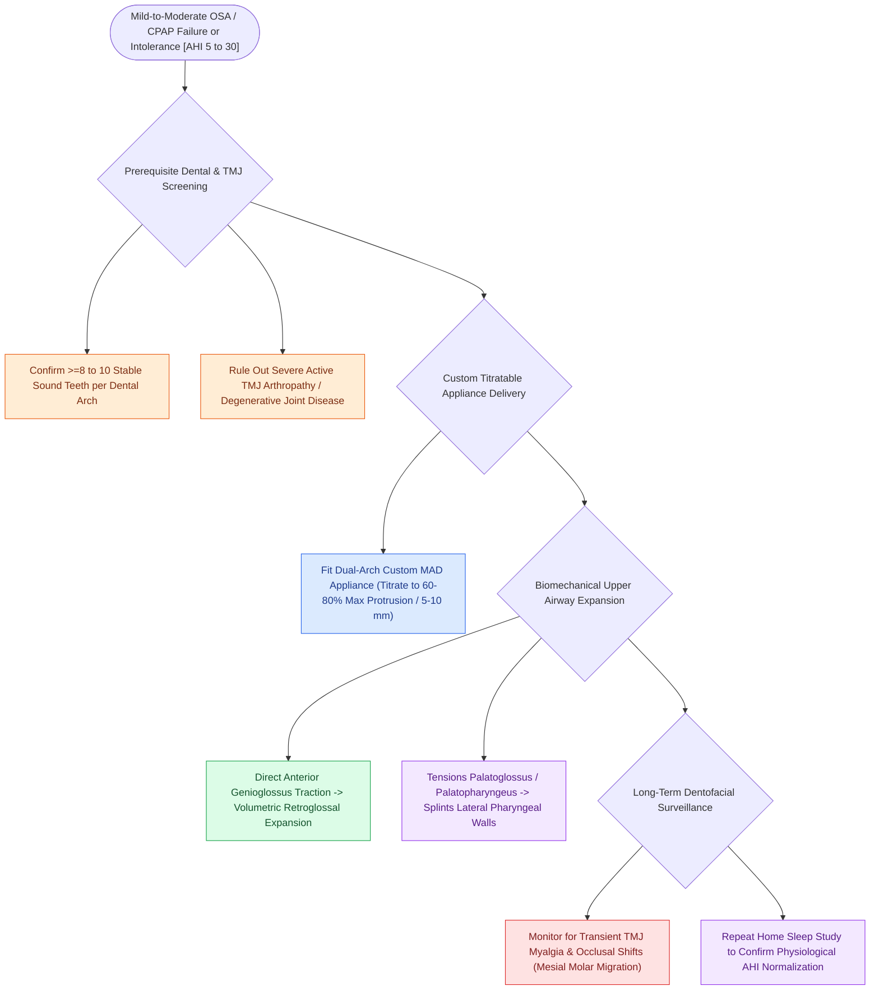

# Mandibular advancement devices MAD advance the mandible to enlarge the retroglossal airway space

## Active Recall

> [!question]- What anatomical airway levels are expanded by a mandibular advancement device?
> *Answer / Clinical Rationale*: Primarily the **retroglossal (tongue base) space**, with secondary lateral wall and retropalatal stiffening.

> [!question]- What minimum dental and TMJ criteria are required for MAD therapy, and what dentofacial changes occur with long-term use?
> *Answer / Clinical Rationale*: Requires at least **8 to 10 healthy, stable teeth per dental arch** and minimum $5\text{ mm}$ protrusive range (contraindicated in active periodontitis, severe TMJ arthropathy, or severe central sleep apnea). Long-term nightly wear causes **mesial tipping of mandibular teeth, retroclination of maxillary incisors, reduced overjet/overbite, and potential anterior crossbite or posterior open bite**.

## Core Clinical & Mechanistic Principles
**Mandibular Advancement Devices (MADs / Oral Appliance Therapy)** are customized dental appliances that physically protrude and stabilize the mandible during sleep:
- **Biomechanical Mechanism of Airway Expansion**:
  - The appliance anchors to the maxillary and mandibular dentition and advances the lower jaw **$60\text{–}80\%$ of maximal voluntary mandibular protrusion** ($5\text{–}10\text{ mm}$).
  - Advances the **[[Geniohyoid and genioglossus muscles are primary upper airway dilators maintaining pharyngeal patency|genioglossus muscle]] and tongue base anteriorly**, directly increasing the cross-sectional area of the **retroglossal (hypopharyngeal) airway**.
  - Tensions the **palatoglossus and palatopharyngeus muscles**, indirectly expanding and stiffening the **lateral pharyngeal walls and retropalatal space**.
- **Ideal Patient Selection, Titration & Efficacy**:
  - Mild-to-moderate OSA ($\text{AHI } 5\text{–}30$) intolerant of or refusing CPAP, primary snoring, positional OSA, or non-obese ($\text{BMI} < 30$) CPAP failures; requires **$\ge 8\text{–}10$ healthy teeth per arch** and $\ge 5\text{ mm}$ protrusion without active periodontitis or severe TMJ degeneration.
  - Initiated at $50\%\text{–}60\%$ max protrusion and titrated $0.5\text{–}1.0\text{ mm}$ every 1–2 weeks to **$60\%\text{–}80\%$** ($5\text{–}10\text{ mm}$), achieving **$25\%\text{–}40\%$ retroglossal area expansion**, lower **[[The Starling resistor model explains upper airway collapsibility and critical closing pressure Pcrit|Pcrit]]**, complete $\text{AHI} < 5$ success in **$\sim 50\%\text{–}60\%$** (partial $\ge 50\%$ AHI drop in $70\%\text{–}80\%$), and superior nightly adherence ($>6.5\text{ h/night}$ vs $4\text{ h/night}$ CPAP).

### Side Effect Profile & Management Matrix

| Timeframe | Side Effect | Pathophysiologic Mechanism | Preventive & Corrective Strategy |
| :--- | :--- | :--- | :--- |
| **Acute / Short-Term** (Weeks 1–4) | Hypersalivation / Transient Occlusal Dysesthesia | Trigeminal salivary reflex; retrodiscal compression | Self-limiting in 2–4 weeks; morning aligner splint |
| **Subacute** (Months 1–6) | Masseter / Temporalis / TMJ Myalgia | Sustained isometric loading | Reduce advancement by 1–2 mm; physical therapy |
| **Chronic** (>1–2 years) | Decreased Overjet/Overbite; Posterior Open Bite | Mesial mandibular drift; maxillary incisor retroclination | Semi-annual dental follow-up; morning aligner wear |

## Connected Concepts & Graph Traversal
- **Physiological Basis**: [[The Starling resistor model explains upper airway collapsibility and critical closing pressure Pcrit|Upper Airway Collapsibility & Pcrit]]
- **Anatomical Dilators**: [[Geniohyoid and genioglossus muscles are primary upper airway dilators maintaining pharyngeal patency|Upper Airway Dilators]]
- **Adult PSG Thresholds**: [[Adult polysomnography criteria define obstructive sleep apnea severity by apnea-hypopnea index thresholds of five, fifteen, and thirty|Adult OSA Severity Stratification]]
- **Positional Therapy**: [[Positional obstructive sleep apnea is treated with sleep position trainers and positional avoidance devices|Positional OSA]]
- **Nasal Surgery OSA**: [[Nasal surgery alone improves CPAP compliance and subjective daytime somnolence without normalizing AHI|Nasal Surgery OSA]]
- **HGNS Stimulation**: [[Hypoglossal nerve stimulation HGNS activates the medial branch of CN XII to advance the tongue during inspiration|HGNS Stimulation]]
- **Surgical Skeletal Alternative**: [[Maxillomandibular advancement MMA advances the skeletal framework by ten to twelve millimeters to expand the upper airway|Maxillomandibular Advancement]]
