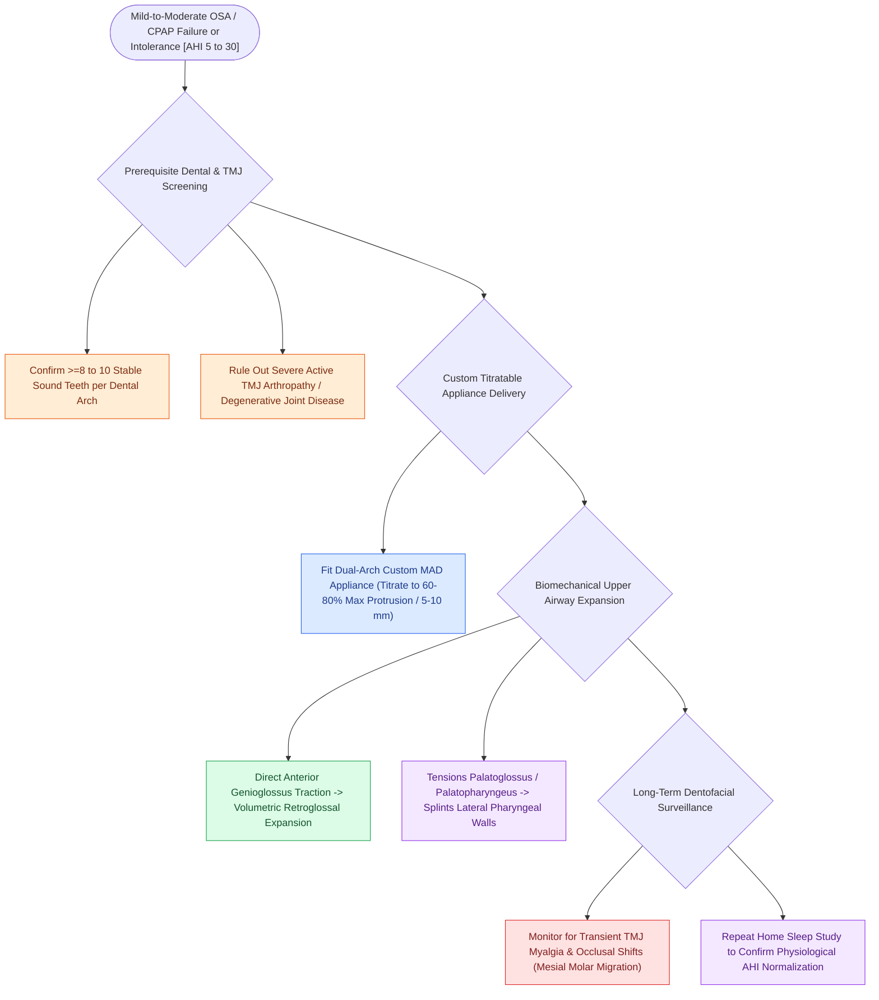

# Mandibular advancement devices MAD advance the mandible to enlarge the retroglossal airway space

## Active Recall

> [!question]- What anatomical airway levels are expanded by a mandibular advancement device?
> *Answer / Clinical Rationale*: Primarily the **retroglossal (tongue base) space**, with secondary lateral wall and retropalatal stiffening.

> [!question]- What is the minimum dental requirement to support a custom mandibular advancement device?
> *Answer / Clinical Rationale*: At least **8 to 10 healthy, stable teeth per dental arch**.

## Core Clinical & Mechanistic Principles
**Mandibular Advancement Devices (MADs / Oral Appliance Therapy)** are customized dental appliances that physically protrude and stabilize the mandible during sleep:
- **Biomechanical Mechanism of Airway Expansion**:
  - The appliance anchors to the maxillary and mandibular dentition and advances the lower jaw **$60\text{–}80\%$ of maximal voluntary mandibular protrusion** ($5\text{–}10\text{ mm}$).
  - Advances the **[[Geniohyoid and genioglossus muscles are primary upper airway dilators maintaining pharyngeal patency|genioglossus muscle]] and tongue base anteriorly**, directly increasing the cross-sectional area of the **retroglossal (hypopharyngeal) airway**.
  - Tensions the **palatoglossus and palatopharyngeus muscles**, indirectly expanding and stiffening the **lateral pharyngeal walls and retropalatal space**.
- **Ideal Patient Selection & Indications**:
  - Mild-to-moderate OSA ($\text{AHI } 5\text{–}30$) intolerant of or refusing CPAP.
  - Severe OSA after failing CPAP.
  - Non-obese ($\text{BMI} < 30$), supine-predominant OSA, and absence of severe central sleep apnea.
  - **Adequate Dentition**: Requires at least **8–10 healthy teeth per arch** to support orthodontic forces.

### Surgical Technique & Critical Safety Checks
- **Adverse Effects & Monitoring**: Temporomandibular joint (TMJ) arthralgia, myofascial jaw pain, salivation, and **long-term dental changes (mesial shift of mandibular molars / anterior crossbite)**; requires routine follow-up with a dental sleep specialist.

## Connected Concepts & Graph Traversal
- **Positional OSA**: [[Positional obstructive sleep apnea is treated with sleep position trainers and positional avoidance devices|Positional OSA]]
- **Nasal Surgery OSA**: [[Nasal surgery alone improves CPAP compliance and subjective daytime somnolence without normalizing AHI|Nasal Surgery OSA]]
- **HGNS Stimulation**: [[Hypoglossal nerve stimulation HGNS activates the medial branch of CN XII to advance the tongue during inspiration|HGNS Stimulation]]
- **Advanced Mastercraft**: [[Mandibular advancement oral appliances enlarge the retroglossal airway through anterior mandibular translation for mild-to-moderate obstructive sleep apnea|MAD Biomechanics & Dentofacial Sequelae]]
